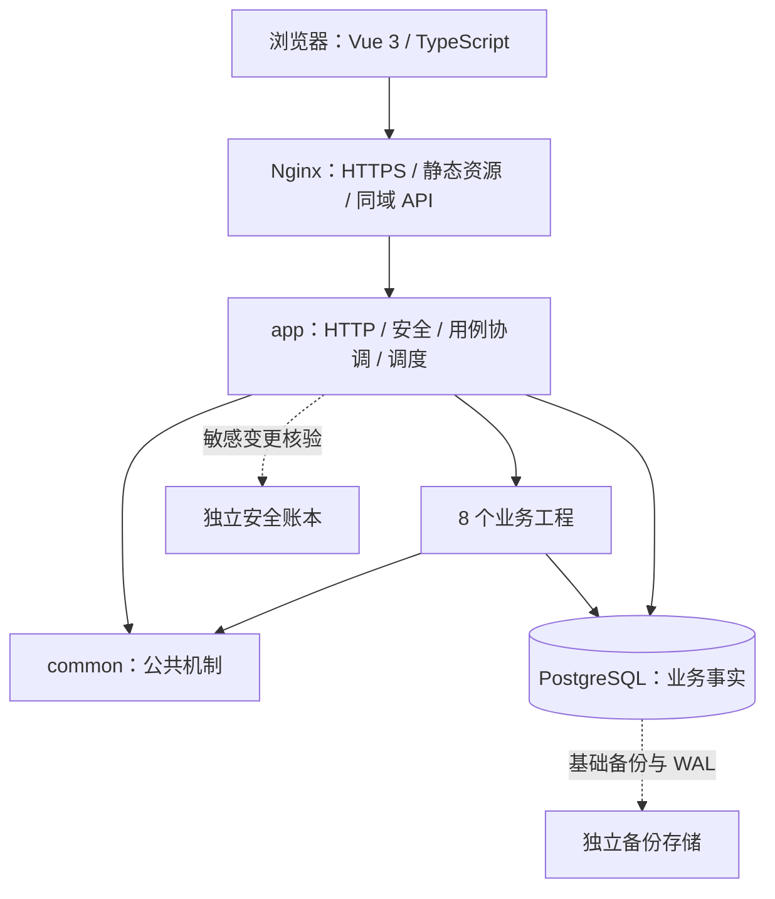

# Asterway

个人成长管理系统。将目标拆分为阶段和任务，安排到周计划与日计划，记录实际执行和习惯完成情况，再通过今日看板与历史统计回顾投入。

维护者：**LingXI5499**。默认分支：`main`。当前工程版本：`0.1.0-SNAPSHOT`；当前开发文档版本：**V2.0**。最新同步记录核对于 2026-10-26；V2.0 设计文档保留 2026-10-22 基线，当前实现以代码和下方状态为准。

## 当前进度

2026-10-26 已整理账户服务职责及辅助组件目录，抽离会话 SQL 资源；后端全模块编译与前端生产构建通过，未运行测试。本次代码同步仅面向已有远程开发分支，不合入 main；发布范围见账户模块实现与运行说明。

2026-10-25 已补齐账户核心功能代码：注册、登录、查看与修改资料、修改密码、正常退出、设备时区，以及拼图验证、失败锁定、操作幂等、安全核验、日志和 Swagger。前端使用简单账户页面，不包含其他业务模块或管理后台开发。

本次按要求不新增、不运行测试。后端使用 `-Dmaven.test.skip=true` 打包通过，前端生产构建通过；经明确授权，开发库 V003 已执行，既有账户时区回填为 Asia/Shanghai，前后端已启动。启动访问确认不代表账户业务已通过验收。

运行入口：页面 `http://127.0.0.1:5173/`，Swagger `http://127.0.0.1:8088/swagger-ui/index.html`。完整接口、运行方式、数据变化与验证边界见 [账户模块实现与运行说明](docs/验收记录/账户模块实现与运行说明.md)。

| 范围 | 当前状态 |
|---|---|
| 账户 HTTP | 10 个认证/本人端点、2 个公开辅助端点、1 个本人操作结果查询端点 |
| 数据库 | V001、V002 保持原文；V003 已兼容扩展既有账户表和账户辅助表 |
| 账户页面 | 登录、注册、账户中心，包含拼图、资料编辑、改密、退出与时区同步 |
| 编译与启动 | 后端打包、前端构建和本机启动通过；本轮未执行测试 |
| 其他业务 | 仍按 V2.0 设计后续实施，完整系统验收保持 NOT_VERIFIED |

## 架构与工程边界

采用前后端分离的模块化单体架构。一个 `app` 应用装配全部业务工程，同一 Java 进程内协调业务事务，使用 PostgreSQL 保存业务事实、会话和持久事件。以下为设计拓扑，前端、反向代理、业务处理和独立恢复设施仍需实施。



`app` 直接依赖 `common` 和全部 8 个业务工程；各业务工程的内部依赖只有 `common`，`common` 不依赖业务工程。跨模块用例由 `app` 协调；只有 `app` 配置可执行 JAR 重打包，其余子工程为普通 JAR。当前这些边界已体现在 POM，公共 HTTP 响应与异常基础已实现，账户核心 HTTP 接口、安全过滤链、事务及持久化逻辑已实现，其余业务与完整安全/恢复机制仍待实现。

所有 HTTP Controller 放在 `app/web/<工程名>/`；`request/` 存请求 DTO，`response/` 存响应 VO，返回数据装入统一 `ApiResponse.data`。业务工程采用 `api/service/mapper/model`，公开输入和结果在 `api/model`，Mapper XML 留在所属工程。common 保留中立契约和机制端口，具体锁、幂等、事件及审计适配在 `app/infrastructure`。完整目录与示例见原有编码实施手册和 A09，已按此边界建立账户业务切片，其余业务类仍待实施。

规划由服务端可撤销会话管理身份，按账户隔离个人数据，以事务、账户锁和数据库约束处理并发。数据库不建立物理外键、数据库级联或模拟外键的触发器；跨表归属、引用与历史保留由应用事务校验。账户本地安全账本已实现；完整运行恢复门禁和备份恢复仍属于待实现、待验证范围。

### 十二个业务模块与 Maven 工程

业务模块按产品功能划分；多个业务模块可以落在同一个 Maven 工程中。**12 个业务模块 → 8 个业务工程 + `common` + `app` = 10 个子工程；连同父工程，Reactor 为 11 项。**

| 业务模块 | Maven 业务工程 | 主要职责 |
|---|---|---|
| MOD-001 账户管理 | `identity` | 注册、登录、资料、密码、时区与会话撤销 |
| MOD-002 目标管理 | `growth` | 目标规划、归档、延期及完成条件 |
| MOD-003 阶段管理 | `growth` | 阶段顺序、状态及目标内推进 |
| MOD-004 任务管理 | `growth` | 任务安排、完成、删除及历史保留 |
| MOD-005 周计划 | `planning` | 周身份、任务安排及周期处理 |
| MOD-006 日计划 | `planning` | 日安排、改期及过去计划只读 |
| MOD-007 执行计时 | `execution` | 开始、暂停、结束、时间修正及投入归属 |
| MOD-008 习惯管理 | `habit` | 周期规则、状态变更及当天完成事实 |
| MOD-009 今日看板 | `insights` | 今日任务、习惯及待处理事项汇总 |
| MOD-010 历史统计 | `insights` | 按原日期和原归属汇总完成与投入 |
| MOD-011 系统通知 | `notification` | 目标完成条件通知、去重、已读与处理 |
| MOD-012 基础管理后台 | `administration` | 受限账户管理及两项站点配置 |

### 技术基线

| 层次 | 当前基线与证据 |
|---|---|
| 后端语言与构建 | Java 17、Maven 3.9.4；父 POM 固定 Java 版本，Wrapper 属性指定 Maven 版本 |
| 应用框架 | Spring Boot 3.5.16、Spring MVC、Spring Security、Bean Validation，依赖已声明 |
| 持久化 | MyBatis Starter 3.0.5 + XML、PostgreSQL JDBC、Flyway、Spring Session JDBC，依赖与资源位置已声明 |
| 数据库 | 设计目标为 PostgreSQL 17.11；实际迁移、约束与框架会话表尚待落地 |
| 前端 | 规划为 Vue 3 + TypeScript，采用 Vite、Vue Router、Pinia、Element Plus；工程与锁定版本尚未建立 |
| 部署 | 规划为 Nginx 同域入口、单应用实例、独立数据库与备份存储，尚未部署验收 |

前端当前实际依赖见 frontend/package.json 与 package-lock.json；其他前端基线仍需核对。完整版本依据见 [A08 技术版本基线](docs/开发文档V2.0/附录/A08-技术版本基线.md)。

## 仓库结构

```text
backend/
  pom.xml                 # 聚合父工程：com.asterway:asterway-backend
  common/                 # 公共机制
  identity/               # 账户
  growth/                 # 目标、阶段、任务
  planning/               # 周计划、日计划
  execution/              # 执行计时
  habit/                  # 习惯
  insights/               # 今日看板、历史统计
  notification/           # 系统通知
  administration/         # 基础管理后台
  app/                    # 启动、HTTP、安全、用例协调、适配及集中迁移
docs/
  README.md               # 文档导航
  index.html              # 跳转至 V2.0 阅读页
  开发文档V2.0/
    01～10 主文档          # 需求至运维、追溯及校验记录
    模块设计/              # 12 个模块分册及公共能力
    附录/                  # 数据、接口、页面、系统处理等完整细则
    编制源文件/            # 本版重建所需的业务、质量及工程设计输入
    tools/                 # 文档编排、渲染与校验
    data/                  # 结构化目录、指纹与校验结果
    index.html             # 可直接打开的完整离线阅读页
```

## 阅读与校验

从 [V2.0 文档目录](docs/开发文档V2.0/README.md) 开始，先读需求与系统设计，再按 [十二模块设计](docs/开发文档V2.0/04-模块设计文档.md) 和 [编码实施手册](docs/开发文档V2.0/05-编码实施手册.md) 推进。下载仓库后可直接打开 [完整离线阅读页](docs/开发文档V2.0/index.html)；GitHub 文件页用于查看源码，不是已部署的应用。

在仓库根目录执行：

```powershell
# 文档重建与静态校验；需要 Python、Markdown 包及 Node.js
python -X utf8 docs/开发文档V2.0/tools/build.py

# 后端编译与测试；使用已安装的 JDK 17 与 Maven 3.9.4
mvn -B -f backend/pom.xml clean compile
mvn -B -f backend/pom.xml -pl app -am '-Dtest=ApiResponseContractTest,ApiErrorContractTest' '-Dsurefire.failIfNoSpecifiedTests=false' test
mvn -B -f backend/pom.xml test
```

当前只提交了 Maven Wrapper 版本属性，尚无 `mvnw` / `mvnw.cmd`。`validate` 检查工程模型，不能替代编译、测试、启动或业务验收。

业务、接口和字段输入在 `编制源文件/` 维护，正文组织在 `tools/` 维护。调整输入并复核后，先执行 `python -X utf8 docs/开发文档V2.0/tools/prepare.py --refresh-sources` 更新指纹，再运行上面的文档重建命令，并同步提交正文、数据与 HTML。

## 下一阶段

1. `ApiResponse` 已以 ALWAYS 空值策略通过序列化测试；继续按 [基线核对与需求追溯](docs/开发文档V2.0/09-基线核对与需求追溯.md) 处理数据库 schema 与会话绑定、安全过滤链及恢复门禁、Wrapper 和前端版本锁定。
2. 核实 V001/V002 原文和真实迁移历史，在保护现有数据的基础上追加迁移；在隔离库验证升级、约束和无外键会话适配，完善其他异常边界、事务锁、幂等、可靠事件及安全机制。
3. 完成账户专项测试及余下账户能力，再按 DEV 依赖完成目标与任务、周日计划、执行、习惯、通知、查询和后台功能，逐批保留测试与接口联调证据。
4. 验证现有前端账户页面与真实后端链路，随后按阶段补齐其他页面；最后执行系统测试、部署和恢复演练。

本地仅使用 `feature/LingXI-develop`。成果先审阅，获得本次明确批准后才提交、推送 feature；模块完成并另获批准后才合入 main。提交、拉取请求及合并标题使用 `LingXI` 前缀，发布与提交身份使用维护者账户；保留其他未授权修改、stash 和本地发布记录。
