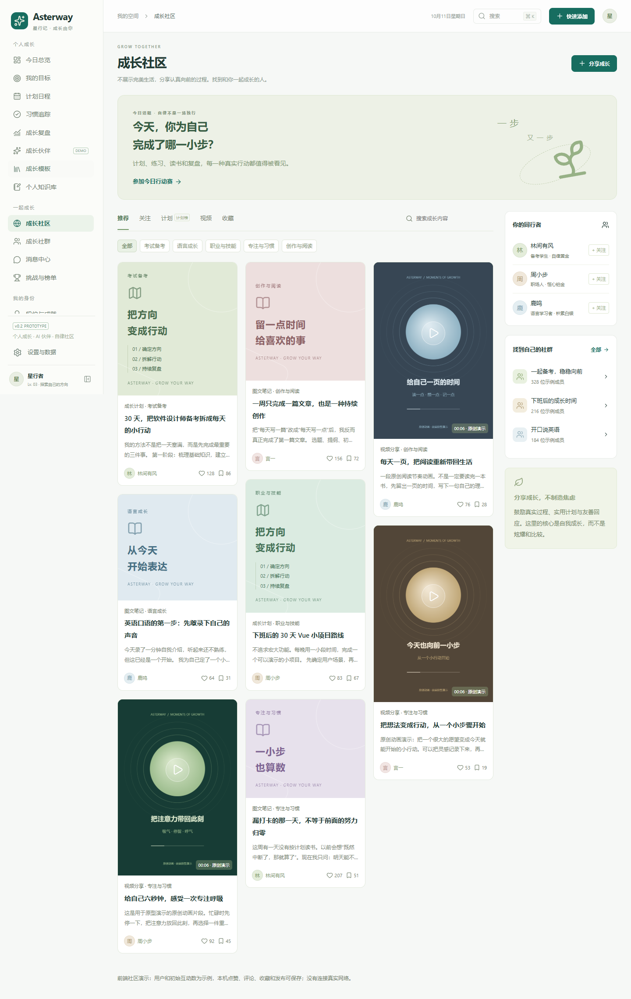

# Asterway · 星行纪

**AI Personal Growth OS — Find your path. Grow your way.**

`v0.2.0` 是用于合作伙伴演示与需求讨论的 Vue 前端原型。目标下有多个任务，习惯独立追踪；成长伙伴通过对话创建计划和记录个人知识；社区围绕自律与自我成长展开。



## 项目结构

```text
Asterway/                         # Git 仓库根目录
├── asterway-web/                  # 当前开发的 Vue 前端
│   ├── src/pages/                # 16 个产品页面
│   ├── src/components/           # 共享组件、弹窗、计划预览与内容封面
│   ├── src/store/                # Pinia + 简单浏览器本地保存
│   ├── src/domain/               # 模型、统计、校验
│   ├── src/agent/                # 本地规则伙伴、批量创建、撤销
│   ├── src/data/                 # 成长模板与明确标注的示例社区
│   ├── public/media/             # 原创可播放演示视频和封面
│   ├── scripts/                  # 演示媒体生成脚本
│   └── e2e/                      # 浏览器演示流程验证
├── asterway-server/               # 后续后端预留，无服务实现
├── docs/                         # 范围、演示脚本、验证记录与截图
└── .github/workflows/            # 前端自动检查
```

## 启动

需要 Node.js 24.12+ 或 22.18+。

```bash
cd asterway-web
npm install
npm run dev
```

打开 **http://127.0.0.1:5173/**。首次打开提供演示数据；设置中可备份、清空或重置。已有 v0.1 成长数据继续保留。

```bash
npm test           # 业务规则测试
npm run build      # Vue TypeScript 检查 + Vite 构建
npm run test:e2e    # 桌面和手机浏览器流程
npm run preview    # 预览 dist 构建产物
```

本地浏览器测试使用 Microsoft Edge；无 Edge 时可设置 `CI=1` 并执行 `npx playwright install chromium`。使用 Hash 路由，构建产物位于 `asterway-web/dist/`。

## 页面与布局

| 页面 | 布局与可演示交互 |
| --- | --- |
| 今日总览 | 仪表盘：重点、任务、习惯、XP、专注计时 |
| 我的目标 | 目标卡片与详情：一个目标下的阶段、多个任务、成长进度、计划分享 |
| 计划日程 | 周日程与列表：新增、改期、过期提醒、时段冲突 |
| 习惯追踪 | 周矩阵：每日或每周频率、补打、暂停、归档 |
| 成长复盘 | 数据面板：7/30 天趋势、分类进展与文字复盘 |
| 成长模板 | 27 个卡片模板：考试、语言、技能、阅读、生活；预览后建立整套计划 |
| 成长伙伴 | 对话 + 变更预览：创建目标任务习惯、保存记忆、调整日程、复盘、撤销 |
| 个人知识库 | 笔记卡片：手动记录、伙伴记忆、社区收藏、查询和编辑 |
| 成长社区 | 图文瀑布流、计划榜、竖向视频卡片：发布、关注、点赞、评论、收藏 |
| 成长社群 | 社群卡片：发现、加入、退出、新建、进入群聊 |
| 消息中心 | PC 会话列表与聊天分栏；手机上下分区：私信、群聊、模拟回复 |
| 挑战与榜单 | 每日赛、七日习惯、专注挑战；进度卡片与排名列表 |
| 段位与成就 | 六段成长阶梯、八个徽章、真实积分进度 |
| 会员与权益 | 三列权益对比：仅切换演示身份，不收费、不锁定功能 |
| 成长主页 | 本人/示例用户档案、成长统计、内容和收藏 |
| 设置与数据 | 个人档案和成长身份、完整备份、兼容旧版导入、重置、清空 |

侧栏按个人成长、一起成长、我的身份分组。导航行独立排列，长导航内部滚动；手机使用抽屉。社区桌面按空间显示 2–4 列瀑布流，手机显示双列。

## 演示边界

- 当前为纯前端：没有真实注册登录、联网消息、社区服务、云端知识库、大模型或支付。
- 成长伙伴使用本地关键词规则，默认先预览再确认。用户可明确勾选“新增自动执行”；改期仍需确认。伙伴能引用本地时间偏好，限制计划单次行动时长；它不是开放问答模型。
- 模板是可调整的行动示例，不是官方考试规则或完整课程。计划任务分布在选择的周期内。
- 社区用户、初始互动数与他人的榜单分数是示例。自己的操作和挑战进度来自当前浏览器中的记录。
- 3 段视频为原创 6 秒动画，支持实际播放、循环和上一段/下一段；允许添加小于 1 MB 的本地图片或视频。重置演示数据可恢复完整示例内容。
- 任务奖励 20 XP、习惯日打卡奖励 10 XP，撤销时冲销。成长总分 = 行动 XP + 已领取挑战积分。每日赛每日期一次，长期挑战仅一次。
- 批量创建只允许撤销最近一次；相关内容随后修改、任务完成、新增关联任务或习惯打卡后，会保护这些新记录。
- 数据属于当前浏览器/网址。设置导出同时包含成长、社区、对话和个人知识；旧版仅成长备份仍可导入。较大媒体可能触及浏览器容量，届时会显示保存失败提示。
- 专注时长只在主动记录实际计时结果后累计；关闭计时窗口不继续计时。

技术栈：Vue 3、TypeScript、Vite、Pinia、Vue Router、Lucide Vue、原生 CSS、Zod、Vitest、Playwright。没有引入 React、后端或复杂数据平台。

按 [演示脚本](docs/DEMO_SCRIPT.md) 体验；当前需求与布局映射见 [v0.2 原型范围](docs/PROTOTYPE_V2.md)，检查结果见 [验证记录](docs/VALIDATION.md)。最初七页 MVP 范围留存于 [MVP_SCOPE](docs/MVP_SCOPE.md)。

后续所有 Git 分支使用 **LIngXI** 前缀，规则记录于 `AGENTS.md`。
