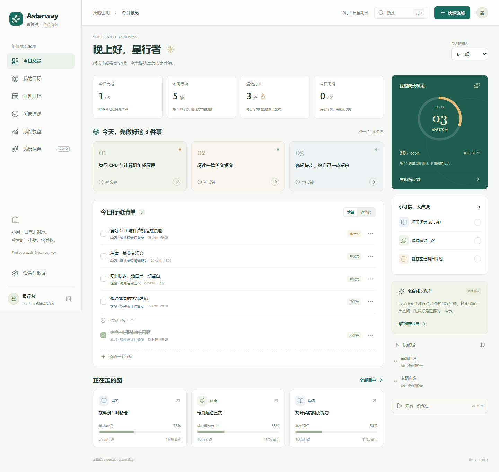

# Asterway · 星行纪

**AI Personal Growth OS — Find your path. Grow your way.**

一个 PC 优先的个人成长工作台：把长期目标变成今天能执行的行动，记录习惯，用成长反馈和计划调整形成闭环。

`v0.1.0` 是用于合作伙伴演示、讨论需求的纯前端 MVP。所有数据保存在浏览器本地；成长伙伴使用规则演示，未连接真实 AI。



## 项目结构

```text
Asterway/                  # Git 仓库根目录
├── asterway-web/           # Vue 前端，当前唯一实现的应用
│   ├── src/
│   │   ├── pages/          # 七个产品页面
│   │   ├── components/     # 导航、表单、弹窗和业务组件
│   │   ├── store/          # Pinia 状态与本地保存
│   │   ├── domain/         # 数据模型、统计和业务规则
│   │   ├── agent/          # 本地计划草案、确认与撤销
│   │   ├── data/           # 相对今天生成的演示记录
│   │   └── tests/          # 关键规则测试
│   ├── e2e/               # 浏览器演示流程验证
│   └── public/
├── asterway-server/        # 未来后端预留，本版没有服务代码
├── docs/                   # 范围、演示脚本、验证与截图
└── .github/workflows/      # 前端自动检查
```

## 启动

需要 Node.js 24.12+ 或 22.18+。在项目根目录执行：

```bash
cd asterway-web
npm install
npm run dev
```

打开 **http://127.0.0.1:5173/**。首次打开自动提供演示数据；可在设置中清空，从自己的目标开始。

```bash
npm test           # 业务规则测试
npm run build      # TypeScript 检查和生产构建
npm run preview    # 预览 dist 构建产物
npm run test:e2e    # 浏览器验证
```

本地浏览器测试默认使用已安装的 Microsoft Edge。无 Edge 时，可设置 `CI=1` 并先执行 `npx playwright install chromium`，使用 Playwright Chromium。

构建结果在 `asterway-web/dist/`，可放到任意静态托管服务。使用 Hash 路由，子页面刷新无需服务器路径重写。本次交付包含源码和本地预览，未配置公开网站部署。

## 可以演示什么

| 页面 | 主要交互 |
| --- | --- |
| 今日总览 | 今日重点、任务完成/撤销、精力记录、习惯打卡、XP、简单专注计时 |
| 我的目标 | 新增/编辑、模板、状态切换、详情、里程碑增删改和上下移动、关联任务 |
| 计划日程 | 周/列表切换、任务池、指定日期新增、改期、过期提醒、时段冲突 |
| 习惯追踪 | 每天/每周 N 次、周矩阵、过去 7 天补打、暂停/恢复、归档 |
| 成长复盘 | 7/30 天真实统计、每日完成趋势、目标分类进展、每周文字复盘 |
| 成长伙伴 | 时间不足调整、目标拆解、本周摘要；草案预览 → 确认 → 撤销 |
| 设置与数据 | 个人档案、JSON 导出、校验后导入、演示重置、清空 |

全局支持搜索、快捷添加、导航折叠、移动抽屉、键盘焦点和 Esc 关闭弹窗。

## 演示边界

- 没有后端、注册登录、同步服务、真实 AI 接口或支付功能。
- 数据属于当前浏览器/当前网址；更换浏览器、端口或设备不会自动同步。重要记录请先导出。
- 任务预估时长不计作实际专注；专注时长只在用户主动记录计时结果后保存。
- 伙伴仅识别示例指令和关键词，未知输入会明确说明演示范围。
- 任务完成奖励 20 XP，习惯日打卡奖励 10 XP；撤销冲销，重复完成不重复奖励。每 100 XP 升一级。
- 图表完成数量按实际完成日；完成率按区间内计划到期的有效任务。已完成任务不能直接改期，需先取消完成。
- 删除目标保留任务，解除关联；任务删除、习惯归档保留已有历史记录。已删除任务不计入当前目标进度和计划分母。
- 只允许撤销最近一次伙伴操作；若相关任务随后被修改，则阻止覆盖式撤销。
- 移动端习惯矩阵在表格区域内横向浏览，主体页面不横向溢出。

技术栈：Vue 3、TypeScript、Vite、Pinia、Vue Router、Lucide Vue、原生 CSS、轻量图表、Vitest、Playwright。根据用户要求替换原任务书的 React 技术栈；不引入完整 UI 框架或大型图表库，以便快速讨论和修改产品。

请先按 [3 分钟演示脚本](docs/DEMO_SCRIPT.md) 体验，再用文末的问题收集合作伙伴反馈。范围说明见 [MVP_SCOPE](docs/MVP_SCOPE.md)，验证结果见 [VALIDATION](docs/VALIDATION.md)。

本仓库后续所有分支使用 `LIngXI` 前缀，规则同时记录在 `AGENTS.md`。
