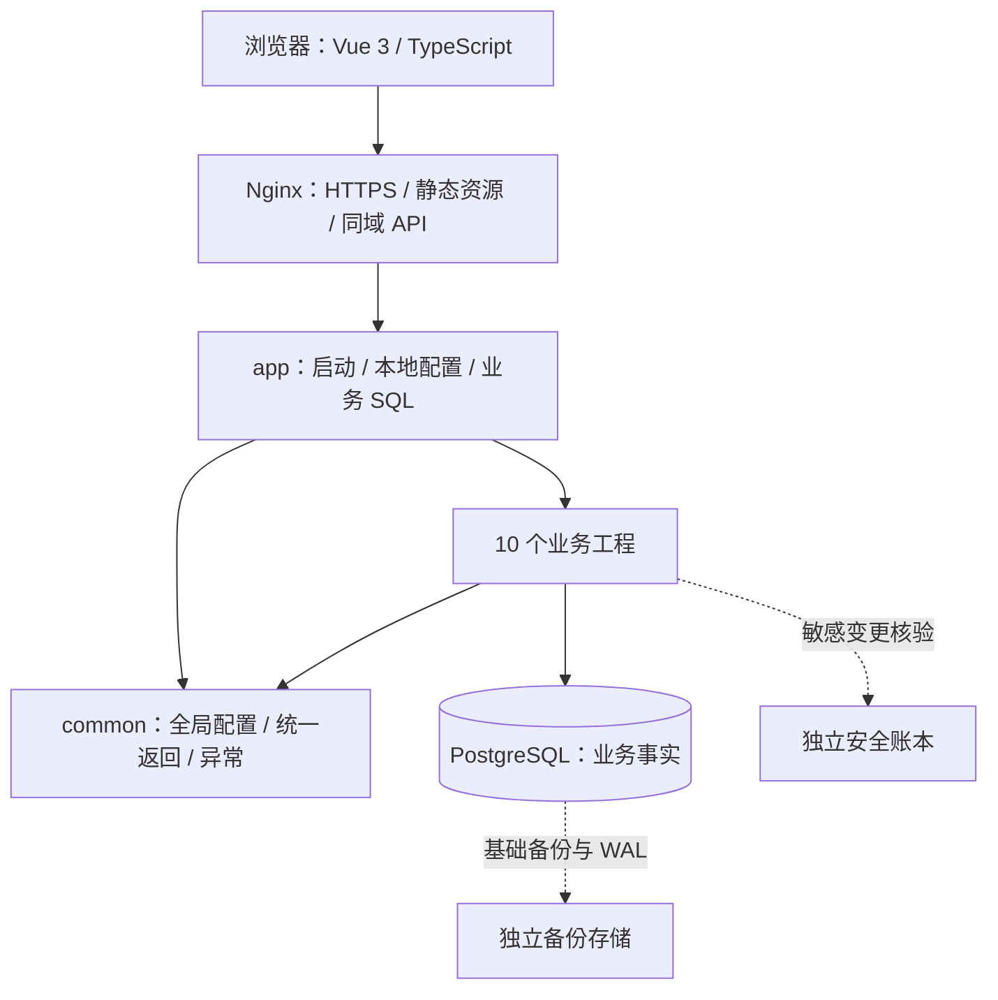

# Asterway

个人成长管理系统。将目标拆分为阶段和任务，安排到周计划与日计划，记录实际执行和习惯完成情况，再通过今日看板与历史统计回顾投入。

维护者：**LingXI5499**。默认分支：`main`。当前工程版本：`0.1.0-SNAPSHOT`；当前开发文档版本：**V2.0**。最新同步记录核对于 2026-10-26；V2.0 设计文档保留 2026-10-22 基线，当前实现以代码和下方状态为准。

## 当前进度

2026-11-04 common 与 identity 后端编码已完成：统一 ResultVO、JWT + Security + Redis、三角色 RBAC 和账户后台链路；十三项 Maven 工程编译打包与应用启动通过，按要求未运行单元、系统、集成或接口业务测试。见 [后端实现与启动说明](docs/identity/后端实现与启动说明.md)。

2026-11-04 identity SQL 阶段已完成：本机 WSL2 PostgreSQL 17.11、Redis、十张表及三角色授权初始化，84 项 SQL 实测通过；该记录为此前 SQL 阶段结果；新前端留待后续。详见 [SQL 阶段验收](docs/identity/SQL阶段验收.md)。

2026-11-04 后端重建为空框架：app 仅保留启动类、本地 application.yml 与按业务工程划分的 SQL 占位文件；common 预留公共能力目录；10 个业务工程仅保留 entity、dto、vo、mapper、service/impl、controller 和 Mapper XML 目录。旧业务代码及测试已移出当前后端，Flyway 已移除，尚无具体接口或数据库表实现。结构及本地运行方式见 [后端框架说明](backend/README.md)。

### 历史记录（不代表当前后端能力）

2026-10-29 按模块职责重构：app 只保留启动类、Controller、DTO、VO；common 集中全局配置、统一返回与异常；全部 21 个 Service 及 Mapper 归所属业务模块，模块间通过公开 API 调用，不保留 app 用例编排层。当前分层与事务职责见 [后端架构说明](backend/README.md)。

2026-10-26 已整理账户服务职责及辅助组件目录，抽离会话 SQL 资源；后端全模块编译与前端生产构建通过，未运行测试。本次代码同步仅面向已有远程开发分支，不合入 main；发布范围见账户模块实现与运行说明。

2026-10-25 已补齐账户核心功能代码：注册、登录、查看与修改资料、修改密码、正常退出、设备时区，以及拼图验证、失败锁定、操作幂等、安全核验、日志和 Swagger。前端使用简单账户页面，不包含其他业务模块或管理后台开发。

本次按要求不新增、不运行测试。后端使用 `-Dmaven.test.skip=true` 打包通过，前端生产构建通过；经明确授权，开发库 V003 已执行，既有账户时区回填为 Asia/Shanghai，前后端已启动。启动访问确认不代表账户业务已通过验收。

运行入口：页面 `http://127.0.0.1:5173/`，Swagger `http://127.0.0.1:8088/swagger-ui/index.html`。完整接口、运行方式、数据变化与验证边界见 [账户模块实现与运行说明](docs/验收记录/账户模块实现与运行说明.md)。

| 范围 | 当前状态 |
|---|---|
| 账户 HTTP | 10 个认证/本人端点、2 个公开辅助端点、1 个本人操作结果查询端点 |
| 数据库 | V001、V002 保持原文；V003 已兼容扩展既有账户表和账户辅助表 |
| 账户页面 | 登录、注册、账户中心，包含拼图、资料编辑、改密、退出与时区同步 |
| 编译与启动 | 后端打包、前端构建和本机启动通过；本轮未执行测试 |
| 其他业务 | 仍按 V2.0 设计后续实施，完整系统验收保持 NOT_VERIFIED |

## 架构与工程边界

采用前后端分离的模块化单体架构。一个 `app` 应用装配全部业务工程，同一 Java 进程内协调业务事务，使用 PostgreSQL 保存业务事实与审计，Redis 保存登录会话等短期状态。以下为设计拓扑，前端、反向代理、业务处理和独立恢复设施仍需实施。



app 依赖 common 和 10 个业务工程；每个业务工程当前仅依赖 common，业务工程互不依赖。common 不依赖业务工程。只有 app 生成可执行 JAR，其余工程为普通 JAR。

Controller、DTO、VO、Entity、Service 接口与实现、Mapper/XML 均归所属业务工程；统一响应、异常处理、security、配置和工具等归 common。目前仅预留空目录，不提供具体实现。app 只放启动类、本地 YAML 与业务 SQL。完整约定见 [后端架构约定](backend/ARCHITECTURE.md)。

规划由服务端可撤销会话管理身份，按账户隔离个人数据，以事务、账户锁和数据库约束处理并发。数据库不建立物理外键、数据库级联或模拟外键的触发器；跨表归属、引用与历史保留由应用事务校验。账户安全账本、完整运行恢复门禁和备份恢复均留待后续实现、验证。

### 十个独立业务工程

按业务一对一拆分：**10 个业务工程 + app = 11 个功能/启动工程；另有独立公共工程 common，共 12 个 Maven 子工程；连同父工程，Reactor 为 13 项。**

| 业务 | Maven 工程 | 职责范围（待实现） |
|---|---|---|
| 账户 | `identity` | 注册、登录、资料、密码与会话 |
| 目标 | `goal` | 目标规划、归档、延期及完成条件 |
| 阶段 | `stage` | 阶段顺序、状态与推进 |
| 任务 | `task` | 任务安排、完成与历史保留 |
| 计划 | `planning` | 周计划与日计划 |
| 执行计时 | `execution` | 开始、暂停、结束与时间修正 |
| 习惯 | `habit` | 周期规则与完成事实 |
| 看板 | `dashboard` | 今日事项汇总 |
| 历史统计 | `statistics` | 历史完成与投入统计 |
| 系统通知 | `notification` | 站内消息、已读与处理 |

### 技术基线

| 层次 | 当前基线与证据 |
|---|---|
| 后端语言与构建 | Java 17、Maven 3.9.4；父 POM 固定 Java 版本，Wrapper 属性指定 Maven 版本 |
| 应用框架 | Spring Boot 3.5.16、Spring MVC、Spring Security、Bean Validation，依赖已声明 |
| 持久化 | MyBatis Starter 3.0.5 + XML、PostgreSQL JDBC、Spring Session JDBC；SQL 按业务工程集中于 app，已移除 Flyway |
| 数据库 | 本机 WSL2 PostgreSQL 17.11 已安装并验证；账户采用 Redis 会话，不建立 JDBC 会话表 |
| 前端 | 规划为 Vue 3 + TypeScript，采用 Vite、Vue Router、Pinia、Element Plus；工程与锁定版本尚未建立 |
| 部署 | 规划为 Nginx 同域入口、单应用实例、独立数据库与备份存储，尚未部署验收 |

前端当前实际依赖见 frontend/package.json 与 package-lock.json；其他前端基线仍需核对。完整版本依据见 [A08 技术版本基线](docs/开发文档V2.0/附录/A08-技术版本基线.md)。

## 仓库结构

```text
backend/
  pom.xml                 # 聚合父工程：com.asterway:asterway-backend
  common/                 # 全局配置、统一返回、异常与公共工具
  identity/               # 账户
  goal/                   # 目标
  stage/                  # 阶段
  task/                   # 任务
  planning/               # 周计划、日计划
  execution/              # 执行计时
  habit/                  # 习惯
  dashboard/              # 看板
  statistics/             # 历史统计
  notification/           # 系统通知
  app/                    # 唯一启动类、本地 YAML、业务 SQL
docs/
  README.md               # 文档导航
  index.html              # 跳转至 V2.0 阅读页
  开发文档V2.0/
    01～10 主文档          # 需求至运维、追溯及校验记录
    模块设计/              # 12 个模块分册及公共能力
    附录/                  # 数据、接口、页面、系统处理等完整细则
    编制源文件/            # 本版重建所需的业务、质量及工程设计输入
    tools/                 # 文档编排、渲染与校验
    data/                  # 结构化目录、指纹与校验结果
    index.html             # 可直接打开的完整离线阅读页
```

## 阅读与校验

从 [V2.0 文档目录](docs/开发文档V2.0/README.md) 开始，先读需求与系统设计，再按 [十二模块设计](docs/开发文档V2.0/04-模块设计文档.md) 和 [编码实施手册](docs/开发文档V2.0/05-编码实施手册.md) 推进。下载仓库后可直接打开 [完整离线阅读页](docs/开发文档V2.0/index.html)；GitHub 文件页用于查看源码，不是已部署的应用。

在仓库根目录执行：

```powershell
# 文档重建与静态校验；需要 Python、Markdown 包及 Node.js
python -X utf8 docs/开发文档V2.0/tools/build.py

# 后端编译与测试；使用已安装的 JDK 17 与 Maven 3.9.4
mvn -B -f backend/pom.xml clean compile
mvn -B -ntp -f backend/pom.xml clean verify
mvn -B -f backend/pom.xml test
```

当前只提交了 Maven Wrapper 版本属性，尚无 `mvnw` / `mvnw.cmd`。`validate` 检查工程模型，不能替代编译、测试、启动或业务验收。

业务、接口和字段输入在 `编制源文件/` 维护，正文组织在 `tools/` 维护。调整输入并复核后，先执行 `python -X utf8 docs/开发文档V2.0/tools/prepare.py --refresh-sources` 更新指纹，再运行上面的文档重建命令，并同步提交正文、数据与 HTML。

## 下一阶段

1. 审阅 [后端实现与启动说明](docs/identity/后端实现与启动说明.md) 及当前代码；SQL 已确认通过。
2. 后端已完成 common 与 identity 编码；依据用户后续安排进行接口业务验收或前端开发。
3. 完成真实数据库及接口验证，再依据 /asterway REST 接口开发 Vue 账户与后台管理界面。
4. 账户模块验收后，再依次开发其他业务工程。V2.0 文档只用于参考业务，不直接沿用其数据库、接口和旧迁移流程。

本地仅使用 `feature/LingXI-develop`。成果先审阅，获得本次明确批准后才提交、推送 feature；模块完成并另获批准后才合入 main。提交、拉取请求及合并标题使用 `LIngXI` 前缀，发布与提交身份使用维护者账户；保留其他未授权修改、stash 和本地发布记录。
