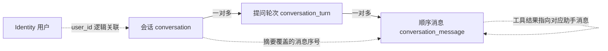

# Agent P1.2 会话管理 SQL 验收说明

日期：2026-11-05。当前状态：**SQL 隔离校验通过，等待用户验收；尚未部署开发库或实现持久化业务代码。**

## 阶段范围与前置提交

P1.1 基础对话已由用户验收。按本次授权，已将此前完成的项目源码与 P1.1 一并提交到本地 `feature/LingXI-develop`：

- 提交：`964e350a429ff78ceff902de7bb85427302093e0`。
- 主题：`LIngXI feat: 完成成长工作区与 Agent P1.1 基础对话`。
- 作者与提交者：`LingXI5499`，使用该账户的 GitHub no-reply 提交邮箱。
- 共 362 个变更文件；私密配置、IDE 文件、缓存和无关旧材料排除，其余暂存与工作区内容保留。
- 只完成本地提交；没有推送 feature、更新 main 或创建标签。

本阶段遵循实施文档 P1.2：会话、消息、历史分页、多轮上下文及摘要。当前仅交付其 SQL 与接口约定；SQL 验收后才开始 Python 持久化、Java 代理及前端适配。不会提前进入 P1.3 工具执行、RAG 或工作流。

## 三张表与关系

全部定义集中在 `backend/app/src/main/resources/sql/agent.sql`，Agent 自有数据放独立 `agent` schema。Java 成长业务表保持原样。继续使用逻辑关联，无物理外键、级联删除、Flyway、自动迁移或自动建表。

| 表 | 保存什么 | 关键约束 |
|---|---|---|
| `agent.conversation` | 所属用户、标题、开关状态、摘要及覆盖边界、下一消息序号、版本和逻辑删除 | 关闭时间与状态成对；删除必须关闭；摘要边界小于下一序号；版本非负 |
| `agent.conversation_turn` | 一次提问的请求标识、内容摘要哈希、生成状态、截止及结束时间 | 同用户 requestId 唯一；同会话最多一轮生成中；失败、取消及截断不能冒充成功 |
| `agent.conversation_message` | 顺序消息、用户原文、助手回复、部分输出、工具调用和结果 | 会话内序号唯一；一轮一条用户消息；工具结果按助手消息及调用标识唯一 |

轮次表承担生成状态和请求幂等，解决刷新、重放、取消及失败后重复调用模型的问题。摘要直接放在会话中，不另建摘要表；保留原始消息，后续压缩不删除历史。仍以会话为一条业务主链，轮次和消息不各建一套独立增删改查入口。

### 会话

- `title` 为 1～100 字，默认“新对话”。
- `status` 为 `ACTIVE / CLOSED`。关闭后可读历史，不再接受新提问；本期不增加重新打开操作。
- `context_summary` 最多 16000 字；无摘要时覆盖序号为 0，摘要时间为空。
- `summary_through_message_no` 表示已经压缩的连续历史边界，不是“最近一次返回的消息数”。
- `next_message_no` 从 1 开始，用会话行锁在短事务中分配；历史展示不依赖时间戳先后。
- `version` 用于标题、关闭、删除和摘要等比较更新。关闭或删除遇到运行中的轮次时返回冲突，先停止生成。
- `deleted_at` 为逻辑删除，所有公开查询排除已删除会话；不删除轮次和消息。

### 提问轮次

状态为 `RUNNING / COMPLETED / FAILED / CANCELLED / INCOMPLETE`。只有真实完整结束 `finish_reason=stop` 才标为 COMPLETED。达到输出限制保留 INCOMPLETE；模型错误、超时和中断分别保留真实失败或取消状态。

`request_id` 为非空 UUID，同一用户全局唯一。`request_hash` 为规范化会话标识和提问内容的 SHA-256。重放同一个 requestId 时，服务先比较会话及哈希：相同则读取原轮次，不重新调用模型；不同则返回 409。明确的“重新生成”使用新的 requestId。

同一会话最多一个 RUNNING，不限制不同会话各自的生成；并发资源上限继续由服务端配置控制。`deadline_at` 由服务端创建，客户端不能指定。进程异常遗留的 RUNNING 在到期后先归一为 FAILED，再接受新轮次。终态更新携带轮次版本和 RUNNING 条件，旧任务不能覆盖已取消结果。

### 消息

- `role` 仅为 `USER / ASSISTANT / TOOL`；角色由服务端产生，不接收客户端伪造的系统消息。
- 用户文本最多 8000 字，助手及工具文本最多 65536 字。所有主键及消息序号在 JSON 中按字符串传输。
- 助手中途停止、失败或截断时 `is_complete=false`，保留已经产生的文本；尚未收到文本时允许空的助手占位消息。
- 完整助手消息必须是正常文本 stop，或带非空工具调用数组的 tool_calls；length 不能标成完整。
- `tool_calls` 保存助手发出的调用数组。单条结构上限为 32 项、256 KiB；注册白名单、参数结构和更小执行预算留到 P1.3，不因存在字段就开放执行。
- 工具结果使用 `tool_request_message_id + tool_call_id` 对应具体的助手调用。同一个调用标识出现在另一条助手消息中是允许的，不能错误地按整轮全局去重；工具结果也不能指向自身。
- `usage` 仅用于保存允许的实际 token 数字字段，不能放认证头、密钥或 SDK 原始响应。

## 后端阶段的事务与上下文规则

数据库只负责行内检查和唯一性，以下跨表规则由 SQLAlchemy Service 在事务中维护：

1. 身份仍通过 Java 验证，取得普通用户 ID、角色和有效权限。所有会话、轮次、消息查询都带所属用户条件，不能依赖请求中的 userId。
2. 每次写入先锁当前用户可访问且未删除的会话行，再处理其轮次和消息。会话、轮次和消息的 userId/conversationId 必须一致；工具结果必须对应同轮次真实存在的助手调用。
3. 开始时在一个短事务内登记轮次、用户消息、助手占位以及序号分配。随后释放数据库事务，再请求模型；不持有行锁等待远程输出。
4. 生成中按受控批次保存部分文本。最终回复、轮次终态和会话更新时间先提交成功，再发送 SSE 完成事件。保存失败不能向界面报告已完成。
5. 取消及截止检查使用比较更新；重放取消不重写结束时间。客户端失联后尽力记录取消，失败时由截止归一恢复，不自动重复模型调用。
6. 历史原文始终保留。上下文使用稳定 System Prompt、旧摘要、边界之后最近消息和当前提问；失败或取消轮次中的用户约束仍应保留，未完成的助手回答不得作为已确认事实。
7. 摘要只在终态轮次边界推进，不截断助手工具调用与结果的配对。摘要按会话版本及原覆盖边界比较更新，防止过期摘要覆盖新内容。
8. 摘要是派生数据，不能保证语义完整性。后端阶段须保留用户约束、已确认事项和未完成任务，校验压缩结果，失败时保留原摘要和原文；不能把压缩失败等同于清空上下文。

SQL 不声称能够跨表验证归属、工具配对或摘要质量，也不使用伪跨表 CHECK 或数据库触发器代替 Service。

## 公开接口约定（待 SQL 验收后实现）

统一前缀 `/asterway`，保持 ResultVO；会话列表使用 PageResultVO，消息采用序号游标避免新消息插入造成翻页重复。默认 size=20，最大 100；会话列表 page 从 1 开始。

| 方法 | 路径（省略统一前缀） | 说明与请求 |
|---|---|---|
| POST | `/agent/conversations` | 创建，`{title?}`，返回 201 |
| GET | `/agent/conversations` | 列表，`status?、keyword?、page、size` |
| GET | `/agent/conversations/{id}` | 详情、版本、摘要边界和当前运行轮次；不向界面返回内部密钥 |
| PATCH | `/agent/conversations/{id}` | 修改标题，`{title,version}` |
| POST | `/agent/conversations/{id}/close` | 关闭，`{version}` |
| DELETE | `/agent/conversations/{id}` | 逻辑删除，`?version=`，沿用 200 ResultVO 空结果 |
| GET | `/agent/conversations/{id}/messages` | `beforeMessageNo?、size`；返回 items、hasMore、nextBeforeMessageNo，界面按升序展示 |
| GET | `/agent/conversations/{id}/turns/{turnId}` | 查询实际生成状态、已保存文本及版本，供刷新和幂等请求恢复 |
| POST | `/agent/conversations/{id}/turns/{turnId}/cancel` | 停止生成，`{version}` |
| POST | `/agent/conversations/{id}/messages` | 持久化普通回复，`{message,requestId}` |
| POST | `/agent/conversations/{id}/messages/stream` | 持久化 SSE，`{message,requestId}` |

本阶段计划新增 11 个接口。原有 P1.1 两个单轮对话接口保持兼容，当前服务继续可用；新前端完成后切换到会话内接口。新增接口没有版本号，也不接受模型指定目标用户。

SSE 继续使用 message_start、delta、message_end、error；开始事件增加 conversationId、turnId、requestId 和轮次版本。已完成请求可重放已保存结果；同 requestId 仍在运行则返回 409 及原轮次信息，引导查询原状态，不隐式创建第二次生成。取消、失败、截断的同 requestId 也不自动重发。

他人或已删除会话均返回 404；权限不足 403；版本、内容重放冲突、关闭后发送、同会话另一轮运行均返回 409。模型或持久化失败使用明确错误码，不能把上游原始错误或凭据返回前端。

Java 只负责公开认证、权限和代理，不为 Python 已管理的 Agent 表再建一套 MyBatis DAO。Python 通过独立受限数据库角色读写自身 schema，不能直接读写 Java 成长业务表。SQLAlchemy 及其驱动依赖留待 SQL 验收后的实现阶段引入。

## 六项准备态权限

新增 `agent:conversation:list/read/create/update/close/delete`，仅授予 USER，并登记成长助手页下六个隐藏按钮节点，不新增前端页面。读取消息和轮次复用 read；生成和取消复用已存在的 `agent:chat:send`，同时校验本人会话。

P1.2 使用独立 `asterway.agent_conversation_backend_ready` 手工 SQL 开关。默认六项权限禁用、按钮隐藏禁用；P1.1 的 ready 标记不能提前启用它们。管理员、超级管理员误授权会被移除，运行时仍有管理身份优先限制。SQL、后端均验收后才手工启用，不随启动运行 SQL。

## 隔离校验与执行边界

执行：仓库根目录运行 `scripts/review_agent_sql.ps1`。脚本固定连接专用 `asterway_identity_test`，不读取开发库凭据，也不连接开发库。

- 在随机 schema 创建最小 Identity 结构夹具，另将完整 Agent DDL 映射到本次随机事实 schema；没有复制真实用户数据。
- 基础组 **72 项**：建表、毫秒精度、空值／状态／时间／长度约束、摘要覆盖、消息及工具唯一性、隐藏权限和分阶段启用、管理身份过滤、初始化幂等、历史分页、部分文本保留、超时归一和逻辑删除，最终回滚。
- 并发组 **15 项**：两条真实数据库连接，先验证后发事务确实阻塞，再提交先发事务；验证同会话运行互斥、同用户 requestId 唯一，以及消息序号严格分配为 1、2。只在专用库本次随机 schema 中短暂提交，结束后按限定名称清理。
- 实际结果：**87/87 通过**，PostgreSQL 17.11；随机 schema 全部清理。结构不包含物理外键，PUBLIC 未获得 Agent schema 访问权。

可复查结果：`docs/agent/P1.2-sql-check-results.json`，记录输入 SQL 哈希及每项检查。没有建立严格单元、系统或集成测试框架；Service、HTTP、多用户实际访问及摘要语义质量仍为 **NOT_VERIFIED**。

当前未执行完整 agent.sql 到开发库，未启用六项新权限，未安装持久化依赖，未修改正在运行的 P1.1 页面和业务代码。P1.2 改动保留在本地工作区，等待本次 SQL 验收，不随 P1.1 提交一起提交或推送。

SQL 验收后再按顺序实现 Python 数据模型／Repository → 会话 Service／上下文与摘要 → Java DTO／VO／Service 接口及实现／Controller → 权限启用 → 构建启动，再确认会话前端交互并开发。当前停止在本 SQL 验收点。

参考：[PostgreSQL CHECK 与唯一约束](https://www.postgresql.org/docs/17/ddl-constraints.html)、[部分索引](https://www.postgresql.org/docs/17/indexes-partial.html)、[JSON 函数](https://www.postgresql.org/docs/17/functions-json.html)。
