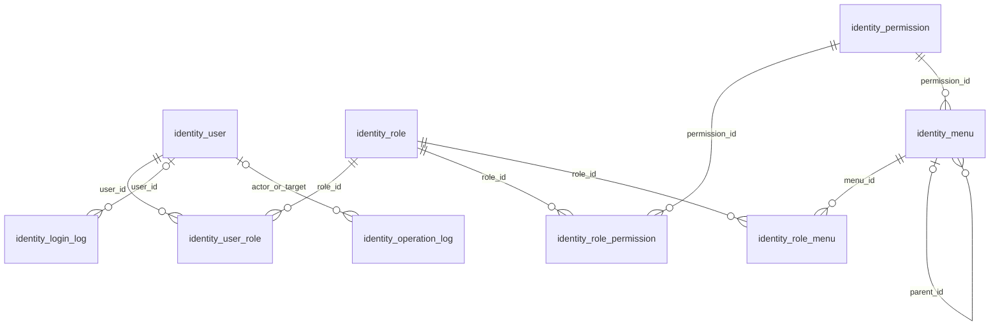

# Identity 数据库与授权设计

2026-11-04，SQL 阶段。文档用于确认业务，FlashMind 用于理解管理操作流程；本轮表结构和权限设计重新编写。Mapper、Service、Controller 和新前端尚未实现。

## 业务边界与角色

- 普通用户关联 USER；管理员关联 USER + ADMIN；初始超管关联 USER + SUPER_ADMIN。
- 本轮只启用三个角色，保留多对多扩展结构，不开放自定义角色新增删除。未来会员是普通用户的独立权益，本轮不建立会员表。
- 注册只能授予 USER，普通管理员不能分配角色。超级管理员可授予或撤销 ADMIN，SUPER_ADMIN 仅由本地初始化建立。
- 管理员只能管理没有 ADMIN/SUPER_ADMIN 关联的普通账户，目标管理身份不因角色被停用而降为普通用户。
- 超管负责授权、权限菜单维护和账户配置；超级管理员仍受账户状态、对象保护及审计规则约束。
- ID 使用数据库自增 bigint，对外作为字符串。时刻使用 timestamptz，开发库会话时区为 UTC。
- SQL 只初始化新结构，不自动执行、不覆盖旧对象、不使用物理外键、级联、触发器或迁移版本表。

## 逻辑关系

下图表示逻辑引用，均无物理外键。

Redis 后续保存登录会话、设备描述、验证码和失败计数，不创建 Spring Session JDBC 表。设备管理以登录会话为单位，设备描述不参与授权。

## 初始权限矩阵

USER 7 项本人权限；ADMIN 附加 12 项管理权限，通过基础 USER 角色合计 19 项；SUPER_ADMIN 37 项。菜单分配与动作授权分开保存。

| 编码 | 动作 | USER | ADMIN 附加 | SUPER_ADMIN |
|---|---|---|---|---|
| identity:profile:read | 查看本人资料 | 是 | 否 | 是 |
| identity:profile:update | 修改本人资料 | 是 | 否 | 是 |
| identity:password:update | 修改本人密码 | 是 | 否 | 是 |
| identity:timezone:read | 查看本人时区 | 是 | 否 | 是 |
| identity:timezone:update | 修改本人时区 | 是 | 否 | 是 |
| identity:device:list | 查看本人登录设备 | 是 | 否 | 是 |
| identity:device:revoke | 退出本人登录设备 | 是 | 否 | 是 |
| identity:user:count | 查看用户数量 | 否 | 是 | 是 |
| identity:user:list | 查询用户 | 否 | 是 | 是 |
| identity:user:read | 查看用户详情 | 否 | 是 | 是 |
| identity:user:create | 新增普通用户 | 否 | 是 | 是 |
| identity:user:update | 修改用户 | 否 | 是 | 是 |
| identity:user:delete | 逻辑删除用户 | 否 | 是 | 是 |
| identity:user:status | 启停用户 | 否 | 是 | 是 |
| identity:user:reset_password | 重置用户密码 | 否 | 是 | 是 |
| identity:user:assign_role | 分配角色（仅超管） | 否 | 否 | 是 |
| identity:role:list | 查询角色 | 否 | 否 | 是 |
| identity:role:read | 查看角色授权 | 否 | 否 | 是 |
| identity:role:update | 修改角色展示信息 | 否 | 否 | 是 |
| identity:role:grant_permission | 分配角色权限 | 否 | 否 | 是 |
| identity:role:grant_menu | 分配角色菜单 | 否 | 否 | 是 |
| identity:permission:list | 查询权限 | 否 | 否 | 是 |
| identity:permission:read | 查看权限详情 | 否 | 否 | 是 |
| identity:permission:create | 新增扩展权限 | 否 | 否 | 是 |
| identity:permission:update | 修改权限 | 否 | 否 | 是 |
| identity:permission:delete | 删除未引用的扩展权限 | 否 | 否 | 是 |
| identity:menu:list | 查询菜单树 | 否 | 否 | 是 |
| identity:menu:read | 查看菜单详情 | 否 | 否 | 是 |
| identity:menu:create | 新增菜单 | 否 | 否 | 是 |
| identity:menu:update | 修改菜单 | 否 | 否 | 是 |
| identity:menu:delete | 删除未引用的扩展菜单 | 否 | 否 | 是 |
| identity:session:list | 查询管理范围内会话 | 否 | 是 | 是 |
| identity:session:revoke | 强退管理范围内会话 | 否 | 是 | 是 |
| identity:login_log:list | 查询管理范围内登录日志 | 否 | 是 | 是 |
| identity:operation_log:list | 查询管理范围内操作日志 | 否 | 是 | 是 |
| identity:setting:read | 读取账户配置 | 否 | 否 | 是 |
| identity:setting:update | 修改账户配置 | 否 | 否 | 是 |

角色分配、角色授权、权限、菜单、账户配置等动作还必须检查超管身份，不能仅给 ADMIN 勾选权限就越过管理边界。权限记录不是自动生成接口的规则。

## 初始菜单矩阵

| 编码 | 名称 | 类型 | 父节点 | 路径或动作权限 | 直接授权角色 |
|---|---|---|---|---|---|
| account_root | 账户中心 | DIRECTORY | — | /account | SUPER_ADMIN, USER |
| system_root | 系统管理 | DIRECTORY | — | /system | ADMIN, SUPER_ADMIN |
| profile | 个人资料 | PAGE | account_root | /account/profile | SUPER_ADMIN, USER |
| devices | 登录设备 | PAGE | account_root | /account/devices | SUPER_ADMIN, USER |
| users | 用户管理 | PAGE | system_root | /system/users | ADMIN, SUPER_ADMIN |
| roles | 角色授权 | PAGE | system_root | /system/roles | SUPER_ADMIN |
| permissions | 权限管理 | PAGE | system_root | /system/permissions | SUPER_ADMIN |
| menus | 菜单管理 | PAGE | system_root | /system/menus | SUPER_ADMIN |
| sessions | 登录会话 | PAGE | system_root | /system/sessions | ADMIN, SUPER_ADMIN |
| login_logs | 登录日志 | PAGE | system_root | /system/login-logs | ADMIN, SUPER_ADMIN |
| operation_logs | 操作日志 | PAGE | system_root | /system/operation-logs | ADMIN, SUPER_ADMIN |
| account_settings | 账户配置 | PAGE | system_root | /system/account-settings | SUPER_ADMIN |
| identity_profile_update | 修改本人资料 | BUTTON | profile | identity:profile:update | SUPER_ADMIN, USER |
| identity_password_update | 修改本人密码 | BUTTON | profile | identity:password:update | SUPER_ADMIN, USER |
| identity_timezone_read | 查看本人时区 | BUTTON | profile | identity:timezone:read | SUPER_ADMIN, USER |
| identity_timezone_update | 修改本人时区 | BUTTON | profile | identity:timezone:update | SUPER_ADMIN, USER |
| identity_device_revoke | 退出本人登录设备 | BUTTON | devices | identity:device:revoke | SUPER_ADMIN, USER |
| identity_user_count | 查看用户数量 | BUTTON | users | identity:user:count | ADMIN, SUPER_ADMIN |
| identity_user_read | 查看用户详情 | BUTTON | users | identity:user:read | ADMIN, SUPER_ADMIN |
| identity_user_create | 新增普通用户 | BUTTON | users | identity:user:create | ADMIN, SUPER_ADMIN |
| identity_user_update | 修改用户 | BUTTON | users | identity:user:update | ADMIN, SUPER_ADMIN |
| identity_user_delete | 逻辑删除用户 | BUTTON | users | identity:user:delete | ADMIN, SUPER_ADMIN |
| identity_user_status | 启停用户 | BUTTON | users | identity:user:status | ADMIN, SUPER_ADMIN |
| identity_user_reset_password | 重置用户密码 | BUTTON | users | identity:user:reset_password | ADMIN, SUPER_ADMIN |
| identity_user_assign_role | 分配角色（仅超管） | BUTTON | users | identity:user:assign_role | SUPER_ADMIN |
| identity_role_read | 查看角色授权 | BUTTON | roles | identity:role:read | SUPER_ADMIN |
| identity_role_update | 修改角色展示信息 | BUTTON | roles | identity:role:update | SUPER_ADMIN |
| identity_role_grant_permission | 分配角色权限 | BUTTON | roles | identity:role:grant_permission | SUPER_ADMIN |
| identity_role_grant_menu | 分配角色菜单 | BUTTON | roles | identity:role:grant_menu | SUPER_ADMIN |
| identity_permission_read | 查看权限详情 | BUTTON | permissions | identity:permission:read | SUPER_ADMIN |
| identity_permission_create | 新增扩展权限 | BUTTON | permissions | identity:permission:create | SUPER_ADMIN |
| identity_permission_update | 修改权限 | BUTTON | permissions | identity:permission:update | SUPER_ADMIN |
| identity_permission_delete | 删除未引用的扩展权限 | BUTTON | permissions | identity:permission:delete | SUPER_ADMIN |
| identity_menu_read | 查看菜单详情 | BUTTON | menus | identity:menu:read | SUPER_ADMIN |
| identity_menu_create | 新增菜单 | BUTTON | menus | identity:menu:create | SUPER_ADMIN |
| identity_menu_update | 修改菜单 | BUTTON | menus | identity:menu:update | SUPER_ADMIN |
| identity_menu_delete | 删除未引用的扩展菜单 | BUTTON | menus | identity:menu:delete | SUPER_ADMIN |
| identity_session_revoke | 强退管理范围内会话 | BUTTON | sessions | identity:session:revoke | ADMIN, SUPER_ADMIN |
| identity_setting_update | 修改账户配置 | BUTTON | account_settings | identity:setting:update | SUPER_ADMIN |

页面须同时满足有效父链、菜单授权和页面权限。停用父节点会隐藏整条分支。component_key 只能映射未来前端的组件白名单，不允许任意文件路径。

## 数据库与后续应用的责任

| 对象或动作 | 数据库直接保证 | 后续 Service 必须保证 |
|---|---|---|
| 用户名 | 1～30、基本中英数字格式、大小写无关全历史唯一 | 按 Unicode 码点及统一汉字规则最终校验；正确处理唯一冲突 |
| 昵称 | 非空白、长度、允许重复 | 注册省略时取用户名；改用户名不自动改昵称 |
| 密码 | 拒绝明文格式，只接受 Argon2id 前缀 | 密码 8～50、确认一致、原密码正确、新旧不同，验证完整哈希，不返回摘要 |
| 时区 | 非空、待生效字段配对、待切换不能等于当前 | IANA 名称有效；按旧时区次日午夜切换；无法识别时要求用户选择 |
| 删除与停用 | 已删除对象必须停用 | 排除删除对象、递增安全版本、撤销会话、保留历史 |
| 关联 | 正数标识、联合唯一 | 引用有效、USER 基础角色、禁止注册指定管理角色 |
| 菜单 | 类型形态、直接自引用拒绝、有效路径唯一 | 多节点循环、悬空父节点、权限引用、内置对象保护及引用删除检查 |
| 并发修改 | version 字段 | UPDATE 比较旧版本并递增，0 行返回并发冲突 |
| 超管保护 | 可锁定 SUPER_ADMIN 角色行 | 所有相关写操作先锁超管角色行，再按固定次序锁用户并重查，防止并发清空可用超管 |
| 注册开关 | JSON 布尔类型、固定配置键 | 注册事务内锁定并重读；与后台关闭注册串行协调 |
| 日志 | 结构及 JSON 对象约束，应用数据库角色仅有 SELECT/INSERT | 管理范围、敏感字段白名单及脱敏；禁止密码、JWT、验证码答案进入日志 |

无外键的明确边界：直接 SQL 可以插入不存在的关联标识、无效 IANA 名称和多节点菜单循环。测试明确展示并检测这些情况，不把“没有数据库约束”伪装成已经实现保护。事务原型仍需在 Service 中实现并再次进行集成验证。

用户名逻辑删除后不重用；角色、权限和菜单编码也不复用；菜单路径在旧菜单逻辑删除后可以重新使用。更新操作显式写 updated_at，无自动触发器。

## 完整字段、约束与索引

以下内容已与本地执行后的 PostgreSQL 系统目录核对，全部 101 个字段均有 SQL COMMENT。数据库详细元数据见 [schema-catalog.json](schema-catalog.json)。

### identity_login_log

| 字段 | 类型 | 可空 | 默认或生成规则 | 职责 |
|---|---|---|---|---|
| id | bigint | 否 | GENERATED ALWAYS AS IDENTITY | 数据库自增主键；对外作为字符串传输 |
| user_id | bigint | 是 | — | 逻辑引用账户，关联有效性由应用检查 |
| username_snapshot | character varying(128) | 否 | — | 尝试登录时的用户名快照；未知用户也能记录 |
| outcome | character varying(16) | 否 | — | SUCCESS 或 FAILURE |
| reason_code | character varying(64) | 否 | — | 结果或拒绝原因编码 |
| session_id | uuid | 是 | — | 登录成功关联的 UUID 会话标识，不是 JWT |
| ip_address | inet | 是 | — | 请求来源 IP；代理来源必须经过可信配置 |
| user_agent | character varying(512) | 否 | ''::character varying | 截断后的客户端描述，不参与授权 |
| device_label | character varying(128) | 否 | ''::character varying | 设备展示描述，不参与授权 |
| trace_id | character varying(64) | 否 | — | 请求追踪标识，不存认证凭据 |
| occurred_at | timestamp with time zone | 否 | CURRENT_TIMESTAMP | 事件发生时刻 |

约束：

- `identity_login_log_check`：`CHECK ((((outcome)::text <> 'SUCCESS'::text) OR ((user_id IS NOT NULL) AND (session_id IS NOT NULL) AND ((reason_code)::text = 'SUCCESS'::text))))`
- `identity_login_log_outcome_check`：`CHECK (((outcome)::text = ANY ((ARRAY['SUCCESS'::character varying, 'FAILURE'::character varying])::text[])))`
- `identity_login_log_pkey`：`PRIMARY KEY (id)`
- `identity_login_log_reason_code_check`：`CHECK (((reason_code)::text ~ '^[A-Z][A-Z0-9_]*$'::text))`
- `identity_login_log_user_id_check`：`CHECK ((user_id > 0))`

索引：

- `identity_login_log_pkey`：`CREATE UNIQUE INDEX identity_login_log_pkey ON public.identity_login_log USING btree (id)`
- `ix_identity_login_log_time`：`CREATE INDEX ix_identity_login_log_time ON public.identity_login_log USING btree (occurred_at DESC, id DESC)`
- `ix_identity_login_log_user_time`：`CREATE INDEX ix_identity_login_log_user_time ON public.identity_login_log USING btree (user_id, occurred_at DESC, id DESC)`

### identity_menu

| 字段 | 类型 | 可空 | 默认或生成规则 | 职责 |
|---|---|---|---|---|
| id | bigint | 否 | GENERATED ALWAYS AS IDENTITY | 数据库自增主键；对外作为字符串传输 |
| code | character varying(64) | 否 | — | 全历史唯一业务编码；内置编码由应用保护 |
| parent_id | bigint | 是 | — | 父菜单逻辑标识；根节点为空；更长循环及悬空父节点由应用拒绝 |
| name | character varying(64) | 否 | — | 界面展示名称 |
| menu_type | character varying(16) | 否 | — | DIRECTORY 目录、PAGE 页面、BUTTON 按钮 |
| route_path | character varying(255) | 是 | — | 目录或页面路径，必须以斜杠开头；按钮为空 |
| component_key | character varying(100) | 是 | — | 页面组件白名单键，不存任意文件路径 |
| permission_id | bigint | 是 | — | 逻辑引用动作权限，关联有效性由应用检查 |
| icon | character varying(64) | 是 | — | 图标键，由前端白名单解释 |
| sort_order | integer | 否 | 0 | 同级非负排序值 |
| is_visible | boolean | 否 | true | 导航展示状态，不代替接口授权 |
| is_builtin | boolean | 否 | false | 内置对象标志；核心对象不能由管理接口删除 |
| is_enabled | boolean | 否 | true | 是否启用；不等同于逻辑删除 |
| version | bigint | 否 | 0 | 乐观锁版本；应用更新时比较并递增 |
| created_at | timestamp with time zone | 否 | CURRENT_TIMESTAMP | 创建时刻 |
| updated_at | timestamp with time zone | 否 | CURRENT_TIMESTAMP | 最近修改时刻；由应用写入，无自动更新时间触发器 |
| created_by | bigint | 是 | — | 创建者账户标识；初始化时可空；无物理外键 |
| updated_by | bigint | 是 | — | 最近修改者账户标识；初始化时可空；无物理外键 |
| deleted_at | timestamp with time zone | 是 | — | 逻辑删除时刻；为空表示未删除 |

约束：

- `ck_identity_menu_shape`：`CHECK (((((menu_type)::text = 'DIRECTORY'::text) AND (route_path IS NOT NULL) AND ((route_path)::text ~~ '/%'::text) AND (component_key IS NULL) AND (permission_id IS NULL)) OR (((menu_type)::text = 'PAGE'::text) AND (route_path IS NOT NULL) AND ((route_path)::text ~~ '/%'::text) AND (component_key IS NOT NULL) AND (btrim((component_key)::text) <> ''::text) AND (permission_id IS NOT NULL)) OR (((menu_type)::text = 'BUTTON'::text) AND (route_path IS NULL) AND (component_key IS NULL) AND (permission_id IS NOT NULL))))`
- `identity_menu_check`：`CHECK (((parent_id > 0) AND (parent_id <> id)))`
- `identity_menu_check1`：`CHECK (((deleted_at IS NULL) OR (NOT is_enabled)))`
- `identity_menu_code_check`：`CHECK (((code)::text ~ '^[a-z][a-z0-9_]{1,63}$'::text))`
- `identity_menu_code_key`：`UNIQUE (code)`
- `identity_menu_menu_type_check`：`CHECK (((menu_type)::text = ANY ((ARRAY['DIRECTORY'::character varying, 'PAGE'::character varying, 'BUTTON'::character varying])::text[])))`
- `identity_menu_name_check`：`CHECK (((name)::text ~ '[^[:space:]]'::text))`
- `identity_menu_permission_id_check`：`CHECK ((permission_id > 0))`
- `identity_menu_pkey`：`PRIMARY KEY (id)`
- `identity_menu_sort_order_check`：`CHECK ((sort_order >= 0))`
- `identity_menu_version_check`：`CHECK ((version >= 0))`

索引：

- `identity_menu_code_key`：`CREATE UNIQUE INDEX identity_menu_code_key ON public.identity_menu USING btree (code)`
- `identity_menu_pkey`：`CREATE UNIQUE INDEX identity_menu_pkey ON public.identity_menu USING btree (id)`
- `ix_identity_menu_parent`：`CREATE INDEX ix_identity_menu_parent ON public.identity_menu USING btree (parent_id, sort_order, id) WHERE (deleted_at IS NULL)`
- `ix_identity_menu_permission`：`CREATE INDEX ix_identity_menu_permission ON public.identity_menu USING btree (permission_id) WHERE (deleted_at IS NULL)`
- `uk_identity_menu_route`：`CREATE UNIQUE INDEX uk_identity_menu_route ON public.identity_menu USING btree (route_path) WHERE ((deleted_at IS NULL) AND (route_path IS NOT NULL))`

### identity_operation_log

| 字段 | 类型 | 可空 | 默认或生成规则 | 职责 |
|---|---|---|---|---|
| id | bigint | 否 | GENERATED ALWAYS AS IDENTITY | 数据库自增主键；对外作为字符串传输 |
| actor_id | bigint | 是 | — | 操作者账户标识，匿名失败场景可空 |
| actor_username | character varying(30) | 是 | — | 操作时用户名快照 |
| target_user_id | bigint | 是 | — | 被管理账户标识，用于管理员日志范围筛选 |
| resource_type | character varying(64) | 否 | — | 被操作资源类别 |
| resource_id | character varying(100) | 是 | — | 被操作资源标识快照 |
| action_code | character varying(100) | 否 | — | 动作权限或审计动作编码 |
| outcome | character varying(16) | 否 | — | SUCCESS 或 FAILURE |
| reason_code | character varying(64) | 是 | — | 结果或拒绝原因编码 |
| change_summary | jsonb | 否 | '{}'::jsonb | 仅安全字段的 JSON 对象，应用负责拒绝密码、JWT 和验证码答案 |
| ip_address | inet | 是 | — | 请求来源 IP；代理来源必须经过可信配置 |
| trace_id | character varying(64) | 否 | — | 请求追踪标识，不存认证凭据 |
| occurred_at | timestamp with time zone | 否 | CURRENT_TIMESTAMP | 事件发生时刻 |

约束：

- `identity_operation_log_actor_id_check`：`CHECK ((actor_id > 0))`
- `identity_operation_log_change_summary_check`：`CHECK ((jsonb_typeof(change_summary) = 'object'::text))`
- `identity_operation_log_outcome_check`：`CHECK (((outcome)::text = ANY ((ARRAY['SUCCESS'::character varying, 'FAILURE'::character varying])::text[])))`
- `identity_operation_log_pkey`：`PRIMARY KEY (id)`
- `identity_operation_log_target_user_id_check`：`CHECK ((target_user_id > 0))`

索引：

- `identity_operation_log_pkey`：`CREATE UNIQUE INDEX identity_operation_log_pkey ON public.identity_operation_log USING btree (id)`
- `ix_identity_operation_log_actor_time`：`CREATE INDEX ix_identity_operation_log_actor_time ON public.identity_operation_log USING btree (actor_id, occurred_at DESC, id DESC)`
- `ix_identity_operation_log_target_time`：`CREATE INDEX ix_identity_operation_log_target_time ON public.identity_operation_log USING btree (target_user_id, occurred_at DESC, id DESC)`
- `ix_identity_operation_log_time`：`CREATE INDEX ix_identity_operation_log_time ON public.identity_operation_log USING btree (occurred_at DESC, id DESC)`

### identity_permission

| 字段 | 类型 | 可空 | 默认或生成规则 | 职责 |
|---|---|---|---|---|
| id | bigint | 否 | GENERATED ALWAYS AS IDENTITY | 数据库自增主键；对外作为字符串传输 |
| code | character varying(100) | 否 | — | 全历史唯一业务编码；内置编码由应用保护 |
| name | character varying(64) | 否 | — | 界面展示名称 |
| description | character varying(255) | 否 | ''::character varying | 用途说明 |
| is_builtin | boolean | 否 | false | 内置对象标志；核心对象不能由管理接口删除 |
| is_enabled | boolean | 否 | true | 是否启用；不等同于逻辑删除 |
| version | bigint | 否 | 0 | 乐观锁版本；应用更新时比较并递增 |
| created_at | timestamp with time zone | 否 | CURRENT_TIMESTAMP | 创建时刻 |
| updated_at | timestamp with time zone | 否 | CURRENT_TIMESTAMP | 最近修改时刻；由应用写入，无自动更新时间触发器 |
| created_by | bigint | 是 | — | 创建者账户标识；初始化时可空；无物理外键 |
| updated_by | bigint | 是 | — | 最近修改者账户标识；初始化时可空；无物理外键 |
| deleted_at | timestamp with time zone | 是 | — | 逻辑删除时刻；为空表示未删除 |

约束：

- `identity_permission_check`：`CHECK (((deleted_at IS NULL) OR (NOT is_enabled)))`
- `identity_permission_code_check`：`CHECK (((code)::text ~ '^[a-z][a-z0-9_]*(:[a-z][a-z0-9_]*){2,3}$'::text))`
- `identity_permission_code_key`：`UNIQUE (code)`
- `identity_permission_name_check`：`CHECK (((name)::text ~ '[^[:space:]]'::text))`
- `identity_permission_pkey`：`PRIMARY KEY (id)`
- `identity_permission_version_check`：`CHECK ((version >= 0))`

索引：

- `identity_permission_code_key`：`CREATE UNIQUE INDEX identity_permission_code_key ON public.identity_permission USING btree (code)`
- `identity_permission_pkey`：`CREATE UNIQUE INDEX identity_permission_pkey ON public.identity_permission USING btree (id)`

### identity_role

| 字段 | 类型 | 可空 | 默认或生成规则 | 职责 |
|---|---|---|---|---|
| id | bigint | 否 | GENERATED ALWAYS AS IDENTITY | 数据库自增主键；对外作为字符串传输 |
| code | character varying(64) | 否 | — | 全历史唯一业务编码；内置编码由应用保护 |
| name | character varying(64) | 否 | — | 界面展示名称 |
| description | character varying(255) | 否 | ''::character varying | 用途说明 |
| is_builtin | boolean | 否 | false | 内置对象标志；核心对象不能由管理接口删除 |
| is_enabled | boolean | 否 | true | 是否启用；不等同于逻辑删除 |
| version | bigint | 否 | 0 | 乐观锁版本；应用更新时比较并递增 |
| created_at | timestamp with time zone | 否 | CURRENT_TIMESTAMP | 创建时刻 |
| updated_at | timestamp with time zone | 否 | CURRENT_TIMESTAMP | 最近修改时刻；由应用写入，无自动更新时间触发器 |
| created_by | bigint | 是 | — | 创建者账户标识；初始化时可空；无物理外键 |
| updated_by | bigint | 是 | — | 最近修改者账户标识；初始化时可空；无物理外键 |
| deleted_at | timestamp with time zone | 是 | — | 逻辑删除时刻；为空表示未删除 |

约束：

- `identity_role_check`：`CHECK (((NOT is_builtin) OR ((code)::text = ANY ((ARRAY['USER'::character varying, 'ADMIN'::character varying, 'SUPER_ADMIN'::character varying])::text[]))))`
- `identity_role_check1`：`CHECK (((deleted_at IS NULL) OR (NOT is_enabled)))`
- `identity_role_code_check`：`CHECK (((code)::text ~ '^[A-Z][A-Z0-9_]{1,63}$'::text))`
- `identity_role_code_key`：`UNIQUE (code)`
- `identity_role_name_check`：`CHECK (((name)::text ~ '[^[:space:]]'::text))`
- `identity_role_pkey`：`PRIMARY KEY (id)`
- `identity_role_version_check`：`CHECK ((version >= 0))`

索引：

- `identity_role_code_key`：`CREATE UNIQUE INDEX identity_role_code_key ON public.identity_role USING btree (code)`
- `identity_role_pkey`：`CREATE UNIQUE INDEX identity_role_pkey ON public.identity_role USING btree (id)`

### identity_role_menu

| 字段 | 类型 | 可空 | 默认或生成规则 | 职责 |
|---|---|---|---|---|
| role_id | bigint | 否 | — | 逻辑引用角色，关联有效性由应用检查 |
| menu_id | bigint | 否 | — | 逻辑引用菜单，关联有效性由应用检查 |
| created_at | timestamp with time zone | 否 | CURRENT_TIMESTAMP | 创建时刻 |
| created_by | bigint | 是 | — | 创建者账户标识；初始化时可空；无物理外键 |

约束：

- `identity_role_menu_menu_id_check`：`CHECK ((menu_id > 0))`
- `identity_role_menu_pkey`：`PRIMARY KEY (role_id, menu_id)`
- `identity_role_menu_role_id_check`：`CHECK ((role_id > 0))`

索引：

- `identity_role_menu_pkey`：`CREATE UNIQUE INDEX identity_role_menu_pkey ON public.identity_role_menu USING btree (role_id, menu_id)`
- `ix_identity_role_menu_reverse`：`CREATE INDEX ix_identity_role_menu_reverse ON public.identity_role_menu USING btree (menu_id, role_id)`

### identity_role_permission

| 字段 | 类型 | 可空 | 默认或生成规则 | 职责 |
|---|---|---|---|---|
| role_id | bigint | 否 | — | 逻辑引用角色，关联有效性由应用检查 |
| permission_id | bigint | 否 | — | 逻辑引用动作权限，关联有效性由应用检查 |
| created_at | timestamp with time zone | 否 | CURRENT_TIMESTAMP | 创建时刻 |
| created_by | bigint | 是 | — | 创建者账户标识；初始化时可空；无物理外键 |

约束：

- `identity_role_permission_permission_id_check`：`CHECK ((permission_id > 0))`
- `identity_role_permission_pkey`：`PRIMARY KEY (role_id, permission_id)`
- `identity_role_permission_role_id_check`：`CHECK ((role_id > 0))`

索引：

- `identity_role_permission_pkey`：`CREATE UNIQUE INDEX identity_role_permission_pkey ON public.identity_role_permission USING btree (role_id, permission_id)`
- `ix_identity_role_permission_reverse`：`CREATE INDEX ix_identity_role_permission_reverse ON public.identity_role_permission USING btree (permission_id, role_id)`

### identity_setting

| 字段 | 类型 | 可空 | 默认或生成规则 | 职责 |
|---|---|---|---|---|
| setting_key | character varying(64) | 否 | — | 仅 site_name 与 registration_enabled，不允许任意扩展配置键 |
| setting_value | jsonb | 否 | — | 站点名称为 JSON 字符串，注册开关为 JSON 布尔值 |
| version | bigint | 否 | 0 | 乐观锁版本；应用更新时比较并递增 |
| created_at | timestamp with time zone | 否 | CURRENT_TIMESTAMP | 创建时刻 |
| updated_at | timestamp with time zone | 否 | CURRENT_TIMESTAMP | 最近修改时刻；由应用写入，无自动更新时间触发器 |
| updated_by | bigint | 是 | — | 最近修改者账户标识；初始化时可空；无物理外键 |

约束：

- `ck_identity_setting_value`：`CHECK (((((setting_key)::text = 'registration_enabled'::text) AND (jsonb_typeof(setting_value) = 'boolean'::text)) OR (((setting_key)::text = 'site_name'::text) AND (jsonb_typeof(setting_value) = 'string'::text) AND ((char_length((setting_value #>> '{}'::text[])) >= 1) AND (char_length((setting_value #>> '{}'::text[])) <= 30)) AND ((setting_value #>> '{}'::text[]) ~ '[^[:space:]]'::text))))`
- `identity_setting_pkey`：`PRIMARY KEY (setting_key)`
- `identity_setting_version_check`：`CHECK ((version >= 0))`

索引：

- `identity_setting_pkey`：`CREATE UNIQUE INDEX identity_setting_pkey ON public.identity_setting USING btree (setting_key)`

### identity_user

| 字段 | 类型 | 可空 | 默认或生成规则 | 职责 |
|---|---|---|---|---|
| id | bigint | 否 | GENERATED ALWAYS AS IDENTITY | 数据库自增主键；对外作为字符串传输 |
| username | character varying(30) | 否 | — | 登录名；大小写无关且全历史唯一，保留展示形式 |
| password_hash | character varying(255) | 否 | — | Argon2id 编码摘要；数据库只做格式前缀检查，完整哈希与密码规则由应用验证 |
| nickname | character varying(30) | 否 | — | 显示昵称，可重复，注册未填时由应用取用户名 |
| is_enabled | boolean | 否 | true | 是否启用；不等同于逻辑删除 |
| must_change_password | boolean | 否 | false | 初始或重置密码后要求修改密码 |
| auth_version | bigint | 否 | 0 | 安全版本；密码与安全状态变化时递增 |
| time_zone | character varying(64) | 否 | — | 有效 IANA 时区；应用通过可用时区列表验证 |
| pending_time_zone | character varying(64) | 是 | — | 待生效时区；没有待切换时为空 |
| time_zone_effective_at | timestamp with time zone | 是 | — | 待切换时刻，与待生效时区同时设置或清空 |
| version | bigint | 否 | 0 | 乐观锁版本；应用更新时比较并递增 |
| created_at | timestamp with time zone | 否 | CURRENT_TIMESTAMP | 创建时刻 |
| updated_at | timestamp with time zone | 否 | CURRENT_TIMESTAMP | 最近修改时刻；由应用写入，无自动更新时间触发器 |
| created_by | bigint | 是 | — | 创建者账户标识；初始化时可空；无物理外键 |
| updated_by | bigint | 是 | — | 最近修改者账户标识；初始化时可空；无物理外键 |
| deleted_at | timestamp with time zone | 是 | — | 逻辑删除时刻；为空表示未删除 |

约束：

- `ck_identity_user_pending_timezone`：`CHECK ((((pending_time_zone IS NULL) AND (time_zone_effective_at IS NULL)) OR ((pending_time_zone IS NOT NULL) AND (btrim((pending_time_zone)::text) <> ''::text) AND ((pending_time_zone)::text <> (time_zone)::text) AND (time_zone_effective_at IS NOT NULL))))`
- `ck_identity_user_username`：`CHECK ((((char_length((username)::text) >= 1) AND (char_length((username)::text) <= 30)) AND (((username)::text COLLATE "C") ~ '^[A-Za-z0-9㐀-䶿一-鿿豈-﫿𠀀-𯨟]+$'::text)))`
- `identity_user_auth_version_check`：`CHECK ((auth_version >= 0))`
- `identity_user_check`：`CHECK (((deleted_at IS NULL) OR (NOT is_enabled)))`
- `identity_user_nickname_check`：`CHECK ((((char_length((nickname)::text) >= 1) AND (char_length((nickname)::text) <= 30)) AND ((nickname)::text ~ '[^[:space:]]'::text)))`
- `identity_user_password_hash_check`：`CHECK (((password_hash)::text ~~ '$argon2id$%'::text))`
- `identity_user_pkey`：`PRIMARY KEY (id)`
- `identity_user_time_zone_check`：`CHECK ((btrim((time_zone)::text) <> ''::text))`
- `identity_user_version_check`：`CHECK ((version >= 0))`

索引：

- `identity_user_pkey`：`CREATE UNIQUE INDEX identity_user_pkey ON public.identity_user USING btree (id)`
- `ix_identity_user_active_page`：`CREATE INDEX ix_identity_user_active_page ON public.identity_user USING btree (created_at DESC, id DESC) WHERE (deleted_at IS NULL)`
- `ix_identity_user_pending_timezone`：`CREATE INDEX ix_identity_user_pending_timezone ON public.identity_user USING btree (time_zone_effective_at, id) WHERE ((deleted_at IS NULL) AND (pending_time_zone IS NOT NULL))`
- `uk_identity_user_username`：`CREATE UNIQUE INDEX uk_identity_user_username ON public.identity_user USING btree (lower(((username)::text COLLATE "C")))`

### identity_user_role

| 字段 | 类型 | 可空 | 默认或生成规则 | 职责 |
|---|---|---|---|---|
| user_id | bigint | 否 | — | 逻辑引用账户，关联有效性由应用检查 |
| role_id | bigint | 否 | — | 逻辑引用角色，关联有效性由应用检查 |
| created_at | timestamp with time zone | 否 | CURRENT_TIMESTAMP | 创建时刻 |
| created_by | bigint | 是 | — | 创建者账户标识；初始化时可空；无物理外键 |

约束：

- `identity_user_role_pkey`：`PRIMARY KEY (user_id, role_id)`
- `identity_user_role_role_id_check`：`CHECK ((role_id > 0))`
- `identity_user_role_user_id_check`：`CHECK ((user_id > 0))`

索引：

- `identity_user_role_pkey`：`CREATE UNIQUE INDEX identity_user_role_pkey ON public.identity_user_role USING btree (user_id, role_id)`
- `ix_identity_user_role_reverse`：`CREATE INDEX ix_identity_user_role_reverse ON public.identity_user_role USING btree (role_id, user_id)`

## 关联材料

- [业务 SQL](../../backend/app/src/main/resources/sql/identity.sql)
- [SQL 阶段验收](SQL阶段验收.md)
- [接口与权限清单](接口与权限清单.md)
