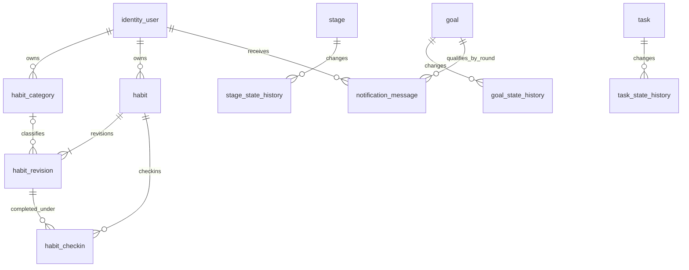

# 后续模块 SQL 第一阶段验收

本文件记录已结束的 SQL 第一阶段。后续已进入后端开发，当前进度和开发库手工补齐结果见 [后端实现与启动说明](后端实现与启动说明.md)；下文“不连接开发库”等边界仅指 SQL 第一阶段。

本阶段实现剩余 SQL 并在真实 PostgreSQL 17.11 的专用校验库完成复核。没有开发新的 Java 或前端，没有连接或部署开发库。每次实际结果、时间、分组数量和输入文件 SHA-256 见 [sql-check-results.json](sql-check-results.json)；SQL 校验不代表后续 Service、权限过滤或 HTTP 业务已经实现。

## 交付和表关系

现有 18 张表不合并、不重建；新增 8 张后，新库完整初始化为 26 张业务表。12 个 Maven 子模块保持原样。

| 所属模块 | 新内容 | 源 SQL |
|---|---|---|
| habit | habit_category、habit、habit_revision、habit_checkin | [habit.sql](../../backend/app/src/main/resources/sql/habit.sql) |
| notification | notification_message | [notification.sql](../../backend/app/src/main/resources/sql/notification.sql) |
| goal | goal_state_history；goal 增加 completion_condition_met、completion_round | [goal.sql](../../backend/app/src/main/resources/sql/goal.sql) |
| stage | stage_state_history | [stage.sql](../../backend/app/src/main/resources/sql/stage.sql) |
| task | task_state_history | [task.sql](../../backend/app/src/main/resources/sql/task.sql) |
| identity | 新增 23 项权限、5 页及 18 个按钮的准备态初始化 | [identity.sql](../../backend/app/src/main/resources/sql/identity.sql) |
| dashboard | 4 个只读查询原型，不增加表 | [dashboard.sql](../../backend/app/src/main/resources/sql/dashboard.sql) |
| statistics | 8 个只读查询原型，不增加表 | [statistics.sql](../../backend/app/src/main/resources/sql/statistics.sql) |

所有关联均为逻辑关联，没有物理外键、级联、触发器或迁移版本链。下面的连线表示应用必须校验的关系：



habit 只保存主体和当前修订号，不关联目标／阶段／任务。规则、资料、分类和生命周期存完整修订快照。一个打卡只引用打卡当时的修订；后续换分类或改规则不会改写它。分类逻辑删除后禁止新的选择，既有引用和历史仍保留；当前分类未变时允许继续保留该引用。

不增加习惯总数或每日数量限制；每日每习惯一次打卡，周期仅“每天”或“指定星期”。可选 HH:mm 为提示时间，不创建自动提醒或额外完成门槛。

## 数据约束及应用职责

数据库负责有效分类名称唯一、修订号唯一、同习惯同日期仅一个有效打卡、同目标同收件人同轮次仅一条通知、同主体同版本同类型状态事件唯一，以及状态枚举、非负版本、成对时间和有限日期等行内检查。字段含义均已写入 COMMENT。

数据库不会通过普通 CHECK 冒充跨表检查。后端阶段仍须在同用户行锁事务中保证：

- habit.current_revision_no 指向真实、同用户的修订，修订连续递增、生效日不倒退，实际动作才新增快照。
- 创建／修改只对今天生效，不能修改封存日期；只允许今天打卡或撤销，不补录。IANA 时区合法性、时区延后生效和 history_locked_through 只前进由公共日历能力维护。
- 每天一次有效打卡。重复打卡返回已有行；撤销保留原行，再次打卡新增行。暂停或结束后可撤销当天打卡，删除后不允许撤销。
- 主体状态、修订、打卡、状态历史、目标达标缓存和通知一致提交；客户端不能提交 user_id、时间或累计耗时作为可信事实。
- 已归档／完成／删除、越权、版本或轮次过期的目标提醒不能确认完成。已读与处理独立，继续保持不完成目标，同轮不重发。
- 管理身份优先于保留的 USER。新四个模块的权限、菜单有效集和 Service 身份限制在后端阶段一并补齐。

状态历史和 habit_revision 是追加式事实，不提供修改／删除接口。部署时为业务数据库角色配置 SELECT、INSERT 权限，撤去这些表的 UPDATE、DELETE、TRUNCATE；本阶段不创建数据库账号或变更现有角色权限。开发使用的特权数据库连接不能被当作不可篡改保证。

## 习惯统计口径

不建立 habit_day，不每天生成占位行，不保存可计算的累计数和完成率。对每个习惯的每个日期：

1. 有有效打卡：完成 1／应做 1，按打卡引用的修订归类。
2. 没有有效打卡：取该日最后一个已生效修订。其状态 ACTIVE、未删除、开始日期已到且星期匹配时，完成 0／应做 1。
3. 其余日期不产生应做分母。今日改规则、暂停、结束或删除不抹掉已有有效打卡；撤销后重新按最新修订判断。

最终完成率为 sum(完成) ÷ sum(应做)，不平均单个习惯百分比；分母为 0 返回 NULL。TOTAL 从首个生效修订开始，WEEK 为周一至周日，MONTH／YEAR 为自然月／年，RANGE 为包含首尾日期的自定义区间；当前周期截到今天，不纳入未来天数。

习惯沿用原 business_date，时区变更不搬移旧打卡。执行和状态事件按查询时的有效账号时区切日，时间点区间统一为半开区间，支持跨午夜和夏令时。执行先累加毫秒再转秒；开放段按最后心跳＋超时、安排边界、当前服务端时间中的最早值封顶。逻辑删除的任务仍计入实际投入历史。

隔离样例特意包含：习惯 4／8 得到 50%，同日完成后换分类再暂停、删除后的历史、撤销后的重新判定、未分类、未来开始日期、周月年总统计；纽约 23／25 小时日，以及 161300 毫秒总投入与 160700 毫秒日期区间投入。当前对象状态与历史完成动作分开；任务同日两次完成可表现为 2 次完成动作、1 个完成任务。

## 历史与目标提醒的初始补齐

状态历史只记录真实创建、状态变化、归档恢复或删除。无变化保存、心跳不写历史。三个历史表分别归原业务模块，后续由各主体主链追加，不增加独立写入 CRUD 链路。

老对象缺少历史时，在人工初始化时写一个 BASELINE，仅说明初始化当时的状态，不能算作过去的完成。当前已完成任务只有 completed_at 有限、位于创建时间至初始化时间之间才导入一次 COMPLETION_IMPORTED；其他未知时间不推造。导入名称为初始化时可得的当前名称，不声称恢复当年的旧名称。只对本次新建基线的任务导入，重复执行或已有真实历史的对象不会再补。已逻辑删除对象也可保留基线和可信完成事实。

目标达标条件为“至少一条有效任务且全部完成”，使用精确条件，不使用舍入后的进度百分比。completion_condition_met 仅为提醒条件缓存，completion_round 仅为轮次；不保存百分比。未达标转达标才加一轮，回落不清零并使旧待处理提醒失效。老目标的首轮消息发送时间取初始化当前时间，不伪造旧提醒。

提醒仅属于有效普通用户。ADMIN／SUPER_ADMIN、停用或缺少有效所属账号的旧数据不能生成个人提醒。后续任务变化、目标完成／归档等写入同事务维护这些字段与消息，本阶段不将新字段部署到仍未完成这些联动的后端。

## 新库与已有库的手工执行范围

本节为后端验收后的实施说明，本次没有执行开发库初始化。

新库：关闭所有 ready／bootstrap 标记，顺序为 identity → goal → stage → task → planning → execution → habit → notification。每份文件自带 BEGIN／COMMIT；dashboard.sql、statistics.sql 是只读 PREPARE 原型，建库无需执行，也不在应用启动时装载。

已有 18 表库：不要整份重跑 identity 或 goal 等旧表文件，不 DROP 旧表，不清理 public。先检查同名新对象和 goal 新列是否存在；只选择缺少的定义，并核对既有类型、缺省值、约束、索引与本次源 SQL 一致，不对不兼容对象强行覆盖。

| 手工选取的标记块／文件 | 内容 |
|---|---|
| goal.sql：GOAL CONDITION UPGRADE | 只补目标两列及对应行内约束 |
| goal.sql：GOAL STATE HISTORY | 新目标历史表及索引／注释 |
| stage.sql：STAGE STATE HISTORY | 新阶段历史表及索引／注释 |
| task.sql：TASK STATE HISTORY | 新任务历史表及索引／注释 |
| habit.sql 建表部分 | 四张新表及其注释／索引 |
| notification.sql 建表部分 | 一张新表及其注释／索引 |
| identity.sql：REMAINING AUTHORIZATION | 只登记新权限菜单；准备阶段仍禁用隐藏 |

这些新增定义应放进同一个人工维护事务，不在外层事务中嵌套原文件的 BEGIN／COMMIT。维护时暂停业务写入，或在同一事务先按 id 对相关 identity_user 行加 FOR UPDATE 锁。对已归档目标遗留安排、缺失所属关系、异常完成时间和已存在新对象先列出检查结果，不擅自清理旧事实。旧归档安排继续按 Execution 的预览和单独已批准处理流程操作。

后端全部验收后，人工事务内按顺序执行：

1. SET LOCAL asterway.remaining_backend_ready = 'true'，SET LOCAL asterway.remaining_history_bootstrap = 'true'。
2. 执行 REMAINING GOAL／STAGE／TASK HISTORY BOOTSTRAP 三段。
3. 执行 notification.sql 的 REMAINING NOTIFICATION BOOTSTRAP。
4. 执行 identity.sql 的 REMAINING AUTHORIZATION，启用动作权限，前端标记保持 false。
5. 核对后提交。需要重复初始化时仍仅选这些标记块，不重跑 CREATE TABLE。

两项初始化标记与 remaining_frontend_ready 都是 SQL 的事务级标记，只在人工 SET LOCAL 时生效；不配置环境变量、YAML、数据库全局参数或自动迁移。默认重放不回填业务事实、不发送提醒。之后前端另外确认并完成才启用 remaining_frontend_ready；这轮不实现或开放页面。

## 权限菜单

准备态登记 23 项权限，默认禁用，关系默认只授予内置 USER；菜单五页、十八按钮全部隐藏禁用。后端启用后页面仍隐藏。自定义、逻辑删除的同代码对象或不匹配的菜单契约会拒绝，避免静默占用；重复启用不推进无变化版本。

- 分类：habit:category:list/create/update/delete。
- 习惯：habit:habit:list/read/create/update/pause/resume/end/reopen/delete/history。
- 打卡：habit:checkin:create/cancel/read。
- 通知：notification:message:list/read/mark_read/handle。
- 看板：dashboard:board:read。
- 统计：statistics:report:read。

目标／阶段／任务历史沿用各自已有读取权限，不新增独立写权限。现有账户、成长和 Execution 授权保留，旧目标删除退役规则保持。新权限对管理角色的直接授权会移除；实际的超级管理员例外和混合身份过滤仍由下一阶段后端共同接入。

## 实际校验与复跑

从仓库根目录执行：

```powershell
.\scripts\review_remaining_sql.ps1
```

脚本使用本机现有 WSL Ubuntu／PostgreSQL／psycopg2，不安装新依赖或框架，固定连接 asterway_identity_test，并检查实际数据库名。新库、旧库升级、原成长 SQL 回归和原 Execution SQL 回归各有随机 schema，使用事务回滚。真实双连接唯一索引竞争只在本次随机 schema 提交竞争赢家，观察第三连接中的真实锁等待，最后清理该 schema；不清理其他 schema 或修改 public。

复核直接读取当前源文件，既有库的 18 表基线通过去除新标记块构造，未另存一套旧 DDL。既有库样例保留账号、目标版本、阶段任务、周日计划、安排历史、执行段和已启用的 Execution 授权，并与新库的列／约束／索引结构进行比对。原成长／Execution 校验只有因增加三张历史表而变化的“6→9”“18→21”表数断言适配，其余原样复跑，不改写历史报告。新报告记录全部输入的 SHA-256，并在结束时再核对文件未变化。

结果范围包括行内约束、部分唯一索引、手工初始化幂等、准备／后端／前端三态授权、统计和看板只读原型、旧库数据保留、真实并发唯一性及既有 SQL 回归。没有新增或运行 Java 单元、系统、集成测试，没有提前开发 Entity、Mapper、Service、Controller。SQL 审阅后再按已批准顺序进入后端分层开发。
