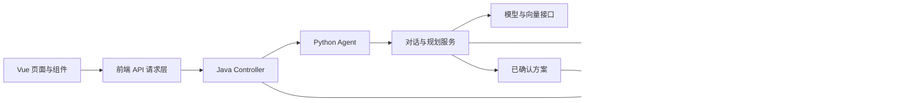

# Asterway 代码阅读说明

本轮给现有源码补充普通注释，解释文件用途、输入字段、方法、条件分支、具体调用、页面绑定、样式和数据库语句。Java 使用 `//` 与 `/* ... */`，Python 使用 `#`，Vue 模板和 XML 使用 `<!-- ... -->`，SQL 使用 `--`。不使用 Javadoc 或 Python 文档字符串。

注释覆盖 `backend`、`frontend`、`agent` 和 `scripts` 的自有实现与配置。依赖目录、编译产物、锁文件中的依赖快照、IDE 个人配置、私密凭据和上传资料不作为源码改写。

## 先看一条完整请求

普通业务由 Java 核对登录身份、权限和所属用户后读写。成长助手可以查询、整理草案、生成复盘；创建或调整业务安排必须经过用户确认，再由 Java 在一个事务里提交。

## 后端按什么顺序读

1. `app/src/main/java` 只有启动类；`application.yml` 是公开配置模板，`sql` 目录按业务模块放数据库定义。
2. `common` 放统一错误、认证、权限、共享配置和跨模块联动约定。
3. `dto` 描述收到的参数，`vo` 描述返回页面的数据，`entity` 对应数据库记录。
4. `controller` 接收 HTTP 请求；`service` 规定可调用的业务方法；`service/impl` 执行真正的规则。
5. `mapper` 接口对应 `resources/mapper` 的 XML。XML 里的 `id` 对应 Java 方法名，`#{字段}` 表示参数绑定，不是把文字直接拼入 SQL。

`@...` 是参与程序运行的注解，不是文档注释。例如 `@Transactional` 管理事务，`@PreAuthorize` 检查权限，`@NotNull` 等限制输入。原有注解与接口约定保留。

## 前端按什么顺序读

`src/main.js` 创建应用，`router` 确定路径对应的页面，`api` 统一发送请求，`views` 组织整页，`components` 提供可复用区域，`composables` 组合加载、监听、轮询和清理行为，`stores` 保存共享状态。

Vue 文件中：

- `<script setup>` 读取输入、维护状态、发送请求并定义事件处理。
- `<template>` 把状态显示出来。`v-if` 决定是否渲染，`v-for` 遍历数据，`v-model` 双向同步输入，`@事件` 绑定处理函数，`:属性` 使用脚本里的值。
- 开发模式会把模板里的 HTML 注释保留为节点。`KeepAlive` 内只允许一个被缓存的组件，所以这部分说明必须写在 `KeepAlive` 外面；不能把注释当作永远不参与编译的文字。
- `<style>` 决定布局与外观；`scoped` 将样式范围限制到当前组件。
- `ref` 保存会更新页面的状态，`computed` 根据其他状态自动重算，`watch` 在指定值变化时执行处理。
- 方案提交成功只表示业务创建或改期已经落库，不表示用户已经完成任务。实际完成情况由进度查询读取真实记录。

## Agent 按什么顺序读

`run.py` 是本机启动入口；`app/main.py` 装配路由、数据库、工作流与后台任务。`api/routes` 接收 Java 转发的请求；`core/context.py` 核对内部密钥与当前用户；`schemas` 校验数据结构；`services` 组织流程；`repositories` 访问存储；`db` 定义表映射；`tools` 提供受控业务查询；`llm` 调用模型并分类处理错误。

对话轮次从 `turn_service.py` 进入。普通查询受 `tool_budget.py` 控制；规划草案由 `conversation_planning.py` 整理；`workflow_service.py` 保存方案版本与状态；`workflow_graph.py` 保存确认边界；Java 提交成功后，`workflow_progress_service.py` 读取真实进度。复盘与调整分别从 `review_service.py` 和 `review_planning_service.py` 继续。

`await` 表示等待异步操作完成；`async with` 管理异步资源的进入和退出；`yield` 逐项交付结果；`try/except/finally` 分别表示尝试执行、处理错误、一定执行收尾。Python 多行字符串中有些是提示词或 SQL 数据，仍保留原字符串内容；它们与已转换成普通 `#` 注释的文档字符串不同。

## 严格 JSON 配置怎样阅读

JSON 不允许写 `//` 或 `/* ... */`，因此 `frontend/package.json` 保持合法 JSON，字段说明集中列在这里。

| 字段 | 含义 |
|---|---|
| `name` | 前端工程在包管理器中的名称。 |
| `private: true` | 阻止把这个业务工程误发布到公共包仓库。 |
| `version` | 当前前端工程的包版本。 |
| `type: module` | JavaScript 文件采用 `import`、`export` 的模块方式。 |
| `scripts.dev` | 启动 Vite 本地开发服务。 |
| `scripts.build` | 生成可以部署的前端构建产物。 |
| `scripts.preview` | 本地预览已经生成的构建产物。 |
| `scripts.test:agent` | 运行已有的助手交互逻辑检查。 |
| `dependencies` | 页面实际运行需要的库。 |
| `devDependencies` | 开发和构建时使用的工具。 |

| 依赖 | 在项目中的作用 |
|---|---|
| `vue` | 组件、响应式状态和页面渲染。 |
| `vue-router` | 页面路径、导航和路由守卫。 |
| `element-plus` | 表单、表格、按钮、弹窗等基础组件。 |
| `echarts` | 统计图表。 |
| `markdown-it` | 将助手回复的 Markdown 转成受控 HTML。 |
| `@fontsource-variable/geist` | 页面字体资源。 |
| `@lucide/vue`、`@phosphor-icons/vue` | Vue 图标组件。 |
| `vite` | 开发服务器、资源处理与生产构建。 |
| `@vitejs/plugin-vue` | 让构建工具理解 `.vue` 单文件组件。 |

依赖名后面的版本约束保持原样。`package-lock.json` 记录实际解析版本、下载地址、完整性校验值和依赖关系，由包管理器维护；不能往其中插入普通注释。

## 数据库和从零验证

[数据库结构阅读说明](数据库结构阅读说明.md) 按当前实际表结构列出全部表、字段、约束和索引。源 SQL 的注释解释具体建表、初始化、查询和授权语句；数据库 `COMMENT ON` 是保存在数据库里的结构说明，不是 Java 文档注释，也不会改变字段值。

本次数据重置的约定为：物理清空所有旧账号、业务事实和 Agent 用户记录，保留系统角色、权限、菜单、授权关系、账户系统设置及固定向量配置定义；重新创建一个随机初始密码的超级管理员，首次登录必须改密。实际密码只写入被版本管理忽略的私密文件。

验证时先用新超管检查系统配置和授权，再自行注册普通用户验证个人业务。管理身份只做管理，不能直接使用成长助手、任务、计划和执行计时等个人业务。
