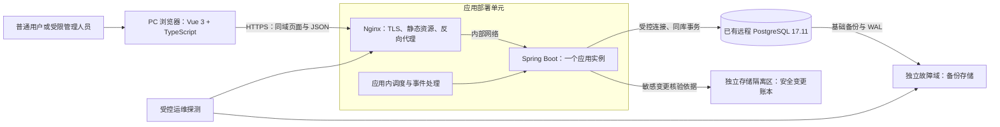
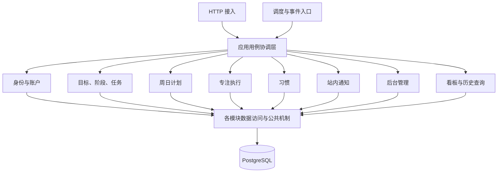
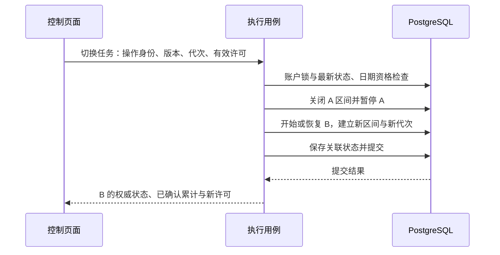

# Asterway V1 系统架构设计

> 文档版本：V1.3（统一技术版本及远程数据库部署；保持无物理外键）  
> 日期：2026-10-19  
> 状态：当前系统架构基线；运行效果尚未验证。  
> 技术依据：[V1模块划分与技术选型 V1.3](V1模块划分与技术选型.md)、[12技术版本基线与环境核验](../12-技术版本基线与环境核验.md)。  
> 业务与质量依据：[业务逻辑 V4](MVP业务逻辑V4.md)、[功能清单 V1.1](MVP功能性需求清单.md)、[非功能性需求分析](MVP非功能性需求分析.md)。  
> 详细设计：数据库、接口、工程与实施计划见[项目文档入口](../README.md)。

**用户补充确认：整个数据库禁止物理外键，所有关联为逻辑关系；不使用触发器模拟引用完整性或数据库级联。服务层在既定锁顺序和事务内校验存在性、归属、关系及删除条件，并提供孤立引用巡检。该要求同样覆盖 Spring Session 等框架表。**

## 1. 架构范围与统一结论

采用 **前后端分离、模块化单体、单应用实例、单 PostgreSQL 数据库、同域访问、独立备份存储** 的 V1 架构。

前端使用Vue 3.5.44、TypeScript 6.0.3、Vite 8.3.4、Vue Router、Pinia、Element Plus，构建环境为Node.js 24.22.0 LTS与npm 11.19.1；后端使用JDK 17、Maven 3.9.4、Spring Boot 3.5.16、Spring MVC、MyBatis XML（Starter 3.0.5）、Spring Security。已有远程PostgreSQL 17.11保存业务事实、会话及持久化事件，Flyway管理数据库变更。服务器已装pgvector 0.8.7，MVP不使用向量业务。全部精确依赖及核验方式以[12技术版本基线](../12-技术版本基线与环境核验.md)为准。

8 个业务模块仍为身份与账户、目标与任务、计划安排、专注执行、习惯、看板与历史统计、站内通知、后台管理。它们在同一 Java 进程内协作，不拆成独立服务。公共工程支撑提供机制，不接管业务规则。

本设计采用 NFR 中的参考负载、计时确认、通知时效、备份恢复等数字作为设计与验证目标，保留其“建议基线”来源。文档定稿表示实现路径已经明确，不表示性能、安全、容量或恢复演练已经通过。

### 1.1 架构决策记录

| 编号 | 决策 | 选择依据与影响 |
|---|---|---|
| ARC-001 | 模块化单体，共用一个业务数据库 | 当前跨模块事务紧密，个人维护成本优先；业务模块不等于部署服务 |
| ARC-002 | 上层应用用例统一协调跨模块写入 | 避免目标、计划、执行互相修改数据或循环调用；一次用例使用明确事务 |
| ARC-003 | 同账户关键命令串行化，数据库约束与版本校验兜底 | 统一处理跨页面、跨设备、调度与后台账户撤销的并发竞争 |
| ARC-004 | 执行事实与计划安排分别保存 | 当前改期不留旧安排副本，真实投入不迁移；完成与计时结束分别管理 |
| ARC-005 | HTTP JSON 命令、短期确认许可与有界刷新 | 满足 V1 交互与计时新鲜度要求；不引入 WebSocket 服务或独立消息中间件 |
| ARC-006 | 同库持久事件，至少一次处理，业务去重 | 核心事务与事件一起保存，通知投递失败可补偿 |
| ARC-007 | 服务器按账户业务时区处理日期 | 客户端时间不决定执行资格；历史保留当时日期与时区依据 |
| ARC-008 | 服务端可撤销会话，逐请求校验有效身份 | 改密、禁用、删除及角色变更不能被旧会话绕过 |
| ARC-009 | Linux 单机容器化部署与 Nginx 同域入口 | 明确运行单元、网络和持久卷；初期单点风险由监测、备份和恢复流程承担 |
| ARC-010 | 物理基础备份、连续 WAL 归档及独立安全核验依据 | 区分应用重启、存储灾难和恢复旧凭据风险 |
| ARC-011 | 业务历史长期保留，日志与安全审计分别轮转 | 删除、缓存清理及审计轮转不抹去真实贡献 |
| ARC-012 | 当前不引入 Redis、微服务或向量库 | 先用现有技术满足需求；扩展须有真实瓶颈、用例与验证依据 |

## 2. 系统上下文与运行单元

| 单元 | 负责内容 | 访问与持久性边界 |
|---|---|---|
| 浏览器前端 | 页面、表单、清单、反馈与计时估计展示 | 不直连数据库；不以本地任务树或计时值作为持久事实 |
| Nginx | 静态前端、HTTPS、`/api/v1` 转发、受控请求大小与入口限流 | 唯一公共 Web 入口；API 错误不回退成静态首页 |
| Java 应用 | 身份、业务用例、模块规则、查询、调度及事件补偿 | 单实例；模块内部调用不经过内部 HTTP |
| PostgreSQL | 业务数据、会话、执行控制、幂等和事件恢复依据 | 仅内部网络可达；应用账户不拥有任意修改结构的权限 |
| 备份与核验存储 | 独立副本、恢复链、恢复所需的安全变更依据 | 与运行磁盘独立；备份和安全账本分权限、分保留策略 |
| 运维探测 | 服务可用性、积压、恢复点年龄和风险告警 | 受控运维能力，不新增产品监控大屏或用户消息功能 |

独立备份与安全账本可以位于同一独立存储服务的不同受控区域；它们不得只是运行主机同盘的两个文件夹。账号、容量、费用及运维响应条件在发布准备时落实，不将此图当成已经购买的资源。

## 3. 逻辑分层与模块协作

### 3.1 各层责任

| 层次 | 责任 | 约束 |
|---|---|---|
| 接入层 | 参数格式、身份入口、HTTP 结果、追踪标识 | 不直接调用 Mapper 改业务状态，不拼接跨模块流程 |
| 应用用例协调层 | 校验当前资格、协调模块、事务、幂等与失败结果 | 跨模块写由此统一组织，不把业务分散到 Controller、调度器和事件监听器 |
| 模块业务能力 | 对自己拥有的数据执行规则、状态变更与业务历史记录 | 通过公开能力交给用例使用；不越过所有者直接更新别的模块表 |
| 查询能力 | 基于统一事实查询详情、看板、历史和统计 | 可以使用只读关联 SQL，不维护第二套业务状态机 |
| 数据与工程支撑 | MyBatis XML、事务、时钟、事件投递、日志、迁移 | 只提供机制；不在基础类中隐藏目标延期或习惯结算规则 |

应用用例协调层是逻辑职责，不要求新增第九个业务模块或独立工程。后续代码结构设计决定具体类、包和接口；本阶段不规定每个动作都必须再加一层空接口。

### 3.2 数据所有权

| 业务所有者 | 持有的核心事实 | 其他模块的使用方式 |
|---|---|---|
| 身份与账户 | 身份、凭据、固定角色、账户状态、时区与会话撤销依据 | 提供身份及授权信息；后台账户修改通过该模块能力完成 |
| 目标与任务 | 目标、阶段、任务、完成事实、进度条件轮次、结束快照和业务节点 | 用例取得资格、更新任务状态和目标条件；通知不能自行决定目标完成 |
| 计划安排 | 逻辑周日计划、当前安排、排序、周期待处理及计划历史依据 | 执行用例取得可执行范围；不复制任务或管理实际耗时 |
| 专注执行 | 执行、有效区间、控制权、确认点及修正依据 | 任务完成、改期、账户撤销等用例按规则协调执行能力 |
| 习惯 | 周期版本、生命周期、当天完成与日结算 | 看板与统计读取事实，不把习惯计入目标任务进度 |
| 通知 | 通知、已读、处理、失效和同轮去重身份 | 消费可靠事件；确认动作转回目标结束用例 |
| 后台管理 | 受限管理入口、两项站点配置及管理操作要求 | 不取得他人成长正文；角色与账户仍由身份模块维护 |
| 看板与历史 | 统一查询口径及可重建的派生结果 | 原始事实归上述模块，缓存不能成为唯一历史来源 |

依赖方向保持“入口 → 用例协调 → 各模块能力 → 数据访问”。例如归档目标由用例同时调用目标、计划、执行能力，不由目标模块反向调用执行模块、再由执行模块调用目标模块。

## 4. 请求、响应与读取流程

### 4.1 普通命令

1. 接入校验身份、请求格式、CSRF 及资源限制，建立追踪标识和操作意图身份。
2. 先执行与本次操作有关的到期补偿。补偿使用独立的短事务，合法的周期结算和失联暂停不能因随后用户命令被拒绝而回滚。
3. 用例开启业务事务，取得规定的锁，重新读取账户、对象、关系、版本及日期资格；事务外的预检查只用于快速反馈。
4. 调用各模块能力，保存必要状态、区间、完成事实、业务历史、必需审计及可靠事件。
5. 提交后返回已保存结果及当前版本。数据库提交结果不确定时返回待核实语义，由幂等身份查询或重试确认。

阶段 2 与阶段 3 之间可能再次跨越边界。业务事务必须重新检查；发现新到期事项时结束当前尝试，先可靠补偿，再用相同操作意图重新校验。不能在一个最终会回滚的失败事务里执行必要清理。

### 4.2 看板与历史读取

访问当前看板、目标或计划时，入口先协调相关到期检查，再调用只读查询。无到期工作时可以快速跳过写事务。查询模块本身不修改目标、习惯或执行状态。

多项相关统计采用一次聚合查询，或使用短的只读一致快照事务，避免目标总数和完成数来自不同提交版本。只读统计不持有账户命令锁；跨请求分页使用稳定排序和明确游标语义，细节在接口设计中定义。

过去计划的内容始终只读。从当前任务入口改期会撤销原有效安排；因此旧日安排列表可以不再显示该条目，实际执行与完成事实仍从历史入口查询。这符合 V4，不把“过去只读”误解成必须保留改期副本。

### 4.3 HTTP 契约方向

使用 `/api/v1` 下的 HTTP JSON 接口，成功返回持久结果，输入错误、未登录、无权操作、对象不存在、状态冲突与服务故障分别表达。不得把所有错误包装成 HTTP 200。

统一响应至少能表达业务结果、稳定错误码、友好信息及追踪标识；列表、操作状态与计时快照按用途定义结构，不为统一外壳重复嵌套数据。具体路径、字段、状态码、分页和 DTO/VO 在接口设计阶段确定。

## 5. 事务、并发与幂等

### 5.1 统一写入边界

所有会改变个人业务状态的命令、到期补偿和事件处理，都遵守账户级命令控制锁。该控制记录在创建账户时可靠建立；物理存储名称留待数据库设计。

V1 使用 PostgreSQL `READ COMMITTED`，关键写入在取得账户控制行锁后重新读取并校验。锁覆盖任务切换、改期、完成、归档、阶段与任务修改、习惯变更、时间修正、周期处理和账户撤销。不同账户可以并发，单个账户的相关写入短暂串行。

关键写事务首先取得运行护栏的共享锁并核验当前运行代次；启动换代取得同一护栏的排他写权限。旧事务结束后新代次才能生效，旧实例后续事务因代次不符拒绝执行，避免旧连接池在新实例就绪后继续写入。

锁内只进行有界数据库操作。密码计算、外部验证、备份、外部安全账本写入和长历史查询放在账户业务锁外；外部结果进入事务后仍须校验用途、版本与有效性。

统一锁顺序为运行护栏 → 必要的全局管理不变量锁 → 按稳定标识排序的账户控制锁 → 业务对象。后台账户或配置关键写入按此顺序锁定操作者与目标，随后重验权限及最后一个可用超级管理员约束；其他流程不得以相反顺序取得这些锁。

数据库主键、唯一、非空、行内检查、时间排除、条件更新和版本校验继续作为兜底，不建立物理外键。引用存在性、同账户归属和父子一致性由持锁应用用例校验；删除前在同一事务检查并显式处理引用，不能仅靠 Java 内存锁。[行锁](https://www.postgresql.org/docs/18/explicit-locking.html)、[事务隔离](https://www.postgresql.org/docs/18/transaction-iso.html)

### 5.2 必须原子生效的业务用例

| 用例 | 同一事务中的必要变化 | 拒绝或失败结果 |
|---|---|---|
| 开始、继续、切换 | 校验当前资格；暂停 A 并关闭区间；建立或恢复 B 的区间与控制权；必要时更新首次执行状态 | 全部回滚，保留操作前合法状态；独立补偿不受影响 |
| 改期或移出 | 必要时暂停；迁移或撤销当前周日安排；保留原执行归属与累计 | 不留一半迁移，也不复制任务 |
| 完成任务 | 结束相关未结束执行；保存唯一完成事实；更新当前考核与目标条件轮次；保存必要事件 | 不允许只标记任务完成而遗漏执行或进度联动 |
| 归档目标 | 检查所有相关执行均已结束；目标归档、有效安排撤出和业务节点 | 包含暂停执行的未结束记录存在时直接拒绝，不自动替用户结束 |
| 主动结束目标 | 校验用户确认；结束相关执行、记录真实进度快照、撤出未完成安排和失效旧条件 | 子任务不被伪造完成 |
| 删除任务或计划 | 先检查执行已结束；清除无事实部分或保留历史身份；撤出安排、更新当前考核 | 真实投入、完成与原归属不能级联删除 |
| 修改或完成习惯 | 规则或状态节点、当天判断、唯一完成或结算依据 | 当天已有有效完成保持 1/1；过去不回算 |
| 用户正常改密 | 先要求用户结束全部未结束执行；确认无遗留后保存新凭据、安全版本、全部既有会话失效依据及必要记录 | 用户取消结束则不提交改密；保存失败保留原密码与会话，不以自动暂停代替前置条件 |
| 管理员禁用、删除或会话撤销 | 关闭可信区间并暂停、更新账户安全状态、失效依据及必需审计 | 不等待被管理用户确认；不能只删 Cookie 而保留有效授权，独立核验协议另见第 12 章 |

Spring 事务与 MyBatis 必须使用同一个数据源及事务管理边界；不在 Mapper 中手动另开连接提交，不依赖类内自调用自动产生代理事务。[MyBatis-Spring 事务](https://mybatis.org/spring/transactions.html)

### 5.3 数据库设计必须落实的不变量

- 同账户同业务周的逻辑周计划唯一；同业务日的逻辑日计划唯一，不预设日计划一定独立建表。
- 单任务只有一个当前安排；同时至多一个未结束执行；同账户至多一个运行区间，允许多个暂停执行。
- 区间采用半开区间 `[开始, 结束)`，同账户有效专注区间不重叠，相邻区间可以共用边界。
- 同任务完成事实、同习惯同业务日完成与结算、同目标条件轮次通知均须去重。
- 父子关联和用户归属必须一致；目标不提供删除语义；保留历史身份不能重新加入任务池。

物理设计使用唯一/部分唯一索引、非空、行约束及必要的区间排除约束；表间关联仅记逻辑关系，不建立物理外键，也不通过触发器模拟外键。跨行业务条件在账户锁内校验；配套索引支持查引用、事务删除和巡检。[PostgreSQL 约束](https://www.postgresql.org/docs/18/ddl-constraints.html)、[部分索引](https://www.postgresql.org/docs/18/indexes-partial.html)

### 5.4 幂等与冲突

写请求以稳定操作标识、账户、操作类型及参数指纹识别同一意图。同一标识携带不同参数时拒绝；重复请求返回已确定结果，不重新生成完成、区间或通知。计划创建、习惯完成等操作还必须有业务唯一键，不能只依赖短期请求记录。

对象版本用于防止旧页面覆盖新状态；执行控制另使用代次。状态冲突返回当前权威状态，客户端先同步，不能自动将旧请求改成一次新的接管或完成。

事务死锁、序列化等技术重试只针对能够安全重放的短事务，使用相同意图与有限次数；最终冲突或资源不足须明确返回。不得无限重试，也不得把结果不确定误报成“未保存”。

核心业务与确认点提交后才能返回成功，保留 PostgreSQL 的持久性保护；不能通过关闭 `fsync` 或为这些写入使用异步提交换取性能数字。[WAL 与提交持久性](https://www.postgresql.org/docs/18/runtime-config-wal.html)

## 6. 专注执行架构

### 6.1 状态和权威来源

执行状态为 `RUNNING / PAUSED / ENDED`，独立于任务是否完成、计划安排和归档状态。一次执行可以包含多个区间；暂停不增时，继续原执行追加新区间，结束后再执行才新建一次并从零计时。

账户执行控制状态保存当前执行、区间、控制页面与会话、控制代次、下一确认序号、短期确认许可、最后确认点 `T`、计划资格截止和应用运行代次等必要依据。页面实例标识不是新的用户身份，也不能代替登录会话。

服务端使用受监测的权威时间。获得账户锁后读取当前时刻，不能用事务开启时已经固定的旧时间判断排队后请求是否过期；客户端时间、上报秒数和定时器回调次数不作为投入事实。时钟异常时停止延长可疑区间，保留已确认值并告警。

### 6.2 确认协议与工程默认值

| 参数 | 本设计初始值 | 与 NFR 的关系 |
|---|---|---|
| 客户端确认发送周期 | 10 秒，一次只允许一个确认请求在途 | 给健康条件下成功持久化间隔 ≤15 秒留余量 |
| 一次性确认许可有效窗 | 自最后确认点 `T` 起 15 秒 | 超窗不再接受该区间续时；属于通信新鲜度工程参数 |
| 过期执行扫描周期 | 5 秒 | 扫描、锁等待、排队和提交总和须满足 `T+45秒` 内保存暂停的目标 |
| 活动页面状态刷新周期 | 2 秒，有界且不重叠 | 与事件处理共同验证状态、通知及账户撤销 5 秒收敛目标 |

这些是工程配置，不新增到超级管理员的两项产品配置中。只有在验证过业务含义和影响后才能调整；不能把许可窗放宽到 45 秒后仍称未知离线时间不计入。

开始、继续和每次成功确认，只签发一个下一序号的一次性随机许可，绑定当前区间、控制代次、控制页面及会话，不预发离线序列。确认必须在请求接收和取得账户锁后均校验新鲜度；实际保存前重新校验截止条件。

成功确认在同一事务消费旧许可、保存新 `T`、推进序号并生成下一许可，提交后才返回。只允许当前控制页面获得下一许可；其他页面观察状态，不替它发送保活。

重复确认不推进 `T`。响应丢失时，同一请求重试只能取回已经提交的结果；仅在控制权、序号及许可有效性仍适用时返回原有下一许可，不生成新许可延长原期限。过期或已换代时返回当前状态。

### 6.3 冻结、断网与迟到请求

若最后确认在 `10:00:00`，旧许可到 `10:00:15` 过期，冻结页面在 `10:00:40` 发来请求：先按 `10:00:00` 截断并暂停、使旧代次失效，再拒绝续时。不能因尚未超过 45 秒而把整个空档补满。

扫描尚未来得及运行时，请求入口也执行相同过期处理。状态查询、刷新或重连不为旧区间重新签发许可；只有用户明确继续，才能从当前服务端时刻建立新专注区间。

15 秒许可配合 5 秒扫描给 45 秒持久暂停目标留出预算；是否能在参考负载和资源竞争下满足上限，必须实测。服务停机期间不承诺扫描准点执行，启动恢复门禁负责截断遗留状态。

该协议判断的是窗口内的新鲜通信，无法证明用户始终专注，也无法识别小于正常窗口的全部短暂冻结。页面不可见不直接暂停，仍能有效确认即可继续；实际冻结、休眠与断网导致许可过期则暂停。[浏览器页面生命周期](https://developer.chrome.com/docs/web-platform/page-lifecycle-api)

### 6.4 切换、接管与结束

- 当前控制页面持有效许可主动暂停、结束或切换，可把该动作作为即时最终确认，旧区间止于服务端动作时刻。
- 其他页面或设备明确接管时，先同步当前版本；它不能替旧控制页面证明末段，旧区间止于旧 `T`，新区间从接管时刻开始，中间允许存在不计时空档。
- 旧许可过期后点击结束，先按旧 `T` 暂停，再结束执行；不能把点击时刻直接用作专注区间终点。
- 暂停执行可以在当前时刻结束，但专注耗时只取已保存区间，不包含暂停到结束的时间。
- 两设备竞争仅接受合法版本下的一次接管；换代后旧页面的确认、暂停或完成请求不能继续改变原控制状态。
- 正常系统退出先结束全部未结束执行；管理员撤销或强制退出使用自动暂停，不等待用户结束。

### 6.5 日期上界与受限补录

指定日期任务到该日本地结束、无日期周任务到下周一当地零点，执行资格终止。若边界先于未知尾段，区间止于最后可信确认点与合法上界的较早者；扫描延迟不补出边界外时间。本周无日期任务跨普通午夜可以继续，投入按当时业务时区切分实际日期。

异常中断的既有末段可按 V4 受限修正。账户锁内校验不早于区间开始、不晚于当前时刻、不越原计划边界、不覆盖主动暂停或后续恢复区间、不与本人任何有效区间重叠。保存原值、新值、修正时间和版本，以替换后的事实重新计算，不在原累计上再加一遍。

客户端可用单调时间辅助前台估计，但恢复页面必须重新读取服务端事实，不根据客户端睡眠时长补算。[浏览器时间测量边界](https://developer.mozilla.org/en-US/docs/Web/API/Performance/now)

## 7. 日期、时区与后台补偿

### 7.1 时间模型

绝对时刻、业务日期、时长分别表达。数据库持久化时刻与区间；业务资格根据账户生效的 IANA 时区计算。服务运行时区可固定为 UTC，不用服务器本地午夜代替所有用户午夜。

业务周按当地周一开始，终点为下周一当地零点。日期边界由时区规则推导，不统一加 24 小时或 7×24 小时；夏令时与跨日期线场景单独验证。区间分桶保存当时业务时区、计划归属和日期依据，后续改期或换时区不重排过去贡献。

设备有效时区用于自动匹配；服务端验证合法时区名称。已设置时区发生变化，按 V4 于旧时区当日结束后生效，并先暂停相关执行、记录生效节点。重复出现的当地日期不能重复勾选或重开已结算结果。

权威时间使用数据库的实际当前时间；长事务等待后不使用固定的事务开始时间判定许可有效性。应用与数据库均需时钟同步及跳变监测。[PostgreSQL 当前时间函数区别](https://www.postgresql.org/docs/18/functions-datetime.html)

### 7.2 调度机制和初始预算

采用应用内受控调度器，按持久化的到期身份、处理位置和重试依据分批处理。调度入口调用同一应用用例，不另写一套判断规则。进程重启后可重建待处理工作；内存定时任务本身不是持久队列。[Spring 调度机制](https://docs.spring.io/spring-framework/reference/integration/scheduling.html)

| 工作 | 初始触发策略 | 设计目标与保护 |
|---|---|---|
| 执行许可过期 | 每 5 秒扫描 | 优先短事务；连同排队、锁及提交验证最后确认后 45 秒内暂停 |
| 目标启动、延期、计划边界、习惯结算、时区节点 | 每 15 秒扫描到期记录 | 对照 NFR 边界后 60 秒目标；用户访问先补做相关状态 |
| 持久事件与通知 | 每 1 秒检查可处理批次，提交后可唤醒一次处理 | 正常服务下通知 5 秒内可查；总时延包含扫描、处理及页面刷新 |
| 服务探测 | 每 1 分钟 | 核查入口、身份关键依赖、核心查询和受控写入能力 |
| 启动积压 | 分批追赶，并限制单批时间及并发 | 对照参考数据集恢复后 5 分钟目标；到期资格不等待整批处理完才生效 |

调度线程只派发短工作；过期执行处理、普通周期补偿、事件消费使用分别有界的队列，初期各最多一个工作者，重统计另最多一个并发。计时确认和过期处理优先获取短事务资源，不能排在长周期批处理之后。批量大小、连接数量和超时在工程配置中限定并记录，不允许无界线程或全量历史加载。

### 7.3 处理顺序与幂等身份

同账户未处理边界按实际应生效时刻顺序处理。用户修改任务、规则或状态前先补齐已经结束的相关周期，防止用“今天的状态”代替昨天结束前的状态。

- 目标到期仅自动开始非主动归档、未结束的目标；延期按 V4 公式与逻辑到期点处理，不能每次刷新再额外加一段。
- 指定日任务按日边界暂停并形成唯一待处理依据；周结束后合并展示由周统筹，不能同时出现多张相同任务的处理卡片。
- 周期结束不自动复制或安排到下一周期。用户迁移后撤销旧有效安排，真实区间仍保留原发生日。
- 习惯日结算先检查有效完成，有则固定 1/1；否则按该日结束前最后有效规则和状态结算。今天的删除、暂停或规则修改不回写过去。
- 每个目标日期事件、账户周期、习惯业务日和时区生效节点都有稳定去重依据。处理记录与业务结果同事务提交；失败不推进为已完成。

处理积压时不能只看对象当前状态；必须能从规则版本、状态节点或尚未撤销的周期依据重建当时应发生的结果。数据库设计须覆盖这些恢复依据。

## 8. 可靠事件与站内通知

核心事务保存必要业务变化和待投递事件，采用同库 outbox 方式。事件是恢复投递的技术依据，永久业务历史另由所属模块保存。

1. 只有 `N>0 且 C=N` 的进行中目标进入完成确认条件；由目标模块维护条件轮次。任务删除引起有效集合变化时也使用同一规则。
2. 事件保存失败则必要核心事务失败；通知实际投递失败不回滚已经提交的任务完成。
3. 消费采用至少一次语义，以目标与条件轮次等业务身份去重；不能每次重试生成新业务身份。
4. 事件认领使用短事务和有期限处理权；释放认领锁后再处理。正式业务处理遵循账户锁在前的统一顺序，避免先锁事件再等账户造成死锁。
5. 通知写入和事件处理完成标记同事务。对象已结束、主动归档或条件轮次失效时记录失效结果，不能按旧事件重新推动目标。
6. 失败记录尝试时间、次数和错误类别，退避重试；长期失败保留待处理依据并告警，不静默删除。
7. 用户点击确认时重新进入目标结束用例校验；已读不等于结束，“继续推进”也不撤销任务完成事实。

正式处理在取得账户锁后，重验事件终态、认领代次与处理权，再写入结果。重试或错误记录也受认领版本约束；已过期的处理者不得把已完成或已失效事件覆盖回重试状态。

提交后的内存唤醒仅用于降低延迟，持久扫描负责恢复。单独使用 `@Async` 或 `AFTER_COMMIT` 监听不能覆盖提交后、投递前进程崩溃的窗口；这是本架构选择持久事件的原因。[Spring 事务事件的提交阶段语义](https://docs.spring.io/spring-framework/reference/data-access/transaction/event.html)

## 9. 安全、身份与管理边界

### 9.1 会话与授权

采用 Spring Security、服务端会话和 Spring Session JDBC。浏览器持有不可预测的会话 Cookie，服务端保存会话，账户安全版本及状态是撤销授权的最终依据。[Spring Session JDBC](https://docs.spring.io/spring-session/reference/guides/boot-jdbc.html)

生产同域 Cookie 使用 `Secure`、`HttpOnly`、明确的 `SameSite=Lax` 策略，路径与作用域按站点最小范围配置；状态修改采用 CSRF 防护，不能因前后端分离而全局关闭。登录前后的 CSRF 获取与更新、注销方法及具体响应由接口设计细化。[Spring Security CSRF](https://docs.spring.io/spring-security/reference/servlet/exploits/csrf.html)

框架建表脚本去除默认外键及级联，会话仓库必须同步适配：删除、注销、过期清理显式处理属性，属性写入与会话删除按父会话行锁串行，不能只改脚本而继续依赖默认级联。具体事务及巡检要求见数据库设计。

每次受保护请求检查当前账户存在性、启用状态、逻辑删除、凭据/安全版本与角色，不只信任会话建立时的快照。关键写入取得账户锁后再次检查，身份存储不可用时拒绝放行。改密或撤销成功后，旧凭据下一次受保护请求必须被拒绝。

本架构不新增闲置自动退出的产品规则，不把框架默认超时直接当作需求；会话工程配置必须遵循已有退出和撤销语义。运行重启可以保留仍有效的登录会话，但执行必须按第 11 章暂停；灾难恢复则使全部旧会话失效。

### 9.2 输入、密码与认证失败

用户名规范化和唯一性沿用 V4；密码按 Unicode 码点统一计数，保留完整 8–50 字符输入，采用已选 Argon2id，盐、成本与运行依赖在工程阶段验证。哈希计算放在短业务锁外，提交登录或改密前重新校验账户及凭据版本。

正常改密沿用 BL-AUTH-004：原密码、新密码及确认通过校验后，仍须先结束全部未结束执行，包括暂停中的执行；用户取消则不提交改密。改密成功注销全部既有会话并重新登录，不能借用管理员自动暂停流程绕过这一要求。

滑动验证由服务端校验用途、时效和一次使用，不信任前端布尔标记。凭据失败按规范化提交用户名计数，包含不存在的用户名；滑动失败只拒绝本次请求。5 次、5 分钟及友好提示沿用 V4，失败计数须可靠提交，不能因抛业务异常而被回滚。

所有用户文本以安全文本方式展示；SQL 参数使用 `#{}` 绑定，排序标识使用白名单与 XML 分支。业务 SQL 和结果映射必须遵循选型定稿第 6.4 节，不使用 SQL/结果映射注解或 Java Provider。V1 不启用 MyBatis 二级业务缓存，关键资格复核不得读到跨请求旧状态。

### 9.3 权限与后台

公开注册只创建普通用户。对象归属与父子关系由服务端从当前身份取得，拒绝客户端夹带所有者、角色或受保护状态。

管理员只在规定范围管理普通账户；超级管理员管理允许范围内管理员、用户和两项站点配置。后台账户接口不提供普通用户的目标、任务、习惯正文或个人执行控制能力。最后一个可用超级管理员的约束按全局管理锁串行检查。

后台变更及配置操作的必要审计与业务结果同事务；审计保存失败不返回操作成功。密码修改只记录事实和版本，不记录密码、哈希、会话令牌或验证秘密。

产品配置仅有站点显示名称、是否开放注册。确认周期、扫描、连接池、密码成本及备份参数均属于受控工程配置，不增加后台配置入口。超级管理员初始建立与灾难恢复属于受控运维流程，不开放任意注册高权限账户的 API。

## 10. 前端与数据通信架构

前端按已确认模块组织路由和页面能力，正式目录与组件层级在代码结构阶段定义。请求统一经过接口访问层；Pinia 管理当前身份、服务端快照和必要界面状态，不保存一份可独立完成业务变更的离线数据库。

| 数据 | 权威位置 | 浏览器处理方式 |
|---|---|---|
| 目标、阶段、任务、计划、习惯、完成与归档事实 | PostgreSQL | 接口查询与提交；未确认提交显示处理中，不提前显示已保存 |
| 区间、确认点及计时控制权 | PostgreSQL | 显示已确认累计和实时估计；只有控制页确认，观察页只刷新 |
| 会话与当前权限 | 服务端会话、账户状态和安全版本 | HttpOnly Cookie；不存入 localStorage 或请求 URL |
| 表单、筛选、折叠、弹窗和请求状态 | 页面内存 | 退出或切换账户清理敏感内容；草稿与正式数据明确区分 |
| 看板与历史统计 | 服务端事实查询，必要时可重建汇总 | 不把本地预计耗时或重复页面条目当作实际统计 |
| 运维密钥、备份和安全账本 | 独立受控存储 | 不下发前端 |

前端启动、重连、恢复可见和账户切换时，先校验身份并拉取当前快照，再展示受保护缓存和开放依赖旧状态的写入。退出时清理状态；接口响应带账户及请求代次校验，切换账户后忽略旧请求的迟到响应。

活动页面以不重叠的有界刷新同步相关状态；不可见页面降低普通刷新压力，正在控制执行的页面仍按确认协议工作，不能把可见性变化直接当作暂停。前端计时按服务端基点计算展示，不按回调次数加秒；许可过期后停止把估计当作持续执行。

无数据、加载失败、无权限、冲突、处理中和结果待确认分别展示。完成任务、删除、归档和结束执行使用各自语义。网络失败不自动重放带副作用的全新意图，重复确认按相同操作身份处理。

生产前端静态资源与 API 同域。带内容哈希的静态资源可长期缓存，入口 HTML 采用可更新策略；账户和业务 API 不进入共享缓存，受保护响应使用明确的禁止缓存策略。页面布局、空状态、异常和具体交互见[页面设计](../07-页面与前端交互设计.md)。

## 11. 部署、发布与服务启动

### 11.1 部署方式

应用采用Linux主机，Docker Compose管理Nginx与一个Java 17应用；连接用户已有的远程PostgreSQL 17.11，数据库由其主机按PGDG RPM方式管理。Node.js 24.22.0 LTS与npm 11.19.1仅用于构建前端，生产提供构建后的静态文件。应用仍为模块化单体，单一业务数据库和事务边界不因数据库远程连接而改变。[Compose单机生产部署](https://docs.docker.com/compose/how-tos/production/)

仅公开HTTPS入口及必要运维通道，应用与远程数据库通过受控网络访问；本机开发连接按实际网络配置受限来源和凭据。反向代理只信任来自自身的转发头，不让客户端伪造安全协议或来源。[Nginx代理能力](https://nginx.org/en/docs/http/ngx_http_proxy_module.html)

远程数据库数据目录及备份独立于应用容器生命周期，应用更新不删除数据库数据。应用、数据库、备份和迁移使用分别授权的身份；秘密通过受控环境或秘密文件注入，不进入前端包、源码和日志。实际端口、资源限额、数据目录及部署工具版本在部署准备时登记。

开发和测试使用真实PostgreSQL 17.11，数据库约束与时间并发测试不用H2替代。开发、测试、生产使用隔离数据库与凭据，测试使用合成数据。运行实例和btree_gist扩展按12核验；服务器已有pgvector RPM不构成启用vector扩展或新增向量功能的要求。环境部署及验证在实施阶段完成。

### 11.2 启动与恢复门禁

1. 加载并校验工程配置、依赖版本和数据库结构版本。生产迁移采用受控单次作业，失败时应用保持未就绪。
2. 确认只有一个 V1 应用实例能够进入工作状态：用独立连接持有数据库会话级独占所有权锁，认领失败不就绪；启动换代按第 5.1 节运行护栏更新代次。检测到所有权丢失立即撤销就绪、停止调度和接收命令；关键写仍须通过持久代次校验，不能只依靠内存状态。
3. 建立新运行代次，作废旧执行许可。按账户分批将旧代次 `RUNNING` 截断到已持久化确认点与合法计划上界的较早者，置为暂停；停机间隔不补时。
4. 启动必要周期与事件补偿。受影响账户开放依赖状态的操作前先完成相关恢复；全局计时恢复未完成时不开放执行入口。
5. 完成数据库、关键读写和身份依赖检查后开放服务，继续在有界批次内追赶非阻塞积压并监测处理年龄。

进程恢复不把正常暂停变成已结束或已完成。新页面首先看到权威暂停及累计值；旧页面请求因运行代次、控制代次及许可失效被拒绝。

### 11.3 发布和回退

发布使用固定构建产物与依赖清单，先核验恢复点与迁移方案，再迁移、启动恢复、核心冒烟和开放流量。计划停机计入可用性，不通过修改统计口径消除。

Flyway 变更按版本追加，已应用文件不重写；结构扩展尽量保持旧应用可读。应用回退与数据库恢复分别判断：新数据语义不兼容时不能仅换回旧包继续写入。迁移失败、恢复失败或关键校验失败保持受控停服或只提供明确维护状态。

## 12. 备份、灾难恢复与安全核验

### 12.1 恢复目标和备份链

按 NFR 采用 RPO ≤15 分钟、RTO ≤4 小时、最近 30 天恢复窗口作为验证目标。初期采用每日物理基础备份、连续 WAL 归档和独立故障域存储；基础备份频率在数据增长后可通过演练调整。

低写入时需受控 WAL 切段，初始按不超过 5 分钟的归档推动周期设计，给传输与重试留余量；最终依据是独立存储中可验证的连续恢复点年龄。监测完整链、归档积压和最近恢复点，不能只看定时任务是否启动。

保留窗口必须连同所需的更早基础备份、WAL、时间线及清单整体计算。配置、运行版本、密钥和恢复凭据分别受控保管；同盘副本不满足独立副本要求。`pg_dump` 可作辅助逻辑导出，不能代替 WAL 重放所需的物理基础备份。[PostgreSQL 连续归档与 PITR](https://www.postgresql.org/docs/18/continuous-archiving.html)

### 12.2 独立安全变更核验

恢复旧备份会同时回退同库账户、会话、审计和事件。仅清空会话仍可能放行旧密码、恢复已删除账户或更高角色，因此独立保存必要安全变更依据。

安全账本覆盖改密、用户名等登录标识变更、禁用、删除、恢复、角色及全局恢复会话代次等事件。只记录稳定账户身份、操作身份、动作、安全与登录标识版本、必要状态/角色/标识核验依据、时间和完整性依据，不保存明文密码、密码哈希或会话秘密。稳定账户身份不得复用，数据库恢复后也不能重新分配灾前已经使用过的账户身份；具体标识方案在数据库设计中落实。

本设计采用保守的双写协议：

1. 在独立存储可靠保存操作意图与预期版本。失败则不执行安全变更，也不持有账户锁等待外部服务。
2. 在数据库事务内按锁顺序重验版本及权限，保存账户变更、必需审计和账本结果待同步依据。
3. 提交后可靠标记独立账本结果，失败由持久事件补偿。明确失败的事务可记录终止；提交结果不确定时保持未决，不猜测失败。
4. 恢复时，未决意图和落后的安全状态使受影响账户进入核验隔离。独立依据缺失且无法界定范围时，所有恢复账户保持拒绝登录及敏感授权。

双写不宣称跨存储原子。账本含完整性检查和覆盖范围水位，生命周期至少覆盖所有可选恢复点及其安全差异；事件轮转前保留独立状态检查点，不能按普通审计 90 天轮转后丢失唯一撤销依据。

旧数据库凭据版本落后时，不能只改版本字段后继续使用旧哈希；须拒绝登录并经受控恢复核验处理。登录标识版本落后时，不能重新接受已失效旧用户名；恢复已降权角色不能放行旧权限，禁用或删除账户不能自动恢复可用。本流程不新增普通用户找回密码能力。

### 12.3 灾难恢复顺序和时间预算

恢复顺序为：故障检测响应 → 隔离或重建环境 → 恢复基础备份与 WAL → 保持登录和写入关闭 → 作废旧会话 → 安全账本核验 → 遗留执行与周期补偿 → 关联及统计检查 → 核心读写验证 → 开放服务。

| 恢复工作 | 内部演练预算 |
|---|---:|
| 检测及人员响应 | 15 分钟 |
| 准备替代环境和恢复材料 | 30 分钟 |
| 恢复与重放 | 90 分钟 |
| 安全核验及业务一致性检查 | 45 分钟 |
| 核心验证与开放 | 30 分钟 |
| 余量 | 30 分钟 |
| 合计 | 240 分钟 |

这是设计预算，必须由隔离环境实际演练证明。时钟从故障导致核心服务不可用开始，包含无人响应和获取凭据的时间；安全核验未完成不能提前宣布恢复。单机备份方案不提供自动高可用，实际资源和人员条件可能导致目标未达，应如实记录。

上线前及此后按 NFR 至少每月演练，重大迁移或存储变更追加。验证只依靠独立副本、账本和受控材料能重建；会话旧凭证、被删除账户和旧密码的重放属于必测项目。

## 13. 历史、资源与可观察性

### 13.1 历史与查询

当前目标进度使用当前有效任务集合；历史完成与投入使用真实事实及原归属。删除任务、删除空阶段、计划归档后仍需可追溯，历史身份不提供重新执行或恢复删除入口。

目标结束快照、目标与阶段节点、习惯规则和生命周期、执行区间和修正记录属于长期业务数据。安全审计、运行日志和事件投递记录各有保留策略；清理它们不能删除上述历史或业务去重依据。

V1 先从事实进行有界聚合，不预建独立分析库或分布式缓存。确有瓶颈时增加可重建汇总，明确事实版本、差量修正和全量重建方法；汇总不能覆盖原始事实。

### 13.2 参考资源与性能

沿用 NFR 的 2 vCPU、4 GiB、40 GiB 可用空间和少量并发账户作为参考环境，独立备份、压测及恢复资源另计。该配置是测量起点，不承诺已经足够。

连接、请求、后台和统计均采用有界资源；计时确认和普通短写不能长期被重统计、备份或密码计算挤占。分页与统计只取所需列及范围，禁止前端全量加载三年历史。具体连接池、超时和内存预算在工程准备时登记，并以混合负载验证。

重点对照普通查询 P95 ≤500 ms、业务写入 ≤800 ms、历史统计 ≤2 s、认证 ≤2 s、正常技术失败率 ≤0.5% 等 NFR 目标，同时测量计时流量和后台资源竞争。不能关闭安全校验、持久性或删减历史换取数字。

### 13.3 监测与告警

记录请求追踪、错误类别、耗时、锁等待、确认间隔、过期执行、事件年龄、周期积压、连接使用、磁盘、WAL 和最后恢复点年龄。正文、密码、哈希、会话和确认许可不进入普通日志。

可用性探测使用隔离的合成探测范围或回滚写验证，不修改真实用户业务数据；只测静态首页或进程存活不够。连续两次失败进入故障，形成受控运维告警；恢复需要核心读写通过及连续成功探测。

按 NFR 记录运行日志建议 30 天、安全和后台审计建议 90 天的来源与轮转策略；永久业务历史和独立安全核验检查点按各自规则保留。告警只在故障发生、升级和恢复时更新，不重复刷屏，也不混入用户目标完成通知。

月度核心可用性以 NFR 的 99% 作为运营统计目标，入口、应用、数据故障和计划维护按原口径计入。首次上线验证探测和处置能力，运行满自然月后才形成月度结果，不以一次部署成功宣称达标。

## 14. 架构验证与需求追溯

下表列出实现阶段必须提供的证据；当前运行验证状态为NOT_VERIFIED。

| 验证项 | 必须证明的结果 | 需求依据 |
|---|---|---|
| 依赖与映射 | JDK 17、Maven 3.9.4及12中依赖组合可构建；XML绑定及打包完整；PostgreSQL 17.11空库和升级迁移可重复 | 12技术版本基线；选型第6章；NFR-MAIN |
| 双设备同时开始与迟到写入 | 一个运行区间；旧代次不复活；失败不产生一半切换 | BL-FOCUS；NFR-REL-002、004、006 |
| 冻结 40 秒、锁等待过期、确认响应丢失 | 不能补满未知空档；重复不推进确认点；暂停清理不因拒绝响应回滚 | NFR-TIME-001～005；NFR-REL-003、007 |
| 午夜、周界与时区切换 | 资格立即受边界约束；真实投入按原时区分桶；重复当地日期不重复贡献 | BL-WEEK/DAY；NFR-TIME-006、008 |
| 改期、删除和阶段删除 | 当前安排不复制；当前考核退出，真实历史和原归属可查 | BL-TASK-007、008；NFR-DATA-001、002 |
| 习惯当天完成后修改或删除 | 当天仍为 1/1；过去规则及结算不重算，不能补记 | BL-HABIT；NFR-DATA-003 |
| 核心提交后进程崩溃、通知重试 | 核心事实保留，事件可恢复，同轮通知一次，旧条件不能结束目标 | BL-NOTICE；NFR-EVENT-003 |
| 横向越权、角色撤销、最后超级管理员并发变更 | 无正文泄露；旧会话拒绝；至少保留一个可用超级管理员 | BL-AUTH/ADMIN；NFR-SEC-001～004、007 |
| 普通重启与数据库不可用 | 旧运行区间按可信点暂停；不可用不假报成功；恢复不补停机时间 | NFR-REL-001；NFR-TIME-004；NFR-AVAIL-003 |
| 旧恢复点及独立账本缺失 | 旧密码、删除账户与更高权限不放行；无法界定范围时保持隔离 | NFR-BCP-005、006 |
| 混合负载、积压及浏览器后台 | 响应、确认、通知与补偿目标分别报告，资源竞争受控 | NFR-PERF/CAP/EVENT；NFA-006、007、024、025 |
| 完整恢复与发布回退 | 独立恢复链有效、RPO/RTO 有实测，安全及业务核验后才开放 | NFR-BCP；NFR-MAIN-003～006 |

## 15. 数据库与详细设计衔接

[01数据库设计与完整数据字典](../01-数据库设计与完整数据字典.md)落实本架构的数据对象、逻辑关系、字段、约束、索引、事务及迁移要求，覆盖36张表，并明确无物理外键的关联校验与清理方式。

接口契约见02～05，后台自动处理见11，模块与代码结构见06，页面交互见07，验证与发布设计见08。实现中发现设计缺口时，应先同步受影响文档和变更记录，再修改实现与测试。
