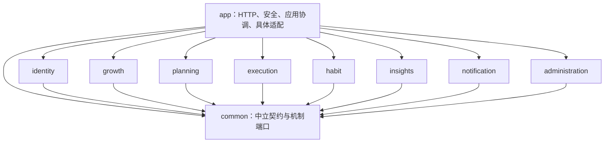

# 06 后端结构与手写实现顺序

> 文档版本：V2.0。
> 用途：本版正文的结构化编制输入；阅读从 [V2.0 文档目录](../README.md) 开始。
> 当前状态：后端骨架已建立，工作树已有最小账户表迁移；完整业务、迁移体系、前端和运行验收尚未完成。本文的包结构细化与实施方案为当前推荐设计，待用户最终审阅，不代表已经编码或批准发布。

## 1. 先明确手写范围与顺序

采用 JDK 17、Maven 3.9.4、Spring Boot 3.5.16、Spring MVC、Spring Security、MyBatis XML、远程 PostgreSQL 17.11、Flyway 和 Spring Session JDBC。MyBatis Starter 固定 3.0.5，Spring、驱动和迁移工具按 Boot BOM 管理；完整版本与本机核验见 [12 技术版本基线](12-技术版本基线与环境核验.md)。业务 SQL 与结果映射只写在 XML，不使用 SQL 注解、结果映射注解、Java Provider 或另一套业务 ORM。

先读10明确需求与业务，再按01编写并验证数据库迁移，按02～05及11编写后端和接口/内部用例测试，完成后端阶段验收后制作07的页面原型，再写Vue 3 + TypeScript前端并联调，最后按08完整验收与准备发布。页面设计用于明确接口和交互需求，实际前端实现按上述顺序进行。

## 2. Maven父子工程与目录

后端采用 `backend/` 父工程加10个子模块：`common`、8个业务模块、`app`。仍是模块化单体，一个Java进程、一个数据库、一次整体发布。后续前端位于 `frontend/`，不进入后端Maven模块。父 POM 与 10 个子工程已存在；DEV-001 核验骨架并补充迁移与资源。

| 工程位置（骨架已存在） | 规划职责 | 产物与边界 |
|---|---|---|
| `backend/pom.xml` 与 Wrapper 版本属性 | 聚合10个模块；统一JDK 17、Maven 3.9.4、Boot 3.5.16、依赖和插件管理 | 父POM，不打可执行包、不保存秘密；Wrapper 属性固定发行版 3.9.4，启动脚本尚未建立 |
| `backend/common/` | 通用身份标识、错误、时间、游标及锁/幂等/事件等中立契约和端口 | 普通依赖包，不引用业务模块；不放HTTP外壳、具体持久适配或目标/计划领域类型 |
| `backend/identity/` | 注册认证、资料、密码、时区及账户安全能力 | 只依赖common；对app公开本模块业务契约 |
| `backend/growth/` | 目标、阶段、任务与生命周期 | 只依赖common，内部按三类职责区分 |
| `backend/planning/` | 周日身份、安排、排序、迁移与周期处理能力 | 只依赖common，不修改实际投入日期 |
| `backend/execution/` | 执行、区间、控制、确认与受限修正能力 | 只依赖common，不反向依赖计划/目标模块 |
| `backend/habit/` | 规则、星期、节点、当天完成及结算 | 只依赖common，不管理任务进度 |
| `backend/insights/` | 看板、历史及统计只读查询 | 只依赖common；按表契约聚合，不写其他模块事实 |
| `backend/notification/` | 通知内容、同轮去重、阅读和失效 | 只依赖common，不自行结束目标 |
| `backend/administration/` | 受限管理业务能力、人数查询及两项配置 | 只依赖common，账户变更仍交给身份能力 |
| `backend/app/` | 启动、配置、全部HTTP Controller、安全过滤链/会话适配、跨模块协调、机制持久适配、调度、迁移与集成测试 | 依赖common及8业务模块；唯一可执行jar，内部区分web/application/security/infrastructure/bootstrap等包 |

依赖方向固定为：app依赖8业务模块和common，8业务模块各自依赖common，common没有业务依赖。兄弟模块不相互依赖，不通过共同依赖app来形成环。全部模块统一版本、不独立发包、不新增注册中心或内部HTTP。

业务模块在 `src/main/java/com/asterway/<模块>/` 下设 `api`、`service`、`mapper`、`model` 等必要包；Mapper XML归该业务模块的 `src/main/resources/mapper/<模块>/`。**全部HTTP Controller放在app的 `web/<模块>/`，请求DTO放 `request/`，响应VO放 `response/`。** `application/` 放有真实协调职责的应用用例，`bootstrap/`及配置包放启动装配。统一HTTP外壳 `ApiResponse` 固定在app，common只保留中立错误与分页等契约，避免底层业务被Web返回结构绑住。完整目录和示例见第11章。

业务对app开放自有 `api` Java能力接口，公开输入/结果在 `api/model/`，本业务公开错误在 `api/error/`。这里的 `api` 是进程内Java调用边界，**不是另一套HTTP Controller或内部HTTP接口**。app将HTTP请求DTO映射为业务输入，并将业务结果映射为响应VO。模块内部存储模型和Mapper不作为公共接口。公开能力可由具体Service实现；只有一份实现的内部服务不强制再配空接口和 `Impl`。

跨域资格由app在同一锁/事务内调用拥有者能力取得，再映射给执行等模块。例如先取得目标任务状态和安排资格，再调用执行能力；不能把一堆领域查询端口塞进common以绕过依赖规则。保留两类明确只读投影例外：insights用自身XML关联约定事实表并映射自己的查询模型；administration用 `AdminAccountQueryMapper` 查询角色授权范围内的账户摘要和人数。两者均不能跨域写入、读取秘密或依赖兄弟模块Java内部类型，其余Mapper只访问本模块拥有的数据。

迁移集中在app的 `src/main/resources/db/migration/`；非秘密配置模板集中在app，秘密外置。各模块有自己的单元/映射测试，跨模块、HTTP、框架会话和启动恢复测试落app的测试源集。

每张表只有一个写入拥有者。app协调时调用拥有者公开能力，不直接跨模块拿Mapper；insights可按契约只读关联查询。

| 拥有者 | 表编号 | 跨域操作怎么做 |
|---|---|---|
| identity | DB-01、02、06、07、32 | app管理协调先检查administration权限，再调用identity改变目标账户；身份模块不依赖后台模块 |
| growth | DB-08～12、16 | 完成任务时app调用growth存完成事实，再调用planning移除当前安排，同一事务提交 |
| planning | DB-13～15 | app从growth取得合法父链和任务快照，planning处理唯一安排和周期身份 |
| execution | DB-17～21 | app先取得任务/安排资格，execution只接受已核验上下文并处理控制与区间 |
| habit | DB-22～26 | 独立管理规则、节点和日结果；时区边界由app协调identity有效区间 |
| notification | DB-27 | app消费者协调目标条件查询与通知写入，不让通知模块反向调用growth |
| administration | DB-28 | 账户人数与管理策略提供公开能力；账户实际写入仍由identity拥有 |
| common契约 / app基础设施实现 | DB-03～05、29～31、33 | common声明中立机制与端口；`app/infrastructure/` 实现锁、审计、去重、outbox和检查点持久适配，业务判断由调用方给出 |
| app的框架适配/迁移 | DB-34～36 | 会话遵守框架真实事务边界；迁移元数据只由Flyway维护 |

为避免日期/资格规则复制，跨域使用的输入快照由app在同一账户锁下取得并传递，不能把HTTP传来的“已经校验过”当可信证明。只读查询不以表拥有者名义取得写权限。

父POM管理版本不代表已经声明真实依赖；子模块仍明确声明使用哪些内部/外部组件。Maven按实际依赖形成构建顺序，不能只调模块列表顺序掩盖环。父工程不让所有子模块继承可执行重打包行为，只有app生成可运行包；需验证它包含各依赖模块XML与迁移资源。[Maven多模块指南](https://maven.apache.org/guides/mini/guide-multiple-modules.html)、[Maven父工程与聚合](https://maven.apache.org/guides/introduction/introduction-to-the-pom.html)

### 2.1 模块、包与构建项不是一个概念

模块回答“代码属于哪项业务”，包内分层回答“代码负责接请求、处理规则还是访问数据库”。本项目有12个产品模块，映射为8个业务Maven工程；加common、app是10个子工程，加父聚合工程是11项Reactor。不是每个产品模块都单独生成一个Maven工程，不能漏掉已存在的administration。

### 2.2 直接依赖矩阵与图

行依赖列，`1`表示直接内部依赖，`—`表示没有。C=common、I=identity、G=growth、P=planning、E=execution、H=habit、S=insights、N=notification、A=administration、X=app。父POM继承不计入业务依赖边。

| 依赖方/被依赖方 | C | I | G | P | E | H | S | N | A | X |
|---|---|---|---|---|---|---|---|---|---|---|
| C common | — | — | — | — | — | — | — | — | — | — |
| I identity | 1 | — | — | — | — | — | — | — | — | — |
| G growth | 1 | — | — | — | — | — | — | — | — | — |
| P planning | 1 | — | — | — | — | — | — | — | — | — |
| E execution | 1 | — | — | — | — | — | — | — | — | — |
| H habit | 1 | — | — | — | — | — | — | — | — | — |
| S insights | 1 | — | — | — | — | — | — | — | — | — |
| N notification | 1 | — | — | — | — | — | — | — | — | — |
| A administration | 1 | — | — | — | — | — | — | — | — | — |
| X app | 1 | 1 | 1 | 1 | 1 | 1 | 1 | 1 | 1 | — |



共17条直接内部依赖：app的9条，加8个业务工程各1条。app调用两个业务工程，不意味着两个业务工程彼此增加依赖。只读SQL投影例外也不产生兄弟工程Java依赖。common现有基础starter本轮不改；其公共类型不应引入Servlet、Web、Security或业务Mapper/Entity。

## 3. 每层到底负责什么

| 类型 | 手写职责 | 约束 |
|---|---|---|
| Controller | 取得当前身份；接收与校验 DTO；调用一个明确用例；按 02 返回 HTTP 与响应 | 不直接写 Mapper，不在这里查十张表拼事务，不信任 body 中的所有者或角色 |
| 应用用例 UseCase | app内协调模块、先补偿后命令、幂等、运行护栏、锁顺序、提交与失败结果 | 跨模块原子操作由此管理；不能一段成功后随意另开事务写另一段 |
| 业务 Service | 负责本模块对象、规则与生命周期；复用时间和统计口径 | 不持锁请求外部账本；不通过内部 HTTP 调本应用 |
| Mapper 接口 | 声明清楚的数据访问方法与参数对象 | 无业务编排、手动提交或 SQL/结果映射注解；同名方法不重载 |
| Mapper XML | 明确列、参数绑定、条件、归属过滤、版本条件、锁与结果映射 | `namespace` 对接口，语句名对方法；业务值用参数绑定，排序只选白名单 |
| 请求 DTO | 只接收本用例允许输入的字段 | 不直接接收整张用户/任务表；不允许越权赋值服务器状态 |
| 响应 VO | 只输出当前页面或操作需要的字段、版本与权威状态 | 不返回密码哈希、内部账本载荷、会话秘密和完整存储对象 |
| 存储/查询模型 | 承接表行或聚合查询，明确空值、枚举和关联含义 | 不直接当公共响应；组合查询可使用专用结果模型 |
| 调度入口 | 分批找到到期工作，调用相同应用用例 | 不写另一套业务规则；内存定时器不充当持久队列 |
| 安全与会话适配 | 认证、CSRF、当前有效授权、会话仓库的无外键清理 | 框架内部 JDBC 不表示另建业务 JDBC 层；适配须进入真实仓库事务 |

全局统一注册 Mapper；不逐接口加 Mapper 标记。复杂对象和组合查询使用明确结果映射；计数等标量可使用标量结果类型。数据库列、Java 属性、DTO/VO 的含义与 01—05 保持一致，不机械要求名称完全相同。

推荐协调用例名称为 `ExecutionCommandUseCase`、`TaskCompletionUseCase`、`PlanChangeUseCase`、`GoalLifecycleUseCase`、`HabitCommandUseCase`、`AccountUseCase`、`AdminAccountUseCase`，放app/application。模块内部仍用具体业务Service。普通单模块只读可由Controller调用公开业务能力，不要求每个接口再配一层空转发UseCase；需要共同锁、幂等、补偿或跨模块原子性的写命令由应用用例组织。

## 4. 公共链路必须先写好

### 4.1 身份与请求结果

统一链路是：接收请求 → 当前身份及必要 CSRF 校验 → 格式校验 → 独立提交相关到期补偿 → 开启命令事务并重验 → 保存 → 提交 → 返回已保存状态。

02 定义公共响应字段、请求头与错误码；03—05 定义具体 DTO/VO。本文件不再发明另一套字段名。响应必须区分以下情况：

| 情况 | 后端应表达的事实 |
|---|---|
| 没有数据 | 成功的空列表/空状态，不能等同于查询失败 |
| 参数不合法 | 字段与可理解原因，不回显密码 |
| 未登录或身份已撤销 | 拒绝受保护请求，不能仅由前端跳页代替 |
| 对象不可访问 | 不透露他人正文或可枚举详情，按 02—05 的统一语义返回 |
| 当前状态/版本冲突 | 原操作未按旧状态执行，返回允许的同步信息；不自动将旧请求升级为新意图 |
| 明确事务失败 | 保持上次有效结果，不假报完成 |
| 提交结果不确定 | 按同一操作身份查询/重试，不能诱导用户再次生成全新操作 |
| 已保存但展示未刷新 | 核心操作仍成功，客户端重新查询；通知失败不回滚完成事实 |

集中异常处理负责把已知业务拒绝、约束冲突、技术错误翻译成 02 规定的结果。未知错误保留追踪标识，详细堆栈只进受控日志；禁止把 SQL、连接信息和秘密返回浏览器。错误 HTTP 状态保持真实，不统一改成成功。

#### 4.1.1 统一外壳、游标与错误类型的落点

| 类型/准确包位置 | 负责什么 | 不负责什么 |
|---|---|---|
| `app/web/contract/ApiResponse<T>` | 唯一HTTP外壳，固定 `code/message/data/traceId`；成功code为OK | 不由业务Service返回，不放common |
| `common/pagination/CursorPage<T>` | 中立游标结果，序列化为 `items/nextCursor/hasMore` | 不新增total/page/pageSize；不改变02的Page JSON结构 |
| `common/error/ErrorCode`、`CommonErrorCode` | 稳定字符串code与安全默认提示契约；真正通用错误 | 不依赖HttpStatus/Servlet，不收拢所有领域状态 |
| `<业务工程>/api/error/XxxErrorCode` | 实现ErrorCode，表达本业务公开错误 | common不反向引用业务枚举，不能按异常文本判断code |
| `common/exception/BusinessException` | 已知业务拒绝，稳定code与受控消息；可保留内部cause | 不携带HTTP对象，不把cause.message、SQL或任意Map透传 |
| `app/web/contract/ErrorData`、`Violation` | HTTP错误附加数据及安全field/message | 不是第二外壳，不携带rejectedValue、密码或完整请求 |
| `app/web/error/ApiErrorFactory` | 统一映射HTTP状态、code、安全提示和允许附加数据 | 不猜测事务结果，不把所有数据库异常当唯一冲突 |
| `app/web/error/ApiErrorWriter` | 为Filter和错误dispatch序列化已选定的结果 | 不重复决定业务规则，不在响应已提交后强行改写 |

`ErrorData` 可按真实接口采用带类型的校验、锁定、版本冲突等数据；不要求全部错误同时具备全部字段。无附加信息时data=null；成功EmptyResult按02返回 `{}`。现行可空字段必须显式返回null，末页 `nextCursor=null`，空列表为 `[]`。现有NON_NULL配置与此有冲突，后续实施时精确调整并用HTTP契约测试覆盖，本轮不改配置。

本期不引入 `ApiProblem` 或第二套 `ProblemDetail` HTTP响应。Spring默认问题详情虽可用，但其字段不等同于本项目外壳；MVC处理器必须统一转换。若选择继承 `ResponseEntityExceptionHandler`，应使用正确扩展点统一创建响应，避免重复注册内建处理或遗漏默认格式。[Spring Framework 6.2错误响应](https://docs.spring.io/spring-framework/reference/6.2/web/webmvc/mvc-ann-rest-exceptions.html)

#### 4.1.2 MVC与Security必须分别接入

| 触发位置 | 推荐接入类 | 对外语义 |
|---|---|---|
| MVC解析、校验、业务拒绝、Controller未知异常 | `web/error/GlobalExceptionHandler` | 经ApiErrorFactory生成同一外壳；语法400、范围422、已知领域状态按02—05 |
| 未登录访问受保护资源 | `security/RestAuthenticationEntryPoint` | 401 AUTH_REQUIRED，返回JSON，不跳转HTML登录页 |
| 已登录无权限 | `security/RestAccessDeniedHandler` | 403 FORBIDDEN，不泄露目标资料 |
| CSRF缺失或无效 | CsrfFilter拒绝入口复用DeniedHandler/工厂 | 403 CSRF_INVALID；匿名注册/登录也可能先触发 |
| JSON登录凭据失败 | AccountUseCase所在登录入口；若选认证Filter则独立FailureHandler | 401 CREDENTIALS_INVALID，固定提示“用户名或密码错误”；不能只配EntryPoint |
| 自定义Filter或Servlet错误dispatch | 该边界受控处理，必要时ApiErrorController | 复用工厂/Writer，不能假设Advice自动捕获全部过滤器异常 |

建议登录由JSON应用用例显式调用identity及框架会话适配，落实滑动验证、可靠失败计数、凭据版本重验。若改由认证Filter承载同一协议，再加入 `RestAuthenticationFailureHandler` 和成功适配，避免默认重定向。Security的ExceptionTranslationFilter只处理其下游可捕获的认证/授权异常，不是系统异常总兜底；TraceIdFilter位于安全链之前，使用受控追踪值并清理线程上下文。方法级安全异常即便进入MVC，也按401/403映射，不能被兜底吞为500。[Spring Security架构](https://docs.spring.io/spring-security/reference/6.5/servlet/architecture.html)、[认证失败处理](https://docs.spring.io/spring-security/reference/6.5/servlet/authentication/passwords/form.html)、[CSRF](https://docs.spring.io/spring-security/reference/6.5/servlet/exploits/csrf.html)

<!-- DIAGRAM:errors -->

#### 4.1.3 错误码与日志边界

继续使用02—05已有状态/code：401 AUTH_REQUIRED或CREDENTIALS_INVALID；403 FORBIDDEN/CSRF_INVALID/ACCOUNT_UNAVAILABLE；404 NOT_FOUND；409版本、状态、未结束执行、控制权及幂等冲突；413载荷过大；422业务范围校验；423 ACCOUNT_LOCKED；429 RATE_LIMITED；503 RESULT_UNKNOWN或SERVICE_UNAVAILABLE。第五次凭据错误锁定属于423，含lockedUntil与字符串retryAfterSeconds，不能替换成429。未知系统异常500的 `INTERNAL_ERROR`、405的 `METHOD_NOT_ALLOWED`、415的 `UNSUPPORTED_MEDIA_TYPE` 为本次待审核补充码，批准后统一纳入02公共目录；405保留Allow。

预期业务拒绝只记录必要code/traceId/安全身份，不重复堆栈；未知异常在拥有边界处记录一次ERROR与完整cause，上层传递不反复打印。业务审计另行持久化。日志和响应均不得包含密码、哈希、Cookie/会话值、验证码材料、控制许可、连接凭据、完整Body或SQL参数原文。数据库约束错误只在核对约束名和业务上下文后翻译；网络失败不能仅靠500断言事务已回滚，RESULT_UNKNOWN必须保留同一Idempotency-Key核实。

#### 4.1.4 HTTP响应示例

以下为设计示例，不是已运行接口结果。所有示例都保留同一外壳；字段名仍以02—05完整对象为准。

201注册成功，data由HTTP响应VO定义：

```json
{"code":"OK","message":"注册成功，请登录","data":{"accountId":"39c538c8-9d34-4d45-9ae4-7d36fb463f14","username":"LingXIDemo","loginRequired":true,"createdAt":"2026-10-22T06:00:00Z"},"traceId":"example-register-01"}
```

200空列表末页，不省略nextCursor：

```json
{"code":"OK","message":"查询成功","data":{"items":[],"nextCursor":null,"hasMore":false},"traceId":"example-page-01"}
```

409版本冲突，版本按十进制字符串传输：

```json
{"code":"VERSION_CONFLICT","message":"内容已更新，请刷新后再决定","data":{"currentVersion":"4"},"traceId":"example-conflict-01"}
```

422字段范围校验；语法无法解析时使用400而非422：

```json
{"code":"VALIDATION_ERROR","message":"请检查填写内容","data":{"violations":[{"field":"expectedEndDate","message":"预计结束日期不能早于开始日期"}]},"traceId":"example-validation-01"}
```

401未登录与403无权限具有不同语义：

```json
{"code":"AUTH_REQUIRED","message":"请先登录","data":null,"traceId":"example-auth-01"}
```

```json
{"code":"FORBIDDEN","message":"没有执行该操作的权限","data":null,"traceId":"example-forbidden-01"}
```

500未知异常采用待审核新增code，提示不披露内部细节：

```json
{"code":"INTERNAL_ERROR","message":"服务暂时出现问题，请稍后重试","data":null,"traceId":"example-system-01"}
```

### 4.2 事务、锁与代理边界

关键写入顺序固定为：运行护栏共享锁及当前代次 → 必要管理锁 → 按稳定身份排序的账户锁 → 父对象、状态与版本 → 显式变更 → 校验跨表结果 → 提交。

普通业务采用架构规定的 `READ COMMITTED`，取得锁后重新读取。不能先在事务外确认父存在，再不加锁创建子记录或删除父记录。MyBatis 与业务事务使用同一数据源。事务入口通过真实代理或显式边界调用，不能假定同类内部自调用已经开启新事务。

密码计算、滑动验证及外部安全账本 I/O 放在短业务锁外；入事务后重验其用途、有效期、账户和版本。返回业务拒绝时，已独立提交的认证失败计数、到期结算和失联暂停仍然保留，不能被后续异常回滚。

### 4.3 类型与时间

UUID 在接口按字符串处理；日期、绝对时刻、当地钟点和时长分别映射，具体格式与单位服从 01—05。Java 使用对应的 `java.time` 类型，不把本地日期偷偷转成服务器默认时区的午夜。枚举保存稳定名称，不保存 Java 枚举序号。

业务判断使用数据库实际当前时间，取得锁后刷新时间，不用排队前的旧事务时间。展示舍入只发生在最后一步，源区间和历史日期边界不改写。用户名只对 ASCII 英文做一致的大小写处理；密码长度按业务约定的 Unicode 码点计数，不按 UTF-8 字节截断。

## 5. 没有物理外键时怎样保证关联正确

数据库仍保留主键、唯一、非空、行内检查、时间排除和版本条件。**应用、Spring Session 与其他框架表一律不建物理外键，不建立数据库级联，不用跨表触发器模拟外键。**

每个关联写入在同一账户锁与事务内完成四项检查：父身份存在、同账户归属、父子关系正确、当前状态允许。更新和删除也使用相同入口。具体逻辑关系目录以 01 为准。

| 操作 | 必查内容 | 写后核对 |
|---|---|---|
| 建阶段/任务 | 目标/阶段存在、属于本人、父链一致、未被删除或禁止管理 | 新任务在唯一阶段下；不重复存一份任意 goalId |
| 建日安排/迁移 | 任务有效、周日属于本人且同周、日期资格、当前唯一安排 | 单任务一行当前/待处理安排；迁移不复制任务或历史区间 |
| 建区间/确认 | 执行、任务、安排、时区、控制页与会话相符 | 运行会话、开放段和控制指针相互一致 |
| 修改习惯 | 当前规则属于该习惯，星期集合与周期一致，日结果属于本人该日 | 当前指针指向新规则；旧规则和已结算结果保留 |
| 删除对象 | 取得相同锁后检查所有当前和历史引用 | 无事实内容显式清理；有事实只移出当前范围并保留身份 |
| 安全与后台操作 | 操作者角色、目标角色、账户状态与最后超级管理员约束 | 授权版本、审计、本地账本关联与结果一致 |

删除空阶段指没有当前有效任务；若历史任务仍引用它，保留必要阶段身份/摘要。任务有过执行或完成事实便不能物理清掉身份。账户逻辑删除，不级联清除其成长事实。

巡检只能补充证据。每天低峰及发布/恢复后，按 08 检查缺父、跨账户、日周不一致和失配指针；发现问题隔离相关写入、保留证据并核对，不自动删历史“修平”。

## 6. 关键流程：照着这些步骤写

以下为人话步骤，不是 Java 或 SQL。

### 6.1 注册与登录

注册先检查开放状态、字段、密码确认和滑动验证；在最终事务再检查仍开放与用户名唯一。预分配账户身份，同事务建立账户、首时区、账户锁、待机执行控制和周期游标，只创建普通用户。失败不能留半个账户；成功后引导登录。

登录先检查规范化提交名的临时锁定，再验证滑动，最后验证凭据。不存在用户名与密码错误都可靠增加失败计数，第五次锁定五分钟；滑动失败不计入。哈希计算后提交前重验账户及凭据版本，不能让并发改密后的旧校验结果建立有效会话。

### 6.2 开始、继续与任务切换

先独立处理到期/失联，命令事务按锁序重验本人、目标阶段状态、当前安排和日期。若同任务有暂停执行则继续原执行；否则建立新执行。先在同一切换时刻关闭原运行段并暂停，再为新任务建立区间、日归属和控制代次。最后核对至多一个运行任务，提交后返回权威状态和新许可。任一必要写入失败则整次切换回滚。

控制页持有效许可主动暂停/结束/切换，可按架构作为即时最终确认；其他观察页显式接管时旧段只到最后可信点，不能用观察行为代替确认。具体输入与结果以 05 为准。

### 6.3 执行确认、过期与恢复

确认核验运行代次、控制代次、页面、会话、序号、一次性许可、日期上界与取得锁后的当前时间。一次成功同时消费旧许可、推进最后确认点和序号、生成下一许可并提交。相同确认重试只取原结果，不再推进时间；不能重新签一个更晚期限的许可来掩盖响应丢失。

许可过期先独立按最后可信点暂停并使旧控制失效，再拒绝续时；该暂停不能因拒绝结果回滚。普通刷新不续许可。服务重启换运行代次，恢复遗留区间后再开放执行；停机、冻结、休眠的未知时间不自动补算。

### 6.4 重新安排任务

补齐已结束周期后，锁账户，查未完成任务、当前安排及目标周日；计时中先暂停。取得或复用唯一周日身份，更新同一个安排行；移回任务池则撤销安排。跨周同步周归属，原日不留可执行副本；既有区间与完成事实的实际日期、时区和历史计划引用不动。

### 6.5 完成任务与目标确认

任务完成接口先在持锁事务内检查该任务全部执行均为ENDED；仍有RUNNING或PAUSED时返回409 UNFINISHED_EXECUTION，不自动结束。页面列出相关执行，由用户先通过05的 API-FOCUS-005 逐个结束，再刷新任务版本，确认不可恢复后提交完成请求。用户取消任何一步均不能显示任务已完成；从未计时的合法任务可直接完成。

真正的完成事务重新校验当前可执行计划、父状态、版本和无未结束执行，再原子保存唯一完成事实、任务DONE、安排撤销、父聚合版本、目标条件和可靠事件。按当前有效任务重算进度；只有任务总数大于零且全部完成才产生同轮条件。通知消费者在核心提交后形成通知，用户确认后目标才结束。先结束与后完成是两个持久化动作，不宣称跨HTTP请求原子；完成保存失败时已经明确结束的执行仍保持ENDED。

### 6.6 目标结束、归档与删除任务/计划

归档目标遇到任何未结束执行——包括暂停中的——都拒绝，要求先结束；不要自动改成任务完成。目标结束接口同样先检查相关执行全部ENDED，否则返回409 UNFINISHED_EXECUTION，不自动结束。页面先用 API-FOCUS-005 逐个结束，再刷新goalVersion，由用户确认后调用04的目标结束接口；结束事务重新检查前置，保存真实结束快照、撤出未完成安排并处理条件轮次，不伪造子任务完成。前面的执行结束与后面的目标结束不是跨请求原子事务，目标保存失败不撤回已成功的执行结束。

任务/计划删除先确认相关执行已结束。无事实内容显式清除；有事实的任务退出当前分子分母并保留身份，计划保留已执行部分与周期身份。阶段完成只检查当前有效任务；空阶段删除不抹去历史归属。全部变更失败时整体回滚。

### 6.7 习惯变更与日结算

修改前先结算已经结束的日期；当天新规则立即生效，旧规则追加留档。今天已有有效完成则仍为完成一、应执行一；今天尚未完成按当前规则和状态判断。午夜后固定当日结果，之后不允许补记或回算。暂停入暂停队列，恢复回清单；结束可恢复，删除只保留历史不恢复。

### 6.8 通知与后台周期

核心事务写可靠事件。消费者先短事务认领并释放认领锁，正式处理再按账户锁序重验终态、认领代次、对象状态与条件轮次。通知与消费完成同事务，旧处理者不能覆写终态。失败保留重试依据并告警；日期工作按应生效时刻顺序处理，失败不推进检查点。

### 6.9 正常退出、改密与管理员撤销

正常退出和正常改密先要求结束所有未结束执行；用户取消就不继续，不能用自动暂停偷换该前置条件。正常退出只注销当前会话；改密成功注销全部既有会话并重新登录，失败保留原密码与会话。

管理员禁用、删除或授权撤销不等待用户结束，按可信点暂停执行、保存安全版本及必需审计。逐请求授权立即拒绝失效身份；会话物理清理失败不能恢复旧权限。

### 6.10 独立安全账本与 Spring Session

敏感变更先在锁外可靠保存独立意图，再在业务事务重验版本并保存账户变更、审计与本地待同步依据；提交后回写账本结果。提交未知不猜失败，恢复时未决账户隔离。账本缺失且无法界定影响范围时全部恢复账户拒绝登录；不能仅清会话或改版本就继续使用旧密码哈希。

会话框架的建表、属性写入、注销、轮换与过期清理需一起适配无外键规则：同一仓库事务锁父会话、检查存在性、显式处理属性和父记录。不能外层持父锁、内层另开事务等待自己；旧会话保存也不能重新激活已撤销权限。具体适配验收见 08。

## 7. 手写业务切片

每个切片先读相关用例与字段，再写数据访问、业务规则/事务和接入，最后做真实 PostgreSQL 与接口验证。测试先列输入预期；编写顺序可以局部往返，但不能只写完 Controller 就宣称业务完成。

下面所有切片的当前执行状态均为 `NOT_VERIFIED`；06 只定义将来怎么做。08 的 TEST 编号供证据关联，09 维护完整需求覆盖。

表中TEST是关联范围，不要求基础切片提前实现所有后续业务。一个用例同时包含仓库、完整业务和浏览器证据时，分别记录本切片能验证的子项；其余保持未验证，等前置功能齐备后补齐。后端阶段出口核对后端适用项，不要求尚未开始的页面原型先完成；完整TEST只有全部适用子项都有证据后才通过。

| 编号 | 依赖 | 先改哪里、后改哪里 | 交付与重点验证 | 失败时怎样回退 |
|---|---|---|---|---|
| DEV-001 工程与数据库基线 | 01、02及12版本基线 | 核验已有父POM、10子模块与app模板 → 核对JDK 17/Maven 3.9.4/Boot 3.5.16、无环依赖和仅app可执行 → 保护现有V001，核实历史后按01追加未用版本 → XML跨模块资源和PostgreSQL 17.11隔离测试环境 | 多模块依赖及打包正确，空库/升级可重复，框架无物理外键；TEST-001、002、059 | 未上线只撤回本次新增且未执行源文件；已执行迁移不覆盖；数据库失败保持未就绪，用隔离测试库定位，不删生产库 |
| DEV-002 公共机制和启动门禁 | DEV-001 | `common` 错误/时间/身份上下文 → 运行护栏与锁 → 幂等与可靠事件 → 恢复门禁/独立账本适配 | 核心提交、失败/未知结果、旧实例拒写；TEST-052—058、062—065 | 停在未就绪；修机制后重跑，不用绕开护栏保证后续功能“能用” |
| DEV-003 注册登录与会话 | DEV-002 | identity Mapper/XML与初始化 → 校验/认证服务 → 无外键会话仓库 → Controller与认证过滤链 | 公开只建USER，用户名唯一、滑动、计数、撤销与会话并发；TEST-003—009、056 | 未发布撤回入口；保存的测试账户可在测试库清理，真实账户不批量删除 |
| DEV-004 资料、改密、退出及时区入口 | DEV-003 | 资料与安全变更用例 → 账本/安全版本 → 正常退出/改密前置 → Controller | 改名立即、昵称独立、先结束执行、旧凭据失效；TEST-010—013、064 | 不逆改真实密码；不确定时查操作状态，保持安全拒绝并受控核验 |
| DEV-005 目标阶段任务主干 | DEV-003 | growth Mapper/XML → 目标/阶段/任务服务 → 应用创建编辑用例 → Controller | 未来开始、手动排序、空状态、创建未执行与父子归属；TEST-014—019 | 回退应用需检查新数据兼容；已有对象保留，不以删历史补救 |
| DEV-006 周日计划与迁移 | DEV-005 | planning 计划/安排映射 → 唯一身份和日期校验 → PlanChangeUseCase → Controller | 同周同日唯一、过去只读、周内无日期、跨周迁移；TEST-023—029 | 单次失败整体回滚；发布回退不重建旧安排副本 |
| DEV-007 正向计时闭环 | DEV-006、DEV-002 | execution区间/控制映射 → 开始暂停继续结束 → 确认许可/接管 → 扫描与启动恢复 → Controller | 唯一计时、区间不重叠、重复确认、冻结及跨日；TEST-030—042 | 停执行入口并按可信点暂停；不删除区间或补算未知尾段 |
| DEV-008 完成、通知与首条统计 | DEV-007 | 无未结束执行前置及409提示 → 完成事实/目标条件 → outbox与通知消费 → insights基础查询 → 接口 | 页面先逐个结束再刷新版本完成，非跨请求原子；100%只通知；TEST-020—022、043、052—054 | 不把已完成改回未完成；完成失败不撤回此前ENDED；同轮事件保留重试 |
| DEV-009 生命周期与历史保留 | DEV-008 | 目标/阶段生命周期 → 条件删除服务 → 计划删除与历史身份 → 接口 | 归档先结束、主动结束快照、空阶段删除及历史贡献；TEST-021、022、028、029、044 | 不能通过回退清除永久事实；结构不兼容保持停服或走验证过的恢复 |
| DEV-010 日期补偿与时区变更 | DEV-007、009 | 周期查询与检查点 → 统一时区服务 → 各模块到期用例 → 分队列调度 | 日周边界、延期、顺序补偿、重复日期；TEST-017、027、039—042、057 | 失败不推进检查点；修复后用相同周期身份补偿，不重复延期 |
| DEV-011 习惯完整闭环 | DEV-003、010 | habit规则/星期/节点/日结果映射 → 变更和结算 → 当日完成 → Controller | 严格周期、完成优先、暂停结束恢复删除、不补记；TEST-045—051 | 已完成/结算事实不反改；停受影响入口，恢复前核对版本和日期 |
| DEV-012 完整看板与历史查询 | DEV-008、010、011 | insights专用查询模型/XML → 统一统计服务 → 查询Controller | 空结果/失败区分，历史日期、原归属、分页及重度账户；TEST-044、058、067、070 | 可回退查询代码；不修改事实来使统计对上 |
| DEV-013 管理后台与固定配置 | DEV-004、009、011 | administration入口 → identity管理能力 → 管理锁/审计/账本 → 配置与统计 | 角色边界、最后超级管理员、两项配置、撤销执行；TEST-012、060、061、064 | 关闭管理写入口，保留审计与账本；不得恢复已失效权限 |
| DEV-014 备份、恢复及运维链路 | DEV-002—013 | 受控部署参数/探测 → 备份与账本检查 → 隔离恢复流程 → 完整性巡检 | 独立恢复链、会话与执行门禁、敏感旧点核验；TEST-062—066、071 | 演练只在隔离环境；真实恢复失败保持入口关闭，不先开站再查权限 |
| DEV-015 后端阶段验收 | DEV-003—014 | 核对02—05接口覆盖 → 自动化回归 → 真实API调试与报告 → 缺陷闭环 | 全部后端用例有证据；API工具只作证据之一，未通过项不写完成 | 回到最小问题切片，重验受影响链；不开始真实前端以掩盖接口缺口 |
| DEV-016 前端页面原型 | DEV-015 | 依据07制作页面/交互原型 → 核对角色、日期、空态与冲突 | 用户流程和API能对应；只是原型，不冒充真实业务数据 | 回修原型或契约设计，记录变化，不私自改变现行业务规则 |
| DEV-017 前端代码与联调 | DEV-016 | frontend工程 → 请求层/身份与状态 → 页面 → 双设备与端到端联调 | 不混本地演示事实，控制页/观察页清楚，退出清缓存；TEST-068—070 | 回退静态产物须检查接口兼容；保留真实业务数据 |
| DEV-018 系统验收与发布准备 | DEV-017 | 全功能回归 → 安全/性能/兼容/恢复实测 → 08门槛报告 | 全部采用指标有结果、缺陷处置和恢复证据；TEST-001—072 | 不通过就修受影响部分再测，不通过修改门槛或删数据假装达标 |
| DEV-019 发布与运行交接 | DEV-018及真实发布授权 | 固定产物/变更单 → 恢复点核验 → 受控迁移 → 门禁/冒烟 → 开放 → 观测 | 配置、人员、告警、回退与月度记录可执行；TEST-071、072 | 按08选择应用回退或数据恢复；先保住权限与历史，再开放 |

DEV-008 是第一个可用后端闭环，不是全 MVP 完成。DEV-015 后才进入实际前端原型；未来每个后端切片内部均允许接口和服务测试，不能把它们全部堆到 DEV-015。DEV-003/004可以先验证账户子项，但正常退出/改密有“先结束未结束执行”的完整分支，须待DEV-007及相应安全协调齐备后联验，才能宣称账户全模块完成；不得为提前验收删除该前置。

## 8. 每个切片的手写检查卡

开始前列出：切片号、输入文档版本、对应业务用例、涉及表/逻辑关系、允许修改的未来文件、前置切片及回退方案。

结束时提供：实际修改清单、与 Mapper 对应的 XML 清单、事务边界、权限/无外键关联检查、异常与并发处理、实际测试输入/结果/证据、未验证项及残余缺陷。涉及字段、接口或规则变化先同步本包 09 的变更链，再改相应正式设计；不能让代码先变成另一套业务。

进入下一切片的最低条件是本切片关键正确性和安全验证通过，并且没有已知会破坏下一切片的数据问题。运行结果由实际证据决定；这张设计卡不替代用户验收，也不代表测试已执行。

## 9. 当前交付状态

本文已给出未来后端落点、层次责任、公共约定、关键用例步骤与DEV-001—019。当前核查确认已有父聚合POM、10个子工程、启动类及9个package-info；Maven离线validate通过仅说明11项工程模型有效，不代表编译、打包、启动、数据库或业务验收通过。尚无可据以宣称业务通过的Controller、业务Service/Mapper、前端或自动化测试实现。

工作树已有 `backend/app/src/main/resources/db/migration/V001__create_app_user.sql`，定义最小 `app.app_user` 的9列，用户说明已经执行；本次未连接数据库，实际结构、执行方式、Flyway历史位置及checksum仍为NOT_VERIFIED。设计DB-01展开为19列，缺失版本、安全与时区等字段及类型/非空差异须通过后续增量迁移处理，不能覆盖V001。核查时该路径暂存版本为空、工作树非空；提交前必须单独核对实际执行原文与暂存，保留现有暂存/工作树内容，不自动修复。

后续版本先核实已用version/script/checksum/success及历史schema，再分配下一未用编号。现有V001不重命名、不重复创建、不重建账户表，也不执行clean/repair/篡改历史。手工执行与Flyway登记必须如实区分，文件SHA-256不能冒充Flyway checksum；原拟定V001身份会话、V002成长等顺序仅是旧计划，不能据此占用实际版本。新非空字段按兼容扩展、受控回填、验证后加约束推进，不伪造旧密码/时区事实。[Flyway版本化迁移](https://documentation.red-gate.com/flyway/flyway-concepts/migrations/versioned-migrations)

配置仍需后续精确核实：公共NON_NULL与显式null契约冲突；local可能覆盖baseline配置；create-schemas=false要求受控schema前置；Session initialize-schema=never且会话迁移/真实仓库适配未完成。这些均不能因为已有依赖或一张账户表而标为关闭。真实数据库、完整迁移升级、安全会话、业务、部署及恢复继续保持NOT_VERIFIED。

## 10. 按讲义逐功能手写的方法

03～05的每个接口已经按“需求分析、业务流程、接口设计、数据操作、分层实现步骤、功能测试”展开。实施时先选定一个API及其FR/BL，再按本节落成具体文件，不先批量创建空Controller、空Service和只有通用CRUD的Mapper。

| 顺序 | 手写对象 | 写之前确认什么 | 完成后如何验证 |
|---|---|---|---|
| 1 | Request DTO、查询参数、Response VO及枚举 | 对照字段表区分必填、缺省、null；long传输字符串与内部数值分开；仅接收允许写的字段 | 合法/缺失/null/未知字段/范围边界可区分，不把数据库实体直接对外返回 |
| 2 | Mapper接口和对应XML | 读取/写入哪些真实字段，所有者条件、版本条件、稳定排序、锁和唯一约束是什么 | 在真实PostgreSQL核对参数映射、影响行数、逻辑关联和并发；不写SQL注解 |
| 3 | 模块内业务Service | 状态前提、计算公式、历史保留、同模块事实变化 | 正常/边界/拒绝分支符合对应业务流程；拒绝不会部分写入 |
| 4 | app应用用例 | 跨模块输入快照、锁序、幂等、核心事务、outbox、到期补偿前置 | 故障注入验证整体提交/回滚，同键重试与并发不重复贡献 |
| 5 | Controller及异常映射 | 完整路径/方法/权限，HTTP/code，DTO转换和当前身份 | 发真实HTTP核对完整响应、错误、Cookie/CSRF、本人隔离 |
| 6 | 功能测试证据 | 本接口功能测试和08关联TEST是否包含本切片适用子项 | 保存脱敏请求响应、必要事实快照及追踪；未执行项保留NOT_VERIFIED |

这六步允许为一个小功能往返调整，不要求先写完整全站Mapper再写业务。应用用例负责协调模块；各业务模块的Service/Mapper只依赖common。接口章节中的Mapper方法是未来职责建议，实施者可在同职责内合理合并，但不能借“复用”删掉归属、状态和版本检查。

### 10.1 以“完成任务”为例的完整交接

1. 在10中定位FR-TASK-009，在04定位API-TASK-005。先理解完成不可恢复、执行结束不等于任务完成、先结束相关执行的规则。
2. 页面取最新TaskView。若有未结束执行，按05逐个结束；这些请求已提交后，即使后面的完成失败，也不恢复执行。
3. 请求DTO只接收接口声明的expectedVersion、确认等字段；taskId来自Path，本人身份来自会话，不接收客户端task.status/userId作为真实状态。
4. 应用用例在有效护栏/账户锁内核实原幂等结果，再重读本人任务、阶段、目标、版本及全部未结束执行。发现阻塞按标准结构返回，而不是只查第一条。
5. `TaskCompletionUseCase` 经真实事务代理，在一个核心事务中调用growth公开能力修改任务、写唯一完成事实与完整快照；调用planning公开能力移除当前未完成安排；维护目标精确条件轮次并通过app的事件/幂等适配写必要outbox与安全结果。涉及哪些具体列与VO以04及01为准，app不能跨模块直接取Mapper，业务子服务不能随意REQUIRES_NEW拆开原子链。
6. 成功返回已提交对象。Controller不自己发通知；通知消费者按11重验轮次，页面刷新目标、计划、看板和通知。
7. 通过正常完成、重复同键、旧版本、他人UUID、暂停执行阻塞、提交中失败、响应丢失和通知消费者失败等测试。它们验证不同约束，不能只用一次200响应宣布业务完整。

### 10.2 系统流程的文件落点

11中的自动流程在DEV-002、007～014中实现。调度入口只发现候选并调用app协调器；app取得各模块输入并安排事务；模块Service执行规则；Mapper/XML完成存储。不能在调度方法里直接拼跨模块SQL，也不能让execution反向依赖growth/planning形成模块环。读取前补偿复用相同内部用例，和用户命令的事务边界见11第9章。

insights查询前若需到期补偿，先由应用用例独立提交相应写入，再进入纯只读查询；不能在readOnly统计事务里偷偷补偿。多条聚合查询需要一致快照时可明确采用只读REPEATABLE READ或单条SQL，由实际测试证明，不把所有写命令统一提高隔离级别。administration投影仅限授权账户摘要、人数和允许资料，不查询凭据或成长正文。通知以同库持久outbox继续消费，只有afterCommit/内存事件不能保证崩溃后恢复；领域事件属于发布方公开契约，common仅留中立机制。

## 11. 推荐包结构与数据对象

### 11.1 先读懂模块与层次

`backend`是Maven父聚合工程，下面10个目录是子工程。一个子工程里面再按职责建Java包；`request`、`response`和`service`不是新的Maven模块，也不会因此独立部署。所有子工程组成一个后端进程，由app统一启动。

**request就是HTTP请求DTO，response就是HTTP响应VO。** 本项目统一用这两个包名，不再并建含义相同的dto/vo目录。例如注册时前端JSON先进入 `RegisterRequest`，Controller映射成identity公开的 `RegisterCommand`，业务返回 `RegistrationResult`，Controller映射为 `RegistrationResponse`，最后由 `ApiResponse<RegistrationResponse>` 输出统一外壳。`ApiResponse`只定义外层code/message/data/traceId，`RegistrationResponse`定义data中的账户ID、用户名等允许字段。

| 对象 | 位置 | 谁使用 | 与其他对象的区别 |
|---|---|---|---|
| RegisterRequest，请求DTO | app/web/identity/request | HTTP参数绑定和校验 | 只允许客户端输入，不含真实角色、所有者或服务器状态 |
| RegisterCommand，公开业务输入 | identity/api/model | app调用AccountApi | 不带Servlet/HTTP响应，可信身份由服务端注入 |
| RegistrationResult，公开业务结果 | identity/api/model | identity向app提供结果 | 表达业务事实，不直接要求JSON外壳 |
| RegistrationResponse，响应VO | app/web/identity/response | HTTP输出 | 按接口选择字段，不含哈希、内部账本或会话秘密 |
| AccountEntity，内部存储模型 | identity/model | identity的Mapper/Service | 对应存储需要，不作为HTTP响应或跨模块公共接口 |
| ApiResponse，统一HTTP外壳 | app/web/contract | Controller、MVC和安全错误接入 | 统一成功/错误结构，业务Service不返回它 |

这些对象承担不同边界，不要求每个简单内部方法都复制一套同字段类型。简单转换可直接写在所属HTTP包或用例内，复杂重复转换才建立明确映射类，不机械增加Assembler。

### 11.2 app：完整应用组装层

以下是审核后的目标结构；仅启动类、配置及迁移等现有文件已经存在，其余按实际切片逐步实现，不表示本轮已经创建。所有HTTP Controller按业务工程分包，安全会话与基础设施留在app，不把领域状态转换堆进app。

```text
backend/app/
├── pom.xml                                      唯一可执行JAR
└── src/
    ├── main/
    │   ├── java/com/asterway/app/
    │   │   ├── AsterwayApplication.java          启动与集中扫描
    │   │   ├── config/
    │   │   │   ├── WebConfig.java                HTTP/Jackson配置
    │   │   │   └── SecurityConfig.java           显式安全链
    │   │   ├── web/
    │   │   │   ├── contract/
    │   │   │   │   ├── ApiResponse.java          HTTP统一外壳
    │   │   │   │   ├── ErrorData.java            有类型的错误附加数据
    │   │   │   │   └── Violation.java            安全字段提示
    │   │   │   ├── error/
    │   │   │   │   ├── GlobalExceptionHandler.java
    │   │   │   │   ├── ApiErrorFactory.java      code/状态/安全data映射
    │   │   │   │   ├── ApiErrorWriter.java       Filter/dispatch输出
    │   │   │   │   └── ApiErrorController.java   按需错误dispatch兜底
    │   │   │   ├── filter/TraceIdFilter.java
    │   │   │   ├── identity/
    │   │   │   │   ├── AccountController.java
    │   │   │   │   ├── request/RegisterRequest.java
    │   │   │   │   └── response/RegistrationResponse.java
    │   │   │   ├── growth/
    │   │   │   │   ├── GoalController.java
    │   │   │   │   ├── StageController.java
    │   │   │   │   ├── TaskController.java
    │   │   │   │   ├── request/                 HTTP请求DTO
    │   │   │   │   └── response/                HTTP响应VO
    │   │   │   ├── planning/                   周/日Controller与request/response
    │   │   │   ├── execution/                  FocusController与request/response
    │   │   │   ├── habit/                      HabitController与request/response
    │   │   │   ├── insights/                   Dashboard/History Controller及响应
    │   │   │   ├── notification/               NotificationController与请求/响应
    │   │   │   └── administration/             AdministrationController与请求/响应
    │   │   ├── application/
    │   │   │   ├── identity/AccountUseCase.java
    │   │   │   ├── task/TaskCompletionUseCase.java
    │   │   │   ├── goal/GoalLifecycleUseCase.java
    │   │   │   ├── planning/PlanChangeUseCase.java
    │   │   │   ├── execution/ExecutionCommandUseCase.java
    │   │   │   ├── habit/HabitCommandUseCase.java
    │   │   │   └── administration/AdminAccountUseCase.java
    │   │   ├── security/
    │   │   │   ├── RestAuthenticationEntryPoint.java
    │   │   │   ├── RestAccessDeniedHandler.java
    │   │   │   ├── RestAuthenticationFailureHandler.java  仅过滤器登录需要
    │   │   │   └── session/                    Session框架与撤销适配
    │   │   ├── infrastructure/
    │   │   │   ├── concurrency/                护栏与账户锁实现
    │   │   │   ├── idempotency/                请求指纹、结果核实适配
    │   │   │   ├── event/                      同库outbox与可靠消费协调
    │   │   │   ├── audit/                      审计持久适配
    │   │   │   └── checkpoint/                 补偿进度持久适配
    │   │   ├── bootstrap/                     运行代次、恢复与READY
    │   │   └── scheduling/                    调用相同应用用例
    │   └── resources/
    │       ├── application.yml
    │       ├── application-local.yml           忽略的秘密配置，不发布
    │       ├── mapper/infrastructure/           app自己的机制表XML，按需
    │       └── db/migration/                   集中迁移；V001受保护
    └── test/
        ├── java/com/asterway/app/
        │   ├── web/                            HTTP/JSON契约测试
        │   ├── security/                       401/403/CSRF/登录失败
        │   ├── application/                    跨模块事务与业务链
        │   ├── infrastructure/                 幂等/锁/Session/outbox
        │   └── bootstrap/                      启动恢复与安全门禁
        └── resources/application-test.yml       后续无秘密隔离测试配置
```

ApiErrorFactory承担code到HTTP状态的映射，不再并建同义映射器。Advice识别异常后委派工厂，Writer只序列化结果。ApiErrorController仅在需要统一框架错误dispatch时建立，避免注册多个互相覆盖的兜底。机制Mapper按需放 `app/infrastructure/<机制>/mapper/`，XML放app的 `mapper/infrastructure/`，不把业务Mapper复制进app。

### 11.3 common：中立公共契约

```text
backend/common/src/main/java/com/asterway/common/
├── package-info.java
├── error/
│   ├── ErrorCode.java
│   └── CommonErrorCode.java
├── exception/BusinessException.java
├── pagination/CursorPage.java
├── context/                         稳定身份和中立上下文，按需
├── time/                            中立时间类型/端口，按需
├── concurrency/                     锁序和中立机制端口，按需
├── idempotency/                     中立意图契约/端口，按需
└── event/                           中立事件机制契约/端口，按需
```

common不保存Goal/Task等领域规则，不包含Controller/ApiResponse，不引用app、业务内部类型或具体Web/Security类。当前common已有基础starter依赖，本轮不删除；“契约用纯Java表达”是类型设计约束，不是声称现有POM没有Spring依赖。实际锁、去重、审计、outbox的持久实现放app/infrastructure，不能以公共为由把所有数据库访问都放common。

### 11.4 业务工程：api、service、mapper、model

以growth为例，其他业务工程按同一职责边界创建实际需要的类型：

```text
backend/growth/
├── pom.xml
└── src/
    ├── main/
    │   ├── java/com/asterway/growth/
    │   │   ├── package-info.java
    │   │   ├── api/
    │   │   │   ├── GoalApi.java                 对app公开Java能力
    │   │   │   ├── StageApi.java
    │   │   │   ├── TaskApi.java
    │   │   │   ├── model/                      Command/Result/Snapshot
    │   │   │   └── error/                      公开业务错误
    │   │   ├── service/
    │   │   │   ├── GoalService.java             实现GoalApi和目标规则
    │   │   │   ├── StageService.java
    │   │   │   └── TaskService.java
    │   │   ├── mapper/
    │   │   │   ├── GoalMapper.java
    │   │   │   ├── StageMapper.java
    │   │   │   └── TaskMapper.java
    │   │   └── model/                          内部Entity/必要查询投影
    │   └── resources/mapper/growth/
    │       ├── GoalMapper.xml                  具体SQL与结果映射
    │       ├── StageMapper.xml
    │       └── TaskMapper.xml
    └── test/java/com/asterway/growth/           单元/真实隔离库映射测试
```

| 工程 | 推荐公开能力 | 内部Service/Mapper例子 | 业务内容 |
|---|---|---|---|
| identity | AccountApi | AccountService/AccountMapper | 注册认证、资料、密码、时区、安全版本 |
| growth | GoalApi、StageApi、TaskApi | 同名具体Service/Mapper | 目标、阶段、任务、完成事实和生命周期 |
| planning | WeeklyPlanApi、DailyPlanApi | WeeklyPlanService/Mapper、DailyPlanService/Mapper | 周日身份、唯一安排、排序、迁移与周期 |
| execution | FocusApi | FocusService/FocusMapper；控制和区间按需要拆分 | 执行、可信确认、许可、接管、区间和日分配 |
| habit | HabitApi | HabitService/HabitMapper | 规则、星期、节点、当日完成、结算 |
| insights | DashboardApi、HistoryApi | DashboardService/Mapper、HistoryService/Mapper | 查询口径和只读投影，不写事实表 |
| notification | NotificationApi | NotificationService/NotificationMapper | 同轮去重、通知内容、阅读与失效 |
| administration | AdministrationApi | AdministrationService、AdminAccountQueryMapper | 管理授权、配置、受限账户投影，账户写入交identity |

公开接口是有意义的模块边界，允许 `GoalService implements GoalApi`；不再额外并建空 `GoalService` 接口和 `GoalServiceImpl`，也不强制GrowthApi总转发层。insights按查询需要建模型，不为套模板添加持久Entity或无意义写入Service。domain/repository/manager/assembler等包不是默认必需层；只在真实职责需要时引入。

### 11.5 一条请求如何经过这些包

```text
前端JSON
  → app/web/growth/request       请求DTO接收允许字段
  → app/web/growth/TaskController
  → app/application/task/TaskCompletionUseCase  锁/事务/跨域协调
  → growth/api/TaskApi           进程内公开Java能力
  → growth/service/TaskService   任务规则
  → growth/mapper/TaskMapper
  → growth的TaskMapper.xml       本模块SQL
  → PostgreSQL
  → 公开业务Result
  → app/web/growth/response      响应VO
  → ApiResponse                 HTTP外壳并返回前端
```

完成任务还需要planning/execution时，由app用例分别调用它们的公开能力，核心事实同事务提交。普通只读可省略没有职责的应用转发类；Controller始终不直接取Mapper，不通过HTTP调用本应用内部模块。请求DTO、响应VO与内部Entity按各自边界演进，不能直接返回数据库行。

## 12. 架构决策记录

以下为本轮推荐决策，状态为 `PROPOSED`，待用户最终审阅。继承的业务/API规则仍有效；目录细化和新增错误码不表示代码已经存在，审阅通过也不自动授权实施全部阶段、数据库操作、远程推送或main合入。

| ADR | 推荐决策 | 理由与代价 |
|---|---|---|
| ADR-01 app完整组装 | 保留现有10子工程，app承接HTTP、安全、配置、用例、适配与迁移 | 与现有POM及模块化单体一致；按包控制职责，领域规则仍在业务工程。不选择app仅启动再新增Web工程，也不把HTTP移入common |
| ADR-02 公共边界 | common中立契约/端口，app/infrastructure具体持久与框架实现 | 避免底层业务依赖Web/数据库实现；现有starter不在本轮改动 |
| ADR-03 唯一响应 | ApiResponse在app，成功/MVC/安全错误同一外壳 | 保持code/message/data/traceId；不并行加入ApiProblem/默认ProblemDetail，框架错误需主动映射 |
| ADR-04 唯一分页 | CursorPage放common，JSON保持items/nextCursor/hasMore | 沿用现行契约，不引入total/page/pageSize；游标签名、身份/筛选绑定和稳定排序需实测 |
| ADR-05 错误归属 | ErrorCode与通用错误在common，领域错误在业务api/error，HTTP映射在app | 新增500/405/415 code是待审核补充，需同步公共规范和测试；不按异常文本猜含义 |
| ADR-06 包与命名 | HTTP request/response，业务api/service/mapper/model，应用协调UseCase | request/response就是DTO/VO；不混用两套目录，不强制空接口/Impl/Assembler |
| ADR-07 跨模块协调 | app调用公开Java api；业务工程只依赖common | 防止兄弟模块环和common堆积领域端口；需明确同事务锁序、可信快照和所有权 |
| ADR-08 只读例外 | 只保留insights聚合及administration授权账户投影 | 不破坏现行读设计；明确列、授权、绑定参数和只读边界，写入始终唯一拥有者 |
| ADR-09 可靠事件 | 同库outbox与核心事实原子提交，app协调可靠消费 | 普通内存事件不能保证崩溃恢复；保留认领/重试/幂等和条件轮次，不新增独立消息代理 |
| ADR-10 迁移演进 | 保护既有V001，核实已执行文本与历史后追加未用版本 | 不覆盖旧脚本、不重建表、不篡改历史；先处理空暂存事实与版本分配，再兼容扩展 |
| ADR-11 登录入口 | 推荐JSON应用用例显式对接identity和框架会话 | 便于挑战、计数、凭据重验与统一结果；Filter方案须独立FailureHandler/成功适配，不能只配EntryPoint |

审核重点为第11章目录、ADR-01/02/06的落点和ADR-08的两类例外，以及新增错误码。V001实际执行原文、历史位置及当前空暂存是后续迁移前的事实核实项，不能凭架构审批猜定。所有源文档、模块分册和生成正文按一套结论同步，不保留互斥的第二套目录。

## 13. 分阶段实施与验证

### 13.1 与DEV-001—019的关系

本章把第7章切片细化到文件和验收顺序，不新增另一套业务范围。P0—P5是工程落地阶段；DEV仍是19个业务交付切片。所有未来代码、SQL和测试文件都在用户明确当次实施范围后才创建。本轮仅完善设计，未执行下列编码或数据库步骤。

### 13.2 P0：冻结目录与迁移事实

| 落点 | 顺序及出口 |
|---|---|
| 本文、相关01数据库源、02公共接口源、各模块分册及05手册 | 用户审阅第11/12章，统一术语/依赖/目录/错误补充；不新建Maven工程 |
| `backend/app/src/main/resources/db/migration/V001__create_app_user.sql` | 只核对受保护实际执行原文、工作树/暂存差异；未确认前不修改、不重命名、不提交空版本 |
| 迁移清单与 `backend/app/src/main/resources/db/migration/README.md` | 核实history schema/version/script/checksum/success；若手工执行如实记录，确认下一未用版本并重新分配后续迁移 |
| 既有工作区、暂存、stash与发布记录 | 保持原样；用户成果、架构审阅稿和未来实施范围分别审阅，不批量暂存覆盖 |

出口是一套明确目录和可信迁移事实，不是应用或数据库测试通过。不执行现有库的clean/repair/baseline/migrate；不以架构文档替代备份与隔离验证。

### 13.3 P1：公共类型与HTTP错误链

对应DEV-002的公共HTTP部分，不需要连接真实数据库。按下表实际需要创建文件：

| 位置 | 拟实施内容 |
|---|---|
| `backend/common/src/main/java/com/asterway/common/error/` | ErrorCode.java、CommonErrorCode.java |
| `backend/common/src/main/java/com/asterway/common/exception/BusinessException.java` | 受控业务拒绝 |
| `backend/common/src/main/java/com/asterway/common/pagination/CursorPage.java` | 现行游标结果 |
| `backend/app/src/main/java/com/asterway/app/web/contract/` | ApiResponse.java、ErrorData.java、Violation.java及首个真实接口需要的专用错误数据 |
| `backend/app/src/main/java/com/asterway/app/web/error/` | GlobalExceptionHandler.java、ApiErrorFactory.java、ApiErrorWriter.java |
| `backend/app/src/main/java/com/asterway/app/web/filter/TraceIdFilter.java` | 安全链前追踪与清理 |
| `backend/app/src/main/java/com/asterway/app/config/` | SecurityConfig.java、实际所需WebConfig.java及精确null序列化策略 |
| `backend/app/src/main/java/com/asterway/app/security/` | RestAuthenticationEntryPoint.java、RestAccessDeniedHandler.java；仅选过滤器登录时增加FailureHandler |
| `backend/app/pom.xml` | 未来需要时仅增加test scope的spring-security-test，版本随BOM；本轮不改 |
| `backend/app/src/test/java/com/asterway/app/web/` | ApiResponseContractTest.java、ApiErrorContractTest.java |
| `backend/app/src/test/java/com/asterway/app/security/SecurityErrorContractTest.java` | 安全入口JSON/状态/头校验 |

测试使用窄范围MockMvc与mock业务/会话协作者，显式隔离DataSource、Flyway和local配置，不能默认SpringBootTest误连现有库。输入覆盖对象/空对象、空列表末页、nullable字段、字符串long、畸形JSON/UUID、范围/未知字段、业务冲突、未知异常、安全GET未登录、已登录无权限、缺错CSRF、登录失败及方法/媒体类型错误。核对HTTP、code/data/traceId、JSON类型、Allow/Retry-After等适用头和敏感信息不外泄；不另写只重复数据容器字段的无意义测试。

```powershell
# 未来相关测试源码与隔离上下文齐备后，在仓库根目录执行
mvn -f backend/pom.xml -pl app -am "-Dtest=ApiResponseContractTest,ApiErrorContractTest,SecurityErrorContractTest" -Dsurefire.failIfNoSpecifiedTests=false test
```

通过仅说明HTTP错误边界成立，不表示真实登录、会话撤销或恢复已经验收。

### 13.4 P2：增量迁移、公共机制与先行门禁

对应DEV-001/002及账户链真实前置。迁移仅在 `backend/app/src/main/resources/db/migration/` 追加历史核实后的未用版本；`V<下一未用版本>__extend_identity_and_session.sql`仅为命名说明，不能原样创建。只有确认2未占用时才可取V002，并同步成长等后续版本，不复制另一份V001。

| 位置 | 实施与验证重点 |
|---|---|
| `backend/app/src/main/resources/db/migration/` | 账户版本/安全/时区、认证短期、护栏及无外键Session等本批真实依赖；兼容字段→受控回填→一致性检查→约束→代码切换 |
| `backend/app/src/main/java/com/asterway/app/infrastructure/` | concurrency/idempotency/event/audit/checkpoint的真实适配，按用例需要创建；XML放app的mapper/infrastructure |
| `backend/app/src/main/java/com/asterway/app/security/session/` | Spring Session真实仓库更新、轮换、删除、属性清理与撤销边界，无物理外键 |
| `backend/app/src/main/java/com/asterway/app/bootstrap/` | 运行所有权、护栏代次及必要READY、安全依据先完成，不能拖到P5才开始 |
| `backend/app/src/main/resources/application.yml` | 审核后精确处理schema、历史位置、Session表及受控baseline；local秘密不发布 |
| `backend/app/src/test/java/com/asterway/app/infrastructure/` | MigrationUpgradeTest.java、SessionRepositoryIntegrationTest.java及真实并发/故障证据 |
| `backend/app/src/test/resources/application-test.yml` | 无秘密且显式使用受控隔离PostgreSQL17，禁止复用真实local数据源 |

先清点与备份，在隔离副本回放保护基线，再验证空库、已有V001升级、重复启动、部分失败恢复及并发。新增非空值不能靠伪造默认时间/时区填满；哈希只能兼容验证并在正常流程升级，不能猜原密码。回退优先兼容应用与前向修复，不生成破坏性down脚本；恢复备份仍须完整安全门禁与独立演练。需显式授权实施及隔离环境后才运行。

### 13.5 P3：账户首条纵向链路

| 位置 | 内容 |
|---|---|
| `backend/identity/src/main/java/com/asterway/identity/api/AccountApi.java` | 对app公开能力；输入/结果与错误分别api/model、api/error |
| `backend/identity/src/main/java/com/asterway/identity/service/AccountService.java` | 账户规则；Mapper在mapper/AccountMapper.java，内部AccountEntity在model |
| `backend/identity/src/main/resources/mapper/identity/AccountMapper.xml` | 明确列、规范化、归属、版本和锁，业务SQL仅XML |
| `backend/app/src/main/java/com/asterway/app/web/identity/` | AccountController及request/response |
| `backend/app/src/main/java/com/asterway/app/application/identity/AccountUseCase.java` | 注册/登录/安全协调，实际Session适配 |
| `backend/app/src/test/java/com/asterway/app/security/AccountSecurityIntegrationTest.java` | 真实认证、安全上下文/会话、CSRF、撤销与并发 |
| `backend/app/src/test/java/com/asterway/app/application/identity/AccountUseCaseIntegrationTest.java` | 注册初始化原子性、失败/未知结果和副作用 |

先验证注册初始化、ASCII用户名唯一、Unicode边界、挑战绑定、第五次失败锁定、可靠计数、并发改名/改密及旧凭据拒绝，再按真实依赖补足。框架默认会话过期不能无声变成业务规则；以现行无闲置/固定小时自动退出约定验收。P3只是账户切片，DEV-004的正常退出/改密完整分支须等P4执行能力齐备后联验，不能提前宣布账户全模块通过或满足main合入条件。

### 13.6 P4：目标、计划、执行与跨模块事务

按growth的Goal/Stage/Task → planning周日与唯一安排 → execution执行/控制/日分配顺序实施，各工程沿第11章写自有api/service/mapper/model/XML，迁移集中按P0清单追加。跨模块准确落点为：

| 位置 | 重点验收 |
|---|---|
| `backend/app/src/main/java/com/asterway/app/application/task/TaskCompletionUseCase.java` | 全执行ENDED前置、完成/撤安排/条件/outbox同事务 |
| `backend/app/src/main/java/com/asterway/app/application/goal/GoalLifecycleUseCase.java` | 归档/结束遇暂停也拒绝，不伪造子任务完成 |
| `backend/app/src/main/java/com/asterway/app/application/planning/PlanChangeUseCase.java` | 独立补偿、唯一安排迁移、原投入日期和历史归属不变 |
| `backend/app/src/main/java/com/asterway/app/application/execution/ExecutionCommandUseCase.java` | 可信快照、单运行、许可/控制代次、结束不等于DONE |
| `backend/app/src/test/java/com/asterway/app/application/TaskCompletionIntegrationTest.java` | 必要写入点故障注入、同键一次效果、跨HTTP结束不被完成失败撤回 |
| `backend/app/src/test/java/com/asterway/app/application/ExecutionConcurrencyIntegrationTest.java` | 并发控制、段不重叠、过期/换代、断网/重启不补未知尾段 |

对应TEST-014—044、054—058、065等适用项，每切片及时测试，不能堆到最终回归。此时补齐账户退出/改密与管理员撤销的执行依赖，区分主动结束前置和强制可信点暂停。

### 13.7 P5：剩余业务与系统交付

habit、notification、insights、administration各用自身工程及XML：习惯规则/结算；outbox同轮去重；只读统计与历史口径；受限投影、两项配置、最后超管与identity写入协调。app协调落点沿第11章，不让通知反向调用growth或后台Mapper写账户。

在P2先行门禁和业务恢复基础上，完善app/bootstrap、scheduling、检查点、完整备份恢复、监测、跨模块故障与性能验证；不是P5才首次建立运行护栏。按DEV-015后端阶段出口通过后才进入原型、frontend及20页面/95接口联调，最后依DEV-018/019执行真实发布授权与交接。

```powershell
# 未来测试源码、test profile和隔离数据库齐备后
mvn -f backend/pom.xml -pl app -am -Dspring.profiles.active=test verify
# 未来所有适用测试单独通过后的整体打包，不能替代验收
mvn -f backend/pom.xml -pl app -am -DskipTests package
```

当前只有Wrapper版本属性，命令使用已安装mvn，不假定已有mvnw脚本。版本管理仍只在当前 `feature/LingXI-develop` 整理本地候选成果；用户针对当次成果明确审核通过后才能同步feature，main必须在模块完成/适用验证和单独明确审批后操作。不得因文档合入而新建/切换/拉取分支、覆盖其他改动或自动推送。
