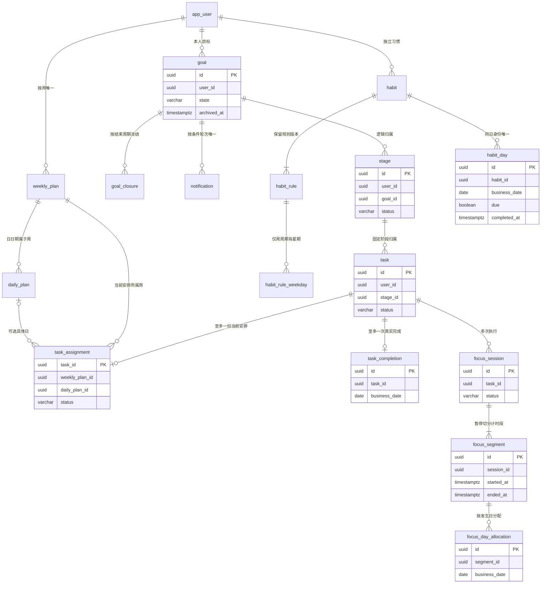

# A01 完整数据字典

> 文档版本 V2.0；核对日期 2026-10-22。继承现行契约和业务规则。后端仅有工程骨架；业务、DDL、前端及运行验证尚未完成。

## 1. 阅读方式、公共字段与类型

数据库基线为远程 PostgreSQL 17.11；开发和测试使用隔离的同版真实数据库。服务器已安装 pgvector 0.8.7 的 RPM，MVP 不引入向量字段或检索；本文时间排除约束所需 `btree_gist` 单独预检。精确版本来源、运行实例和扩展核验见 [12 技术版本基线](A08-技术版本基线.md)。

下文逐表列出全部专用字段；注明的公共字段集必须展开到物理表中，不能只建专用字段。`空=否` 表示 NOT NULL；`—` 表示没有数据库默认，应用必须提供或明确写 NULL；日期和时刻只接受有效有限值。

| 字段集 | 字段 | PostgreSQL 类型 | 空 | 默认/规则 |
|---|---|---|---|---|
| I | id | uuid | 否 | 主键；gen_random_uuid()，也允许应用预分配 UUID v4 |
| C | created_at | timestamptz(6) | 否 | clock_timestamp()；真实持久化时刻 |
| U | user_id | uuid | 否 | —；私有所有者，应用从当前身份取得并校验 |
| M | updated_at | timestamptz(6) | 否 | clock_timestamp()；更新时显式赋值，不假设数据库自动维护 |
| M | version | bigint | 否 | 0；≥0，条件更新成功后递增 |

`T` 以下指 `timestamptz(6)`。所有日期引用规则均使用 IANA 时区及固定边界，不得将服务器 UTC 日期当作用户日期。数字时长用秒或微秒，字段含单位。状态字符串采用下表给出的精确值和命名 CHECK。

行内非空文本检查使用 char_length>0；全部空白、合法汉字、可见字符等按 V4 由前后端统一 Unicode 校验，不擅自新增名称/描述最大长度。用户名和昵称的 30 字符上限来自业务基线。

所有 JSONB 快照/载荷采用对象结构、schema_version>0；不能含密码、哈希、会话或确认许可。64 KiB 工程上限只用于outbox、幂等结果和安全摘要等技术载荷，不用于必须冻结业务原文的完成/结束快照及正文变更节点。业务原文必须完整保留，不能创建时允许长正文、结束时因技术摘要上限拒绝或截断。源正文在明确列中保存，事件只带必要ID，避免复制长正文到技术队列。

## 2. 身份、时区与并发控制

### DB-01 app.app_user

公共字段：I+C+M。账户主身份，不物理删除。

| 字段 | 类型 | 空 | 默认 | 含义与规则 |
|---|---|---|---|---|
| username | varchar(30) | 否 | — | 1–30 字符，保留展示形式；合法字符按 V4 |
| username_key | varchar(30) COLLATE C | 否 | STORED 生成列 | translate(username,'ABCDEFGHIJKLMNOPQRSTUVWXYZ','abcdefghijklmnopqrstuvwxyz')；全局唯一 |
| nickname | varchar(30) | 否 | — | 1–30 字符；注册未填时服务写入注册用户名，后续独立修改 |
| password_hash | text | 否 | — | 完整 Argon2id 编码及必要参数，不保存密码原文 |
| role | varchar(16) | 否 | USER | USER / ADMIN / SUPER_ADMIN |
| status | varchar(16) | 否 | ENABLED | ENABLED / DISABLED |
| deleted_at | T | 是 | NULL | 后台逻辑删除；非空即拒绝登录 |
| security_version | bigint | 否 | 1 | >0；密码、授权或撤销变化的校验版本 |
| credential_version | bigint | 否 | 1 | >0；改密递增，不用改数字掩盖恢复旧哈希 |
| login_name_version | bigint | 否 | 1 | >0；改名递增，现有会话仍关联本账户 |
| password_changed_at | T | 否 | — | 初始设密及后续改密时刻 |
| current_zone_period_id | uuid | 否 | — | 本人当前已生效的时区区间 ID，逻辑关联 DB-02 |
| pending_zone_id | varchar(64) | 是 | NULL | 待生效 IANA 时区 |
| pending_zone_effective_at | T | 是 | NULL | 旧时区当日结束边界，与 pending_zone_id 同空同非空 |
| pending_zone_requested_at | T | 是 | NULL | 请求时刻，三个 pending 字段成组 |

username_key 由数据库生成，不能由请求直接填写；英文只作 ASCII 大小写转换，不额外使用会改变中文或符号语义的 NFKC。逻辑删除账户继续占用其保留行的当前登录名，唯一索引不按 deleted_at 过滤。改名后的旧键释放，但不能继续登录原账户。[生成列](https://www.postgresql.org/docs/18/ddl-generated-columns.html)

### DB-02 app.user_zone_period

公共字段：I+C+U。

| 字段 | 类型 | 空 | 默认 | 含义与规则 |
|---|---|---|---|---|
| revision | bigint | 否 | — | >0，同账户唯一版本 |
| zone_id | varchar(64) | 否 | — | 已校验的 IANA 名称，历史不改写 |
| tzdb_version | varchar(32) | 否 | — | 建立该区间时使用的规则版本标识 |
| valid_from | T | 否 | — | 实际生效时刻 |
| valid_to | T | 是 | NULL | 开放区间为空，关闭时一次写入且 >valid_from |
| source | varchar(24) | 否 | — | INITIAL_DEVICE / DEVICE_CHANGE / RECOVERY |

同账户区间不重叠，至多一条开放；正常改时区先关闭旧区间再新增并更新用户指针，同事务完成。引用该历史区间的事实保留，不能删除区间。

### DB-03 app.account_guard

公共字段：C+M；使用 user_id 为主键，不再添加 id。

| 字段 | 类型 | 空 | 默认 | 含义与规则 |
|---|---|---|---|---|
| user_id | uuid | 否 | — | PK；每账户一行，注册同事务建立 |
| recovered_generation | bigint | 否 | 0 | ≥0；已完成执行恢复的应用运行代次 |
| recovery_state | varchar(16) | 否 | CLEAR | CLEAR / ISOLATED / REVIEW；隔离时拒绝相应授权和写入 |
| isolation_reason | varchar(64) | 是 | NULL | 固定原因码，不放密码或正文 |

该行用于 FOR UPDATE 串行化；逻辑删除用户也不删除控制行。

### DB-04 app.runtime_guard

公共字段：C+M；单例。

| 字段 | 类型 | 空 | 默认 | 含义与规则 |
|---|---|---|---|---|
| singleton_id | smallint | 否 | 1 | PK；CHECK=1 |
| generation | bigint | 否 | 0 | ≥0；启动换代，关键事务校验 |
| instance_id | uuid | 是 | NULL | 当前 Java 实例身份 |
| state | varchar(16) | 否 | STOPPED | STOPPED / RECOVERING / READY |
| restore_epoch | uuid | 否 | — | 恢复会话代次，灾难恢复必须更新 |
| owner_started_at | T | 是 | NULL | 当前实例取得所有权的时刻 |

运行所有权使用独立连接的会话级 advisory lock；该行承载持久 fencing 代次，普通命令共享锁、启动换代排他更新。READY 必须有实例及启动时刻。恢复出的旧 READY 不是放行依据，启动仍先进入恢复流程。

### DB-05 app.admin_guard

公共字段：C+M。

| 字段 | 类型 | 空 | 默认 | 含义与规则 |
|---|---|---|---|---|
| singleton_id | smallint | 否 | 1 | PK；CHECK=1，管理不变量锁 |

管理员及配置关键变更在账户锁之前取得该行锁；不保存一份可能失真的超级管理员数量。

### DB-06 app.login_attempt

公共字段：M。

| 字段 | 类型 | 空 | 默认 | 含义与规则 |
|---|---|---|---|---|
| username_key | varchar(30) COLLATE C | 否 | — | PK；规范化提交用户名，可能不存在账户 |
| failure_count | smallint | 否 | 0 | 0–5；第 5 次进入锁定 |
| locked_until | T | 是 | NULL | 未锁定为空；到期或成功后清零 |
| last_failed_at | T | 是 | NULL | 最近有效凭据失败，不含滑动失败 |
| retain_until | T | 否 | — | 短期记录清理边界，不早于有效锁定终点 |

失败更新可靠提交，不能因登录拒绝异常回滚。保留时长是工程参数，不成为账户注册或业务使用配额。

### DB-07 app.captcha_challenge

公共字段：I+C+M。

| 字段 | 类型 | 空 | 默认 | 含义与规则 |
|---|---|---|---|---|
| purpose | varchar(16) | 否 | — | REGISTER / LOGIN |
| binding_digest | bytea | 否 | — | 本次受控请求/挑战绑定摘要，非用户画像 |
| verification_data | bytea | 否 | — | 服务端短期校验材料或受控引用，按实现加密保护 |
| expires_at | T | 否 | — | 到期拒绝且可清理 |
| consumed_at | T | 是 | NULL | 一次使用，重复不可重新通过 |

不保存每次滑动轨迹，不得将材料写入日志、去重快照或普通查询响应。消费与认证请求意图绑定；结果待核实重试按同一意图处理，不能换意图重复消费。

## 3. 目标、阶段、任务与业务历史

### DB-08 app.goal

公共字段：I+C+U+M。

| 字段 | 类型 | 空 | 默认 | 含义与规则 |
|---|---|---|---|---|
| name | text | 否 | — | 非空名称 |
| description | text | 否 | — | 非空描述 |
| completion_criteria | text | 否 | — | 非空完成条件 |
| start_date | date | 否 | — | 业务开始日 |
| expected_end_date | date | 否 | — | 当前预计结束日，≥start_date |
| baseline_duration_days | integer | 否 | — | ≥1；最近人工设定的含首尾日历天数，自动延期不改 |
| state | varchar(16) | 否 | — | PENDING / ACTIVE / COMPLETED，服务根据开始日写入 |
| archived_at | T | 是 | NULL | 主动归档；与业务状态正交 |
| closed_at | T | 是 | NULL | 当前已结束时刻；仅 COMPLETED 非空，重开清空但快照保留 |
| cycle_no | integer | 否 | 1 | >0；每次重开递增，不重置任务完成 |
| completion_condition_met | boolean | 否 | false | 当前是否处于有效全部完成条件，由源任务及状态计算维护 |
| condition_round | bigint | 否 | 0 | ≥0；新一轮条件成立递增，通知用此去重 |
| next_action_at | T | 是 | NULL | 可重建到期提示，实际资格仍即时校验 |

没有 deleted_at；运行角色不获 DELETE。当前任务 N/C、百分比与投入不持久化为独立可修改字段。自动延期严格使用 V4 已记录公式，不自行逐日反复叠加延期。

### DB-09 app.stage

公共字段：I+C+U+M。

| 字段 | 类型 | 空 | 默认 | 含义与规则 |
|---|---|---|---|---|
| goal_id | uuid | 否 | — | 本人父目标，逻辑关联 |
| name | text | 否 | — | 非空 |
| description | text | 否 | — | 非空 |
| completion_criteria | text | 是 | NULL | 可选条件 |
| start_date | date | 是 | NULL | 可选规划日 |
| end_date | date | 是 | NULL | 双日期填写时 ≥start_date |
| sort_order | bigint | 否 | 0 | ≥0；完整顺序由持锁用例保存，(sort_order,id) 稳定排序 |
| status | varchar(16) | 否 | NOT_STARTED | NOT_STARTED / IN_PROGRESS / PAUSED / DONE |
| completed_at | T | 是 | NULL | 仅 DONE 非空；重开保留旧业务节点 |
| deleted_at | T | 是 | NULL | 空阶段逻辑移除，当前清单排除 |

阶段完成前在账户锁内查当前有效任务和未结束执行；空阶段可确认完成。父目标不能因阶段完成自动结束。

### DB-10 app.task

公共字段：I+C+U+M。

| 字段 | 类型 | 空 | 默认 | 含义与规则 |
|---|---|---|---|---|
| stage_id | uuid | 否 | — | 本人所属阶段；目标通过阶段取得 |
| name | text | 否 | — | 非空 |
| description | text | 否 | — | 非空 |
| completion_criteria | text | 否 | — | 非空 |
| priority | varchar(8) | 否 | — | HIGH / MEDIUM / LOW，创建请求必填 |
| estimated_seconds | bigint | 是 | NULL | >0；计时中不修改，不作倒计时或实际时间 |
| start_date | date | 是 | NULL | 可选业务开始日 |
| due_date | date | 是 | NULL | 最终截止日；双日期填写时 ≥start_date |
| status | varchar(16) | 否 | NOT_STARTED | NOT_STARTED / IN_PROGRESS / PAUSED / DONE |
| deleted_at | T | 是 | NULL | 非空退出当前考核；不提供恢复删除入口 |

完成时间与当时安排统一由 DB-16 保存；DONE 不可回退。存在任意执行或完成事实时只能移除并保留身份，0 秒执行同样算开始过。

### DB-11 app.goal_event

公共字段：I+C+U，追加事实。

| 字段 | 类型 | 空 | 默认 | 含义与规则 |
|---|---|---|---|---|
| goal_id | uuid | 否 | — | 所属目标 |
| subject_type | varchar(8) | 否 | — | GOAL / STAGE |
| stage_id | uuid | 是 | NULL | STAGE 时必填且属于 goal_id；GOAL 时为空 |
| event_type | varchar(32) | 否 | — | CREATE / AUTO_START / EDIT / EXTEND / CLOSE / ARCHIVE / RESTORE / REOPEN / PAUSE / RESUME / DELETE_STAGE |
| occurred_at | T | 否 | — | 业务应生效时刻；created_at 为实际记录时刻 |
| cycle_no | integer | 否 | — | 目标当前推进区间，>0 |
| event_key | uuid | 否 | — | 稳定事件意图，(user_id,event_key) 唯一 |
| schema_version | smallint | 否 | 1 | 快照结构版本，>0 |
| snapshot | jsonb | 否 | '{}' | 动作允许的旧新值、延期 B/N/C 等明确键，不存整棵任务树 |

不接受 TASK 作为此表可变历史引用，避免没有执行的多余任务无法彻底删除。任务完成、执行各有自己的长期事实。

### DB-12 app.goal_closure

公共字段：I+C+U，不可变。

| 字段 | 类型 | 空 | 默认 | 含义与规则 |
|---|---|---|---|---|
| goal_id | uuid | 否 | — | 所属目标 |
| cycle_no | integer | 否 | — | 与 goal_id 构成唯一结束轮次 |
| end_type | varchar(24) | 否 | — | ALL_TASKS_CONFIRMED / USER_ENDED |
| closed_at | T | 否 | — | 用户确认的真实结束时刻 |
| task_count | integer | 否 | — | ≥0；结束当时有效任务 N |
| completed_count | integer | 否 | — | 0≤C≤N；不补完成子任务 |
| focus_microseconds | bigint | 否 | — | ≥0；结束当时真实投入快照 |
| schema_version | smallint | 否 | 1 | >0 |
| snapshot | jsonb | 否 | — | 当时名称、日期、完成条件等明确结构 |

N=0 进度显示无任务，不存虚构 100%。重开追加下一 cycle，旧快照不随后来任务删除重算。

## 4. 周日计划、当前安排与完成事实

### DB-13 app.weekly_plan

公共字段：I+C+U+M。

| 字段 | 类型 | 空 | 默认 | 含义与规则 |
|---|---|---|---|---|
| week_start_date | date | 否 | — | ISO 周一；(user_id,week_start_date) 唯一 |
| archived_at | T | 是 | NULL | 展示归档，不释放同周身份 |

不存虚构周目标数量或重复任务列表。无历史且引用处理完可物理删除，有事实复用身份。

### DB-14 app.daily_plan

公共字段：I+C+U+M。

| 字段 | 类型 | 空 | 默认 | 含义与规则 |
|---|---|---|---|---|
| weekly_plan_id | uuid | 否 | — | 本人对应周，逻辑关系 |
| plan_date | date | 否 | — | (user_id,plan_date) 唯一，服务校验位于关联周 |
| archived_at | T | 是 | NULL | 日计划展示归档，历史身份保留 |

日期及周归属创建后不变；更改安排移动 DB-15。无任务只返回空日视图，首次指定日再建行。

### DB-15 app.task_assignment

公共字段：C+U+M；task_id 为主键。

| 字段 | 类型 | 空 | 默认 | 含义与规则 |
|---|---|---|---|---|
| task_id | uuid | 否 | — | PK；唯一未完成任务安排，不增加 id |
| weekly_plan_id | uuid | 否 | — | 本人所选周 |
| daily_plan_id | uuid | 是 | NULL | 空为周内自由日期；非空须同账户同周 |
| sort_order | bigint | 否 | 0 | ≥0；按所在周/日清单解释，与优先级分别管理 |
| status | varchar(8) | 否 | ACTIVE | ACTIVE / PENDING；ACTIVE 不意味着今天可执行 |
| pending_kind | varchar(8) | 是 | NULL | DAY / WEEK，仅 PENDING 使用 |
| pending_business_date | date | 是 | NULL | 日日期或周起点，作为待处理依据 |
| pending_boundary_at | T | 是 | NULL | 原资格结束的绝对边界 |
| pending_since_at | T | 是 | NULL | 首次形成待处理的实际时刻 |

ACTIVE 的 pending 四字段为空；PENDING 四字段非空。日结束再周结束更新同一处理入口为 WEEK，不复制任务。完成后删除本行，由完成事实保存历史安排。

### DB-16 app.task_completion

公共字段：I+C+U，不可变。

| 字段 | 类型 | 空 | 默认 | 含义与规则 |
|---|---|---|---|---|
| task_id | uuid | 否 | — | 全表唯一；本人任务，仅一次完成 |
| stage_id | uuid | 否 | — | 完成时阶段身份，逻辑一致性由用例检查 |
| weekly_plan_id | uuid | 否 | — | 完成时有效周计划 |
| daily_plan_id | uuid | 是 | NULL | 无指定日期则为空 |
| scheduled_date | date | 是 | NULL | 当时指定日期快照，与 daily_plan_id 同空同非空 |
| completed_at | T | 否 | — | 真实完成时刻 |
| business_date | date | 否 | — | 完成当时的实际业务日，不等于任意安排日期 |
| zone_period_id | uuid | 否 | — | 当时生效的账户时区区间 |
| zone_id | varchar(64) | 否 | — | 当时 IANA 名称快照 |
| schema_version | smallint | 否 | 1 | >0 |
| snapshot | jsonb | 否 | — | 任务、阶段、目标名称等完成时摘要 |

可以没有任何 focus_session，实际投入因此为 0。删除任务只保留历史身份并退出当前考核，不删除本行。

## 5. 专注执行、时间修正与日归属

### DB-17 app.focus_session

公共字段：I+C+U+M。

| 字段 | 类型 | 空 | 默认 | 含义与规则 |
|---|---|---|---|---|
| task_id | uuid | 否 | — | 本人任务，开始/继续前校验当前有效计划 |
| status | varchar(8) | 否 | RUNNING | RUNNING / PAUSED / ENDED |
| started_at | T | 否 | — | 本次首次执行开始，之后不改变 |
| ended_at | T | 是 | NULL | 仅 ENDED 非空，≥started_at |
| pause_reason | varchar(32) | 是 | NULL | 仅 PAUSED 非空，原因见下方 |

暂停原因为 USER_PAUSE、SWITCH、OWNER_TAKEOVER、PLAN_CHANGED、DISCONNECTED、SESSION_REVOKED、STAGE_PAUSED、DATE_EXPIRED、WEEK_EXPIRED、ZONE_CHANGED、PROCESS_RESTART、CLOCK_ANOMALY。运行中改期或移出计划使用PLAN_CHANGED；状态及原因成对检查；同任务未结束唯一，同账户 RUNNING 唯一，PAUSED 可以多条。

### DB-18 app.focus_segment

公共字段：I+C+U+M；区间起点和历史上下文创建后固定。

| 字段 | 类型 | 空 | 默认 | 含义与规则 |
|---|---|---|---|---|
| session_id | uuid | 否 | — | 本次执行 |
| task_id | uuid | 否 | — | 与执行相同任务，便于历史查验和索引 |
| started_at | T | 否 | — | 段开始，闭合后也不修改 |
| last_confirmed_at | T | 否 | — | 初始等于开始；运行中单调推进 |
| ended_at | T | 是 | NULL | 空为开放区间，闭合终点≥last_confirmed_at |
| close_reason | varchar(32) | 是 | NULL | 开放为空，闭合必填；暂停原因加 USER_END / TASK_COMPLETE / GOAL_END |
| interruption_repairable | boolean | 否 | false | 仅既有异常中断末段可标为可受限修正，不代表任意改时间 |
| weekly_plan_id | uuid | 否 | — | 当时有效周身份，后续不迁移 |
| daily_plan_id | uuid | 是 | NULL | 当时可空指定日身份 |
| scheduled_date | date | 是 | NULL | 与指定日 ID 成对的历史日期快照 |
| eligibility_end_at | T | 否 | — | 当时指定日末或周末的资格上界 |
| zone_period_id | uuid | 否 | — | 开始时生效的用户时区区间 |
| zone_id | varchar(64) | 否 | — | IANA 名称快照 |
| tzdb_version | varchar(32) | 否 | — | 生成本段日边界所用规则版本 |

行检查：started_at≤last_confirmed_at≤eligibility_end_at；若 ended_at 非空则 last_confirmed_at≤ended_at≤eligibility_end_at。终点不晚于当前真实时刻由服务校验，不在 CHECK 中依赖 now()。

GiST 排除使用整个段的 `[started_at,ended_at)`，开放上界无界；统计开放段只取 last_confirmed_at，不能把无界区间当成已投入时间。修正后 ended_at 可晚于原确认点，但必须有 DB-20 的有效依据。

### DB-19 app.execution_control

公共字段：C+M；user_id 为主键。

| 字段 | 类型 | 空 | 默认 | 含义与规则 |
|---|---|---|---|---|
| user_id | uuid | 否 | — | PK；注册同事务建立待机行 |
| control_epoch | bigint | 否 | 0 | ≥0；切换、接管、暂停及恢复换代，不回退 |
| runtime_generation | bigint | 否 | 0 | 当前控制所属运行代次 |
| active_session_id | uuid | 是 | NULL | 本人 RUNNING 执行 |
| active_segment_id | uuid | 是 | NULL | 该执行开放区间 |
| controller_instance_id | uuid | 是 | NULL | 当前控制页面实例，不是身份凭证 |
| controller_session_key | char(36) | 是 | NULL | 当前 Spring Session PRIMARY_ID 快照，不建立外键 |
| next_sequence | bigint | 是 | NULL | 活动时 >0，下一允许确认序号 |
| next_permit | bytea | 是 | NULL | 一个短期随机许可，至少 32 字节；严格限制查询与日志 |
| permit_expires_at | T | 是 | NULL | 初始按 T+15 秒；重复请求不能改长 |

待机时自 active_session_id 至 permit_expires_at 的活动字段全部为空；活动时全部非空。许可仅在受控执行确认响应中返回当前控制页，普通查询不得 SELECT * 或返回该列；持久备份加密保护。下一许可仅在仍匹配的提交结果重试中取回原值，不另签发延长期限。

身份依赖真实框架会话、账户状态、安全版本及恢复代次。这里存会话标识不会使已清理或已撤销会话继续有效。

### DB-20 app.focus_adjustment

公共字段：I+C+U，追加事实。

| 字段 | 类型 | 空 | 默认 | 含义与规则 |
|---|---|---|---|---|
| segment_id | uuid | 否 | — | 本人可修正异常末段 |
| old_end_at | T | 否 | — | 修正前闭合终点 |
| new_end_at | T | 否 | — | 修正后的真实终点，不得等于旧值 |
| old_segment_version | bigint | 否 | — | 原版本，≥0 |
| new_segment_version | bigint | 否 | — | 原版本+1，与 segment_id 唯一 |
| reason | text | 否 | — | 用户确认的真实末段说明，非空 |
| operation_id | uuid | 否 | — | 稳定操作意图 |
| business_date | date | 否 | — | 修正动作发生时冻结的业务日期，历史事件筛选使用，实际投入仍计源区间 |
| zone_period_id | uuid | 否 | — | 修正当时本人有效时区身份，逻辑关联DB-02 |
| zone_id | varchar(64) | 否 | — | 修正动作当时IANA时区快照，不随设备以后变化 |

同事务追加本行并更新末段；不修改主动暂停，不新建过去执行，不与任何本人有效区间重叠。修正时刻使用 created_at，不改原 started_at、计划或时区。

### DB-21 app.focus_day_allocation

公共字段：I+C+U，历史日期依据。

| 字段 | 类型 | 空 | 默认 | 含义与规则 |
|---|---|---|---|---|
| segment_id | uuid | 否 | — | 对应源区间 |
| business_date | date | 否 | — | (segment_id,business_date) 唯一 |
| zone_id | varchar(64) | 否 | — | 原 IANA 名称 |
| tzdb_version | varchar(32) | 否 | — | 原边界规则版本 |
| day_start_at | T | 否 | — | 该业务日固定起点 |
| day_end_at | T | 否 | — | 该业务日固定终点，>day_start_at，不固定为 24 小时 |

不存 actual_seconds。贡献计算为 `max(0,min(可信终点,day_end_at)-max(started_at,day_start_at))`；闭合取 ended_at，开放取 last_confirmed_at。每次确认/关闭/修正事务保证可信范围的日期边界齐全。缩短末段不改旧边界，多余日期的求交结果为 0。

## 6. 习惯、规则版本与结算

### DB-22 app.habit

公共字段：I+C+U+M。

| 字段 | 类型 | 空 | 默认 | 含义与规则 |
|---|---|---|---|---|
| current_rule_id | uuid | 否 | — | 本人当前规则；创建时预生成首版 ID 并同事务插入 |
| status | varchar(8) | 否 | ACTIVE | ACTIVE / PAUSED / ENDED |
| ended_at | T | 是 | NULL | 仅 ENDED 非空；恢复后清空，原节点保留 |
| deleted_at | T | 是 | NULL | 删除后不触发、不在可恢复对象中出现 |

名称、类别、描述、条件及周期只在规则表保存，当前展示按 current_rule_id 取得，不维护两套可变内容。

### DB-23 app.habit_rule

公共字段：I+C+U。

| 字段 | 类型 | 空 | 默认 | 含义与规则 |
|---|---|---|---|---|
| habit_id | uuid | 否 | — | 所属本人习惯 |
| revision | integer | 否 | — | >0，与 habit_id 唯一 |
| name | text | 否 | — | 非空名称 |
| category | varchar(24) | 否 | — | 下列固定八类 |
| completion_criteria | text | 否 | — | 非空具体条件 |
| description | text | 是 | NULL | 可选描述 |
| cycle_type | varchar(8) | 否 | — | DAILY / WEEKLY |
| execution_time | time(0) without time zone | 是 | NULL | 当地可选钟点，只作描述，不产生提醒 |
| valid_from | T | 否 | — | 本版本实际开始生效 |
| valid_to | T | 是 | NULL | 替换后关闭，≥valid_from；同瞬间多次变更允许零长版本 |
| effective_business_date | date | 否 | — | 修改当天日期快照 |
| effective_zone_id | varchar(64) | 否 | — | 当时 IANA 名称 |

category：SLEEP_ROUTINE（睡眠作息）、FOOD_WATER（饮食饮水）、FITNESS（运动身体健康）、LEARNING（学习认知）、LIFE_ORDER（生活秩序）、MENTAL_HEALTH（心理情绪）、RELATIONSHIP（人际关系）、OTHER（其他）。

旧内容不更新，只允许结束旧版生效区间；新版本、星期、习惯指针与变更节点同事务写入。DAILY 无星期子行，WEEKLY 至少一行，由服务锁内完整校验。生效区间按同习惯不重叠设计 `ex_habit_rule_no_overlap`，GiST 使用 habit_id 与 `[valid_from,valid_to)`；零长旧版本不贡献区间，当前指针仍唯一。

### DB-24 app.habit_rule_weekday

无公共字段；复合主键。

| 字段 | 类型 | 空 | 默认 | 含义与规则 |
|---|---|---|---|---|
| rule_id | uuid | 否 | — | PK 第 1 列；逻辑关联规则版本 |
| iso_weekday | smallint | 否 | — | PK 第 2 列；CHECK 1–7，周一为 1 |

不再复制 user_id；写入前通过规则查习惯及所有者。同一规则星期集合创建后固定，随规则保留。

### DB-25 app.habit_event

公共字段：I+C+U，不可变时间线。

| 字段 | 类型 | 空 | 默认 | 含义与规则 |
|---|---|---|---|---|
| habit_id | uuid | 否 | — | 本人习惯 |
| event_type | varchar(16) | 否 | — | CREATE / RULE_CHANGED / PAUSE / RESUME / END / REOPEN / DELETE |
| occurred_at | T | 否 | — | 实际动作时刻 |
| business_date | date | 否 | — | 当时业务日 |
| zone_id | varchar(64) | 否 | — | 当时 IANA 名称 |
| from_status | varchar(8) | 是 | NULL | 创建为空，否则使用习惯状态 |
| to_status | varchar(8) | 是 | NULL | 删除可为空，其余为动作后的状态 |
| from_rule_id | uuid | 是 | NULL | 创建前为空 |
| to_rule_id | uuid | 是 | NULL | 有效后规则，删除按摘要需要保留 |
| event_key | uuid | 否 | — | (user_id,event_key) 唯一 |
| schema_version | smallint | 否 | 1 | >0 |
| snapshot | jsonb | 否 | '{}' | 允许字段的变更说明/删除摘要，不放整段用户数据 |

同值保存不生成虚假事件。历史回放按 occurred_at、created_at、id 稳定排序，规则 revision 在同瞬间给出明确顺序。

### DB-26 app.habit_day

公共字段：I+C+U+M。

| 字段 | 类型 | 空 | 默认 | 含义与规则 |
|---|---|---|---|---|
| habit_id | uuid | 否 | — | 本人习惯 |
| business_date | date | 否 | — | 与 habit_id 唯一，重复日期不重开 |
| zone_period_id | uuid | 否 | — | 形成该日结果的已生效时区区间 |
| zone_id | varchar(64) | 否 | — | 固定 IANA 名称 |
| tzdb_version | varchar(32) | 否 | — | 固定边界规则版本 |
| day_start_at | T | 否 | — | 固定日开始 |
| day_end_at | T | 否 | — | 固定日结束，>day_start_at |
| due | boolean | 否 | false | 是否计入分母；今天可调整，完成后必须 true |
| evaluated_rule_id | uuid | 否 | — | 当前日判断时规则，服务校验归属 |
| completed_at | T | 是 | NULL | 非空即真实完成，必须处于固定日边界内 |
| completed_rule_id | uuid | 是 | NULL | 完成当时规则，与 completed_at 同空同非空，之后不变 |
| settled_at | T | 是 | NULL | 非空即已经结算只读 |
| settled_rule_id | uuid | 是 | NULL | 日结束边界前最后有效规则，与 settled_at 成对 |

数据库检查完成必 due=true；不另存 completed 布尔避免同一事实两种表达。完成后改周期、暂停或删除可更新当日未结算的评估依据，但不能撤销 completed_at、完成规则或 due=true。未完成日结算采用最后规则和状态，已结算行整体只读。

## 7. 通知、配置、审计与可靠处理

### DB-27 app.notification

公共字段：I+C+U+M。

| 字段 | 类型 | 空 | 默认 | 含义与规则 |
|---|---|---|---|---|
| goal_id | uuid | 否 | — | 本人目标；先校验归属 |
| condition_round | bigint | 否 | — | >0，与 goal_id 唯一，沿用目标条件轮次 |
| type | varchar(32) | 否 | GOAL_COMPLETION_CONFIRM | 本版只有目标完成确认通知 |
| title | text | 否 | — | 安全展示标题，非空 |
| content | text | 否 | — | 目标及条件摘要；不含凭据 |
| action_state | varchar(16) | 否 | PENDING | PENDING / CONTINUED / CONFIRMED / INVALIDATED |
| read_at | T | 是 | NULL | 已读只影响未读标记，不代表确认结束 |
| handled_at | T | 是 | NULL | CONTINUED/CONFIRMED 的实际处理时刻 |
| invalidated_at | T | 是 | NULL | 条件失效时刻，与 INVALIDATED 成对 |
| invalid_reason | varchar(32) | 是 | NULL | GOAL_CLOSED / GOAL_ARCHIVED / CONDITION_CHANGED |

通知动作重新校验目标，不直接按内容完成。已读、继续、确认与条件失效分别表达；同轮已有记录时不创建第二条。事件清理不得清掉唯一去重依据。

### DB-28 app.system_config

公共字段：M；config_key 为主键。

| 字段 | 类型 | 空 | 默认 | 含义与规则 |
|---|---|---|---|---|
| config_key | varchar(32) | 否 | — | PK；仅 SITE_NAME / REGISTRATION_OPEN |
| value_text | text | 是 | NULL | SITE_NAME 必填，1–30 个可见字符 |
| value_boolean | boolean | 是 | NULL | REGISTRATION_OPEN 必填 |
| updated_by | uuid | 是 | NULL | 修改者稳定 ID；初始化可空 |

两键对应值类型互斥。种子为 SITE_NAME=Asterway、REGISTRATION_OPEN=true；运行角色仅能更新值，不可增加或删除配置键。工程参数不进入本表。

### DB-29 app.audit_event

公共字段：I+C；系统/安全审计，不作为永久业务历史。

| 字段 | 类型 | 空 | 默认 | 含义与规则 |
|---|---|---|---|---|
| actor_user_id | uuid | 是 | NULL | 操作者；匿名或系统事件可空 |
| target_user_id | uuid | 是 | NULL | 涉及的账户，非所有者授权凭据 |
| action | varchar(64) | 否 | — | 固定动作码，不接受客户端任意指令 |
| object_type | varchar(32) | 否 | — | ACCOUNT / CONFIG / AUTH / RECOVERY 等 |
| object_id | varchar(100) | 是 | NULL | 稳定标识快照，可指向已物理移除对象 |
| occurred_at | T | 否 | — | 实际动作时刻 |
| outcome | varchar(16) | 否 | — | SUCCESS / REJECTED / FAILED |
| trace_id | varchar(64) | 否 | — | 排错关联，不是凭证 |
| schema_version | smallint | 否 | 1 | >0 |
| details | jsonb | 否 | '{}' | 允许字段的旧新状态与原因，不存密码、哈希、令牌或正文 |

必要管理审计与变更同事务。凭据失败计数的提交不能因为错误提示而回滚；审计按 NFR 单独轮转。

### DB-30 app.request_dedup

公共字段：I+C+M。

| 字段 | 类型 | 空 | 默认 | 含义与规则 |
|---|---|---|---|---|
| scope_key | varchar(100) | 否 | — | USER:稳定UUID，或服务端受控匿名作用域；不能由请求任意指定 |
| user_id | uuid | 是 | NULL | 登录态作用域必填；匿名可空 |
| operation | varchar(64) | 否 | — | 原接口编号，如API-AUTH-008，参数指纹另含Path对象身份 |
| idempotency_key | uuid | 否 | — | 与 scope_key、operation 唯一 |
| request_fingerprint | bytea | 否 | — | 服务端密钥保护的规范化请求指纹，用于同键同意图校验 |
| state | varchar(16) | 否 | PROCESSING | PROCESSING / SUCCEEDED / REJECTED |
| http_status | smallint | 是 | NULL | 已确定结果的状态码，100–599 |
| result_code | varchar(64) | 是 | NULL | 稳定结果码 |
| result_type | varchar(32) | 是 | NULL | GOAL / TASK / FOCUS_SESSION / ACCOUNT 等 |
| result_id | uuid | 是 | NULL | 可安全查询的结果对象身份 |
| schema_version | smallint | 否 | 1 | >0 |
| result_summary | jsonb | 否 | '{}' | 安全快照；不保存下一许可、会话、密码或挑战秘密 |
| expires_at | T | 否 | — | 到期方可有界清理；未决意图先核对再清理 |

结果与核心写入同事务保存；并发同键只能由一个事务执行。含密码请求不存原文或可离线猜测的普通摘要。确认许可响应只从 execution_control 当前有效控制状态取回原值，不能靠旧结果摘要重新激活。

### DB-31 app.outbox_event

公共字段：I+C+M。

| 字段 | 类型 | 空 | 默认 | 含义与规则 |
|---|---|---|---|---|
| user_id | uuid | 是 | NULL | 私有事件必填；全局工程事件可空 |
| event_type | varchar(64) | 否 | — | 第15节固定事件：GOAL_CONDITION_MET / GOAL_CONDITION_INVALIDATED / GOAL_CLOSED / SECURITY_RESULT_SYNC |
| business_key | varchar(200) | 否 | — | 与 event_type 唯一，如目标UUID+条件轮次 |
| object_id | uuid | 否 | — | 所属对象或安全操作身份 |
| schema_version | smallint | 否 | 1 | >0 |
| payload | jsonb | 否 | — | 允许的标识、版本及必要事实，不存整份业务正文 |
| status | varchar(16) | 否 | PENDING | PENDING / PROCESSING / RETRY / DONE / OBSOLETE |
| attempt_count | integer | 否 | 0 | ≥0 |
| next_attempt_at | T | 否 | — | 可再次处理的时间 |
| claim_generation | bigint | 否 | 0 | ≥0；每次认领递增，旧消费者不可覆盖终态 |
| claimed_by | uuid | 是 | NULL | PROCESSING 时的工作者身份 |
| claim_until | T | 是 | NULL | PROCESSING 时必填，认领到期可回收 |
| completed_at | T | 是 | NULL | DONE/OBSOLETE 的终态时间 |
| last_error_code | varchar(64) | 是 | NULL | 脱敏错误类别，不存堆栈或秘密 |

先用短事务认领再释放锁；正式处理按运行/账户锁序重新校验，通知与消费终态同事务。claim_generation 是认领版本，不等于应用 runtime_generation。

### DB-32 app.security_change

公共字段：C+M；operation_id 为主键。

| 字段 | 类型 | 空 | 默认 | 含义与规则 |
|---|---|---|---|---|
| operation_id | uuid | 否 | — | PK；独立账本与本地事务的同一意图 |
| target_user_id | uuid | 是 | NULL | 账户操作必填，全局恢复代次变化可空 |
| actor_user_id | uuid | 是 | NULL | 操作者，受控系统恢复可空 |
| change_type | varchar(32) | 否 | — | PASSWORD / LOGIN_NAME / STATUS / ROLE / DELETE / SESSION_REVOKE / RESTORE / RESTORE_EPOCH |
| expected_security_version | bigint | 是 | NULL | 账户预期安全版本 |
| before_login_name_version | bigint | 是 | NULL | 改名前版本，避免旧恢复点重新接受旧用户名 |
| after_security_version | bigint | 是 | NULL | 提交后的安全版本 |
| after_credential_version | bigint | 是 | NULL | 新凭据版本；不是密码材料 |
| after_login_name_version | bigint | 是 | NULL | 新登录标识版本 |
| db_outcome | varchar(16) | 否 | PENDING | PENDING / COMMITTED / ABORTED |
| external_state | varchar(16) | 否 | PENDING | PENDING / INTENT_SAVED / RESULT_SAVED |
| external_reference | text | 是 | NULL | 受控账本记录引用，不含存储访问凭据 |
| committed_at | T | 是 | NULL | COMMITTED 时必填 |
| last_sync_at | T | 是 | NULL | 最近外部同步时刻 |
| schema_version | smallint | 否 | 1 | >0 |
| safe_summary | jsonb | 否 | '{}' | 允许的状态、角色、标识核验摘要；无密码、哈希或令牌 |

新用户名、昵称变更不必然注销会话；改名只推进登录名版本。该表可随备份回退，因此不能单凭本地行证明独立账本完整。未决外部意图在恢复时按架构隔离核验。

### DB-33 app.job_checkpoint

公共字段：I+C+U+M。

| 字段 | 类型 | 空 | 默认 | 含义与规则 |
|---|---|---|---|---|
| job_type | varchar(16) | 否 | — | PLAN_DAY / PLAN_WEEK / HABIT_DAY / ZONE_APPLY |
| last_completed_boundary | T | 是 | NULL | 最近可靠完成的绝对边界，不以“任务启动过”推进 |
| last_business_date | date | 是 | NULL | 最近处理的日日期/周起点，作为解释信息 |
| zone_period_id | uuid | 否 | — | 当前处理位置所依时区区间 |
| next_due_at | T | 是 | NULL | 待处理边界；无待生效时区时 ZONE_APPLY 可空 |
| last_result_key | varchar(200) | 是 | NULL | 上一边界的稳定去重依据 |
| last_error_code | varchar(64) | 是 | NULL | 脱敏错误类别，失败不推进游标 |

(user_id,job_type) 唯一；持账户锁分批追赶，结果和游标同事务。目标启动/延期由 goal.next_action_at 与永久节点去重，执行过期由控制许可扫描，不再为每个动作增加独立调度系统。

## 8. 框架管理表

这三张表不按公共字段集展开，列名与锁定框架版本保持兼容。下面是设计核对清单，工程时依据实际依赖比对官方结构；没有创建外键或运行自动初始化。

### DB-34 session_store.spring_session

| 字段 | 类型 | 空 | 默认 | 含义与规则 |
|---|---|---|---|---|
| primary_id | char(36) | 否 | — | PK；框架内部身份 |
| session_id | char(36) | 否 | — | 框架会话凭证，唯一，不写日志 |
| creation_time | bigint | 否 | — | Unix 毫秒，遵循框架类型 |
| last_access_time | bigint | 否 | — | Unix 毫秒 |
| max_inactive_interval | integer | 否 | — | 框架秒数；不得将默认闲置超时擅自当成产品规则 |
| expiry_time | bigint | 否 | — | 框架到期毫秒 |
| principal_name | varchar(100) | 是 | NULL | 认证后使用稳定用户 UUID 字符串，不能使用可改用户名 |

索引为 SESSION_ID 唯一、EXPIRY_TIME、PRINCIPAL_NAME。属性里只放必要身份、安全版本、恢复代次和 CSRF 状态，不存整棵任务树或密码哈希。

### DB-35 session_store.spring_session_attributes

| 字段 | 类型 | 空 | 默认 | 含义与规则 |
|---|---|---|---|---|
| session_primary_id | char(36) | 否 | — | 复合 PK 第 1 列，仅逻辑关联会话 |
| attribute_name | varchar(200) | 否 | — | 复合 PK 第 2 列 |
| attribute_bytes | bytea | 否 | — | 框架受控序列化，禁止反序列化用户任意类型 |

明确去掉官方脚本默认外键与级联。属性写入和会话删除必须在仓库实际事务中锁父会话并显式处理，见后面的框架适配要求。[Spring Session JDBC 配置](https://docs.spring.io/spring-session/reference/configuration/jdbc.html)

### DB-36 migration_meta.flyway_schema_history

| 字段 | 类型 | 空 | 默认 | 含义与规则 |
|---|---|---|---|---|
| installed_rank | integer | 否 | — | PK；执行次序 |
| version | varchar(50) | 是 | NULL | 版本迁移标识，重复迁移可空 |
| description | varchar(200) | 否 | — | 迁移说明 |
| type | varchar(20) | 否 | — | 框架迁移种类 |
| script | varchar(1000) | 否 | — | 迁移文件名 |
| checksum | integer | 是 | NULL | 框架校验值 |
| installed_by | varchar(100) | 否 | — | 迁移身份 |
| installed_on | timestamp without time zone | 否 | 框架当前时刻 | 保持框架原定义，不改成业务时间字段 |
| execution_time | integer | 否 | — | 框架毫秒 |
| success | boolean | 否 | — | 框架执行状态，按官方结构建立相应索引 |

由 Flyway 创建和管理，应用业务代码不增删改。本行结构在锁定具体 Flyway 补丁时与其实际生成结构核对，不实施一套自定义迁移引擎。

## 9. 编号和状态

字段唯一编号采用“表编号.字段名”，例如 DB-18.last_confirmed_at；公共字段展开后同样有编号。前端字段使用 camelCase，数据库字段使用 snake_case，逐 DTO 映射，不得将数据库行原样返回。

当前设计共 DB-01～DB-36：33 张项目表、2 张会话表、1 张迁移表。本册定义当前版本的完整字段基线。文档核对、DDL 生成、数据库执行、约束测试和压测分别记录，设计审查不替代运行验证。

## 10. 逻辑关系与删除检查

| 编号 | 关系 | 创建、修改或删除时必须检查 |
|---|---|---|
| REL-01 | 用户→时区区间、账户锁、执行控制、周期检查点 | 注册同事务产生初始身份；当前时区属于本人、唯一开放；控制与活动执行一致 |
| REL-02 | 目标→阶段→任务 | 父存在、user_id一致、状态可写；阶段不换目标，任务不换阶段；任务表不重复存goal_id |
| REL-03 | 周计划→日计划 | 同账户，日落在该周周一至周日；账户/日期身份唯一且创建后固定 |
| REL-04 | 任务→当前安排→周/可选日 | task_id唯一；父子同账户同周；日为空就是本周无日期任务，不另存scheduled_date |
| REL-05 | 任务→完成事实 | 完成时记录阶段/周/可选日及正文快照；任务DONE与完成事实一致；成功后删除当前安排 |
| REL-06 | 任务→执行→区间→日期归属/修正 | session与segment同人同任务；当时计划和时区固定；不能随当前迁移改写旧段 |
| REL-07 | 执行控制→RUNNING session/开放segment | 三者同一账户和当前代次，真实框架会话仍有效；快照会话标识不阻止框架清理 |
| REL-08 | 习惯→当前规则→星期 | 规则属于该习惯；DAILY无星期，WEEKLY有1～7非重复集合；变更不覆盖旧版 |
| REL-09 | 习惯日→完成/结算时规则 | 各规则属于该习惯且符合相应时间节点；结算后不改归属和结果 |
| REL-10 | 目标→结束快照/通知/节点 | 同人同目标；阶段节点确属该目标；结束按cycle_no、通知按condition_round去重 |
| REL-11 | 会话→属性 | 无物理外键；框架仓库实际事务内锁父、查父再保存属性，删除先属性后父 |
| REL-12 | 审计/安全记录/事件→对象标识 | 按类型保存身份和安全摘要；合法物理删除的对象可只留标识，不强行阻止删除或伪造父行 |

所有私有关系创建和删除都拿相同账户锁；查询父行还要检查 user_id，不能只检查 UUID 存在。物理删除前查全部当前和历史引用；没有历史的子项同事务显式删除，有历史的父身份保留并标记退出当前范围。用户、目标、事实和永久节点不走通用物理删除。

任务完全未执行、未完成且没有需要保留的引用可物理删除；已有任何真实执行或完成则逻辑删除，保留身份和贡献，先结束所有相关执行。阶段仅当前有效任务为空时可删除；历史任务归属不丢。计划未执行且无完成/历史引用可物理删除；有事实时归档保留周期身份。习惯删除保留历史，不能恢复删除项。按时区结算过去周期后再处理今天，不用今天状态抹去过去事实。

每日低峰、发布后、恢复后执行有界孤立引用巡检：缺父、跨账户、日周错配、当前指针错配。异常隔离后人工核对，不自动删历史。巡检不能代替事务内校验。

## 11. 必须实现的数据库约束

### 11.1 主键和唯一键

所有id主键、单例主键、复合主键按字典实现；下表为额外业务唯一约束。没有为了物理外键而添加的冗余唯一键。

| 名称 | 表与键/条件 |
|---|---|
| uq_app_user_username_key | app_user.username_key，全局，逻辑删除不释放用户名 |
| uq_zone_revision / ux_zone_open | user_zone_period(user_id,revision)；user_id在valid_to为空时唯一 |
| uq_goal_closure_cycle | goal_closure(goal_id,cycle_no) |
| uq_goal_event_key | goal_event(user_id,event_key) |
| uq_weekly_plan_user_week / uq_daily_plan_user_date | weekly_plan(user_id,week_start_date)；daily_plan(user_id,plan_date)，归档不释放 |
| uq_task_completion_task | task_completion(task_id) |
| ux_focus_session_unfinished / ux_focus_session_running | focus_session.task_id在RUNNING/PAUSED时唯一；user_id在RUNNING时唯一 |
| ux_focus_segment_open_user / ux_focus_segment_open_session | focus_segment的user_id、session_id分别在ended_at为空时唯一 |
| uq_adjustment_version | focus_adjustment(segment_id,new_segment_version) |
| uq_allocation_day | focus_day_allocation(segment_id,business_date) |
| uq_habit_rule_revision / uq_habit_event_key | habit_rule(habit_id,revision)；habit_event(user_id,event_key) |
| uq_habit_day_date | habit_day(habit_id,business_date) |
| uq_notification_round | notification(goal_id,condition_round) |
| uq_request_intent | request_dedup(scope_key,operation,idempotency_key) |
| uq_outbox_business_key | outbox_event(event_type,business_key) |
| uq_job_scope | job_checkpoint(user_id,job_type) |

task_assignment的task_id、security_change的operation_id已经是主键，不重复建相同唯一索引。session的session_id唯一，属性的(session_primary_id,attribute_name)复合主键遵循框架结构。

### 11.2 行内检查与不重叠

命名使用ck_表名_含义。NOT NULL、枚举、正数、日期顺序、成对空值逐项按照本字典落实。CHECK遇到NULL可能不拒绝，因此不能省略IS NULL/IS NOT NULL组合。[PostgreSQL约束说明](https://www.postgresql.org/docs/18/ddl-constraints.html)

| 名称/范围 | 约束内容 |
|---|---|
| ex_focus_segment_no_overlap | 同user_id的[started_at,ended_at)不相交；开放上界无界，先闭旧段再开新段；零长闭段不贡献时间 |
| ex_zone_period_no_overlap | 同user_id的[valid_from,valid_to)不相交，区间必须为正长度 |
| ex_habit_rule_no_overlap | 同habit_id的[valid_from,valid_to)不相交，允许同一时刻连续改规则产生零长旧版，不允许负长度 |
| 时间排除实现 | 三者使用GiST和btree_gist，UUID等值+时间范围相交排除；这是本表时间约束，不是外键 |
| 控制/区间配对 | 活动控制字段全有或全空，非负代次；起点≤确认点≤资格上界，已闭段终点在确认点与资格上界之间 |
| 习惯/配置配对 | 完成意味着due；完成时间/规则成对；结算时间/规则成对；仅两个配置键且值类型互斥 |
| 通知动作 | PENDING时handled_at为空；CONTINUED/CONFIRMED时handled_at非空；INVALIDATED时invalidated_at与invalid_reason非空。曾CONTINUED后失效可保留原handled_at作为历史 |
| 去重/事件 | PROCESSING不能伪装已成功HTTP；终态具备安全结果；PROCESSING事件须带认领者和到期；DONE/OBSOLETE有completed_at，失败不生成虚假完成 |

三项排除约束均须实际并发验证，不能只靠应用先查后写。[范围类型与排除约束](https://www.postgresql.org/docs/18/rangetypes.html)、[btree_gist](https://www.postgresql.org/docs/18/btree-gist.html)

只对本行的不可变性可设置保护触发器：DONE不回退、完成事实/结束快照/永久节点不可改删、已结算习惯日不可改、段起点及上下文不可移动、固定配置不可增删。触发器不查询父表、不级联、不模拟引用约束。跨表当前指针、角色和状态机仍由持锁服务事务检查。

## 12. 初始索引清单

主键、唯一和排除约束自带的索引不重复建。以下普通索引列顺序是初始设计，实际实施后用参考数据和EXPLAIN验证，不宣称已经调优。

| 名称 | 表及列 | 条件/用途 |
|---|---|---|
| ix_app_user_admin | app_user(role,status,created_at,id) | 后台账户筛选 |
| ix_zone_user_time | user_zone_period(user_id,valid_from,id) | 历史时区 |
| ix_goal_user_list | goal(user_id,archived_at,state,created_at倒序,id) | 稳定列表 |
| ix_goal_due | goal(next_action_at,user_id,id) | 未归档非COMPLETED到期扫描 |
| ix_stage_goal_order | stage(user_id,goal_id,sort_order,id) | deleted_at为空 |
| ix_task_stage_state | task(user_id,stage_id,status,id) | deleted_at为空，进度及空阶段判断 |
| ix_task_user_created | task(user_id,created_at倒序,id) | deleted_at为空，任务池 |
| ix_task_deadline | task(user_id,due_date,id) | due_date非空且未删除非DONE；谓词不写today/now |
| ix_goal_event_timeline | goal_event(user_id,goal_id,occurred_at,id) | 永久节点 |
| ix_assignment_week | task_assignment(user_id,weekly_plan_id,status,sort_order,task_id) | 周清单与查引用 |
| ix_assignment_day | task_assignment(user_id,daily_plan_id,sort_order,task_id) | daily_plan_id非空 |
| ix_assignment_pending | task_assignment(user_id,pending_boundary_at,task_id) | PENDING |
| ix_completion_date | task_completion(user_id,business_date,task_id) | 完成统计 |
| ix_completion_plan | task_completion(user_id,weekly_plan_id,daily_plan_id,task_id) | 历史计划引用 |
| ix_session_task | focus_session(user_id,task_id,started_at倒序,id) | 执行历史 |
| ix_segment_session | focus_segment(session_id,started_at,id) | 段明细 |
| ix_segment_task_time | focus_segment(user_id,task_id,started_at,id) | 归属累计 |
| ix_segment_plan | focus_segment(user_id,weekly_plan_id,daily_plan_id,started_at,id) | 计划历史 |
| ix_control_expiry | execution_control(permit_expires_at,user_id) | 活动段非空，扫描失联 |
| ix_adjustment_segment | focus_adjustment(segment_id,created_at,id) | 修正依据 |
| ix_allocation_date | focus_day_allocation(user_id,business_date,segment_id) | 固定日期投入 |
| ix_habit_user_state | habit(user_id,deleted_at,status,id) | 三类清单 |
| ix_habit_event_timeline | habit_event(user_id,habit_id,occurred_at,id) | 节点 |
| ix_habit_day_range | habit_day(user_id,business_date,habit_id) | 历史结果 |
| ix_notification_list / ix_notification_unread | notification(user_id,created_at倒序,id) / notification(user_id,created_at,id) | 后者read_at为空 |
| ix_audit_actor_time / ix_audit_retention | audit_event(actor_user_id,occurred_at,id) / audit_event(occurred_at,id) | 追溯及轮转 |
| ix_dedup_expiry | request_dedup(expires_at,id) | 清理去重记录 |
| ix_outbox_due / ix_outbox_claim | outbox_event(next_attempt_at,id) / outbox_event(claim_until,id) | 前者PENDING/RETRY，后者PROCESSING |
| ix_security_pending | security_change(external_state,created_at,operation_id) | 独立结果补偿 |
| ix_job_due | job_checkpoint(next_due_at,user_id,job_type) | next_due_at非空 |
| ix_challenge_expiry | captcha_challenge(expires_at,id) | 短期清理 |
| ix_login_attempt_expiry | login_attempt(retain_until,username_key) | 无锁定且过保留边界才删 |

## 13. 核心事务与框架适配

| 编号 | 用例 | 同一事务内保持一致 |
|---|---|---|
| TX-01 | 注册 | 用户、初始时区、账户锁、待机执行控制和检查点；预分配UUID解决双向当前指针，无外键循环 |
| TX-02 | 开始/恢复/切换/接管 | 旧段关闭、旧状态、新段、日期归属、控制代次及许可；只允许一个RUNNING |
| TX-03 | 确认/暂停/结束/修正 | 可信终点、控制状态和区间归属；修正追加原新值，不增加第二份整段贡献 |
| TX-04 | 任务完成 | 任务DONE、完成快照、移除当前安排、父聚合进度/版本、条件轮次、outbox及去重结果 |
| TX-05 | 迁移/删除/归档 | 查本人全部引用、要求执行先结束的动作不自动结束；迁移按规则暂停；安排和版本显式变更 |
| TX-06 | 习惯变更/完成/结算 | 当前状态、规则版本、星期、节点、当日或历史结果；完成优先，过去不改 |
| TX-07 | 管理安全变更 | 运行护栏、管理锁、排序后的相关账户锁；独立INTENT先可靠保存，再本地变更/审计/事件，之后补独立RESULT |
| TX-08 | 事件消费 | 短认领后释放事务；正式处理先账户锁再查claim_generation，去重业务结果与DONE同事务；旧消费者不得覆盖新认领结果 |

默认READ COMMITTED，锁后重读关键行；不在账户锁内做密码昂贵哈希、网络调用或大范围统计。安全变更涉及外部账本不视为跨存储原子提交，用intent/结果/恢复门禁处理。详情见06和08。

Spring Session不能直接套官方带外键脚本。删除必须在仓库实际事务内锁父会话，再显式删属性和父；属性保存也在实际事务内确认并锁住父，父已不存在就不写。若仓库使用独立事务传播，不能在外层持父锁又等待内层事务，否则可能自锁；定制仓库查询与事务边界后，覆盖登录轮换、并发保存、过期清理、撤销、迟到保存测试。仅删去外键而不调整仓库不算完成。[Spring Session JDBC配置](https://docs.spring.io/spring-session/reference/configuration/jdbc.html)

## 14. 三范式、迁移和实施出口

1. 用户、目标、阶段、任务、计划、规则分别描述各自对象；任务不重复goal_id，当前安排不重复日计划日期，内容规则不同时存habit和habit_rule，避免多份可变真相。
2. user_id、执行历史计划/时区字段、完成/结束正文快照是有意冗余，用于隔离检查及固定历史；创建时校验，之后不跟随当前信息改写。不能以三范式为由删掉历史依据。
3. 不存可以漂移的任务实际总耗时或进度百分比；从事实统一计算。JSON仅用于有版本的固定快照和安全事件，不能把关系字段藏入JSON逃避设计。

| 迁移组 | 未来实施内容 |
|---|---|
| V001 | 模式/扩展预检、身份/时区/锁/认证短期表、去除外键后的框架会话表 |
| V002 | 目标、阶段、任务、目标节点、结束快照 |
| V003 | 周日身份、当前安排、任务完成事实 |
| V004 | 执行、段、控制、修正、日期归属及时间排除 |
| V005 | 习惯、规则、星期、节点、日结果及规则排除 |
| V006 | 通知、两项配置、审计、幂等、outbox、安全变更、检查点 |
| V007 | 行内保护、普通索引、固定种子、权限与全库无外键检查 |

只初始化runtime/admin单例与SITE_NAME=Asterway、REGISTRATION_OPEN=true。超级管理员由受控首次初始化产生，不能写公共固定密码。应用运行角色无建表改表权限；迁移身份单独使用。Flyway元数据归框架，已应用迁移不能原地改写。

恢复时关闭入口，换运行/恢复代次、作废全部旧会话和许可、核对独立安全账本、按T暂停遗留执行、顺序补偿周期、巡检关联和统计，再决定开放。备份恢复流程和验收证据见08。

设计出口：36张表字段及公共字段展开明确，逻辑关系/唯一/行内/排除/索引/删除规则可查。实际出口还需空库迁移、升级、并发约束、无外键框架仓库、历史统计和恢复测试，当前全部未执行。

## 15. JSON内容也必须有明确结构

以下采用camelCase键名，与HTTP映射一致；schema_version列当前固定1。写入前按对应结构校验，不能把整张数据库行塞入JSON。增加字段意义或改语义时升级版本并保留旧版读取方式。

| 字段编号 | 固定内容与用途 |
|---|---|
| DB-11.snapshot | businessDate:date、zonePeriodId:UUID、zoneId:string、before:TimelineFields或null、after:TimelineFields、reasonCode:string或null。TimelineFields逐字段白名单见04；记录发生时冻结业务日，查询不再按新tzdb重算 |
| DB-12.snapshot | businessDate:date、zonePeriodId:UUID、zoneId:string、name:string、description:string、completionCriteria:string、startDate:date、expectedEndDate:date、baselineDurationDays:number。C/N、投入、结束类型与时刻在明确列中保存，不再放一份可冲突计数 |
| DB-16.snapshot | taskName:string、taskDescription:string、taskCompletionCriteria:string、priority:string、estimatedSeconds:string或null、taskStartDate:date或null、taskDueDate:date或null、stageName:string、goalName:string。完成日期/时区/归属在明确列中保存；所有正文完整冻结 |
| DB-29.details | changes:数组，每项field:string、before:安全标量或null、after:安全标量或null；reasonCode:string或null、operationId:UUID或null。field只允许username/nickname/role/status/deleted/configValue等本动作合法项；改密只记录passwordChanged=true，不放任意密码材料 |
| DB-30.result_summary | effectApplied:boolean、resourceIds:UUID数组、versions:对象（键为公开资源UUID，值为十进制版本字符串）、errorFields:string数组。无内容用空数组/空对象；HTTP和code在列中。仅API-FOCUS-007可另存confirmationResult对象，字段为sessionId:UUID、segmentId:UUID、confirmedAt:UTC、confirmedFocusMicroseconds:string，用于同键重放原确认事实。用户正文、会话、CSRF、许可不进入这里 |
| DB-31.payload | 按下表事件类型，只有标识和必要枚举；消费者查询最新授权业务状态，不能把旧快照当成无条件命令 |
| DB-32.safe_summary | fieldsChanged:string数组、before:安全字段对象、after:安全字段对象。只可含role/status/deleted、凭据/登录名/安全版本、标准化用户名、restoreEpoch等恢复核验依据；不含密码原文/哈希、认证凭证、个人成长正文 |

所有永久业务节点的日期都在创建当时冻结。DB-20修正动作使用其business_date列；DB-25习惯节点使用自身日期列；DB-26及完成/投入使用固定日依据。业务日期与“技术日志按UTC展示”分别处理，不能从当前设备时区推回历史。

| outbox.event_type | business_key结构 | payload完整字段 | 消费效果 |
|---|---|---|---|
| GOAL_CONDITION_MET | 目标UUID:条件轮次 | goalId:UUID、conditionRound:string、cycleNo:number | 重验目标/条件/轮次，插入同轮确认通知或判过时，不重复发送 |
| GOAL_CONDITION_INVALIDATED | 目标UUID:失效轮次 | goalId:UUID、conditionRound:string、reason:CONDITION_CHANGED或GOAL_ARCHIVED | 只失效对应轮通知，迟到事件不影响更高轮次 |
| GOAL_CLOSED | 目标UUID:cycleNo | goalId:UUID、cycleNo:number、conditionRound:string、endType:ALL_TASKS_CONFIRMED或USER_ENDED | 用户满条件确认的对应轮置CONFIRMED；其他未处理旧通知按GOAL_CLOSED失效，不结束第二次目标 |
| SECURITY_RESULT_SYNC | operationId | operationId:UUID | 核实本地已提交安全结果并同步独立账本，重复同步保持同一操作结果 |

消费者短认领后释放锁，正式处理前先取账户锁再核认领代次，通知变化和事件终态同事务。账号已删或目标已过时也必须形成明确OBSOLETE/DONE结果，不能无限失败重试。安全结果有独立补偿扫描，即使事件迟到仍能依据DB-32恢复；无法核实提交结果时保持未决与安全门禁。

验证码verification_data是受保护的版本化二进制载荷，字段含答案验证材料、通过后的用途令牌摘要/有效期和校验状态，具体对应03的验证码协议；匿名绑定不使用可自报的账户ID。许可随机值和验证答案不得通过普通表详情或日志输出。

## 16. 从业务流程理解表设计

### 16.1 核心逻辑关系图

下面画的是应用维护的逻辑基数，连线不代表物理外键。图中列出主键与关系标识帮助阅读，全部字段、可空性、唯一约束与历史保留仍以本册逐表定义为准。系统护栏、审计、去重、事件、检查点、框架会话和迁移表不在此核心业务图中重复展开，完整关系见第10章。

任务完成后删除当前安排，由完成快照保留当时的计划关系；任务重新安排只更新task_assignment，不更新过去focus_segment、focus_day_allocation或task_completion的归属。图中习惯与任务没有父子连线，表示它们是两条独立业务主线。

### 16.2 表设计如何承接一个功能

| 业务动作 | 当前对象与关系 | 同步保存的事实/机制 | 不能做的简化 |
|---|---|---|---|
| 创建目标并拆解 | goal→stage→task，逐层核验同人同父 | 对应创建/正文节点、版本、request_dedup | 不接受客户端user_id，不重复存task.goal_id |
| 安排或迁移任务 | 同一task_assignment换周/可选日；按需复用计划身份 | 必要执行暂停、原资格关闭、新关系与去重结果 | 不复制任务，不重写过去投入日期 |
| 开始/暂停/继续执行 | focus_session、focus_segment、execution_control | 同账户串行、控制代次、可信点、按日分配 | 不用task预计耗时累计，不让两个任务同时计时 |
| 完成任务 | task变DONE，当前安排退出 | task_completion完整快照、目标条件轮次、outbox、幂等结果 | 不仅把status改DONE，不删除真实执行 |
| 结束/归档目标 | goal状态或归档标记及当前资格 | goal_closure/goal_event、相关通知事件 | 不以阶段完成自动结束目标，不覆盖旧结束快照 |
| 删除有贡献任务 | task标退出当前，保留原阶段身份 | 保留完成及投入，当前进度重算 | 不为删阶段改挂历史任务，不抹掉历史完成数 |
| 习惯完成/变更 | habit、habit_rule/weekday、habit_event、habit_day | 当天已完成优先、规则版本及固定日依据 | 不覆盖旧规则，不取消完成，不补记过去 |
| 周期自动处理 | task_assignment或habit_day等业务表 | job_checkpoint与本边界结果同事务 | 不先推进游标，不自动创建下期安排 |
| 通知消费 | notification当前轮次动作状态 | outbox认领代次、唯一键与消费终态 | 不得将已读当目标结束，不重复同轮通知 |

逐功能的实际字段、读写顺序与异常由02～05对应“数据操作”给出；系统流程由11给出。实现者先从功能确定事务内的数据集合，再核对本册约束，而不是看到一张表就生成一套对外CRUD。
