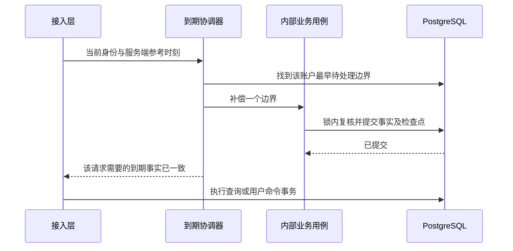

# A07 系统处理

> 文档版本 V2.0；核对日期 2026-10-22。继承现行契约和业务规则。架构细化为本地设计审阅稿。后端业务尚未实现；工作树已有最小账户表 V001，用户说明已执行，真实数据库和迁移历史未核实。

## 1. 自动处理共同规则

### 1.1 为什么要单独设计

“系统自动处理”也必须有触发时机、输入、前提、读写、事务、重复执行和失败结果。页面不在线、应用重启、调度延迟和跨时区时仍应得到相同业务事实。调度器只负责发现到期对象，实际状态变化由应用用例完成，不能在定时任务中复制一套简化业务。

| 项目 | 统一规则 |
|---|---|
| 触发来源 | 定时扫描、应用恢复和访问前补偿。三者调用同一幂等用例，不直接改表 |
| 处理时间 | 一次用例取得服务端参考时刻 now；资格按对象保存的绝对边界和有效时区判断，不使用浏览器时间 |
| 运行资格 | 运行护栏 READY、代次有效；恢复门禁未通过不开放个人命令 |
| 锁顺序 | 先遵守 06 的运行护栏锁序，再管理锁（仅相关管理场景），再账户锁；持账户锁后校验对象和到期事实。不能先长持队列锁再反向等账户锁 |
| 批次 | 扫描只取待处理标识；按账户和稳定顺序分批。单个账户的跨日追赶按最早绝对边界先处理，不在一次长事务中扫全站 |
| 事务 | 一次边界的业务结果、必须同步的事实/outbox、检查点一起提交；失败全部回滚，检查点不能先走 |
| 重复保护 | 使用自然身份、永久事件、条件轮次或已提交检查点；一次扫描的内存集合不是跨重启去重依据 |
| 日志 | 记录 job、对象安全标识、处理边界、代次、耗时、结果、脱敏错误和 traceId；不记录成长正文或安全秘密 |
| 结果 | APPLIED 已改变、NO_CHANGE 已符合结果、OBSOLETE 前提已过时、RETRYABLE_FAILED 可重试；失败不冒充已处理 |

以上结果名是内部处理结果分类，不写入任意新增状态列。持久状态使用 01 已定义字段。短队列认领参数、扫描间隔与批量数是工程参数，实施阶段按 NFR 时效验证并记录，不做产品可任意修改的系统配置。

### 1.2 访问前补偿的调用顺序

补偿与后续用户命令是不同事务。到期事实已提交后，用户后续命令失败不能撤销已发生的日末、过期暂停等事实。GET 可补到期事实，但不能因此自动创建用户计划、完成任务、打卡或结束目标。补偿暂不能完成且会影响本次判断时，返回明确不可用，不能给出过时的可执行资格。

### 1.3 检查点与事实各自负责什么

| 对象 | 持久依据 | 去重与恢复方式 |
|---|---|---|
| 目标开始/延期 | goal.next_action_at、goal_event、目标自身状态与日期 | next_action_at 是扫描提示，实际资格重验；永久业务节点防止重复处理同一旧到期身份 |
| 日/周计划周期 | job_checkpoint 的 PLAN_DAY / PLAN_WEEK | 本账户同 job_type 唯一；结果与 last_completed_boundary 同事务 |
| 习惯日结算 | habit_day、规则/状态节点及 HABIT_DAY 检查点 | 同习惯同业务日唯一；已有完成优先，已结算过去不重算 |
| 时区切换 | user_zone_period、ZONE_APPLY 检查点 | 先结清旧边界，再启用待生效区间；不整体搬动历史 |
| 执行超时 | execution_control、focus_session/segment、运行代次 | 根据有效控制代次与最后可信点关闭既有段；不能重放旧确认续命 |
| 通知与安全同步 | outbox_event、notification、security_change | 认领代次和业务唯一键；安全结果另有独立扫描补偿 |

## 2. JOB-001 到开始日启动目标

### 需求分析

来源：FR-GOAL-012、BL-GOAL-001。用户创建未来开始的目标后可提前拆解和规划，到开始日应自动进入活跃目标。用户主动归档的目标不能因到开始日被系统恢复。

触发：调度发现 goal.next_action_at 到期、应用恢复、目标列表/看板/相关命令前补偿。页面入口是 PAGE-003/004/005，系统调用没有公开 HTTP 地址。

### 业务流程

1. 根据扫描返回的 goalId 定位所属账户，取得运行与账户锁；重新读取 goal、有效时区和当前业务日。
2. 若目标已 COMPLETED 或 archived_at 非空，返回 NO_CHANGE/OBSOLETE；不清除主动归档。目标状态及开始日已被用户修改时，以当前状态和日期重判。
3. 目标为 PENDING 且 start_date 已到时，进入 ACTIVE。未来日期不处理；ACTIVE 不重复发 AUTO_START。
4. 写入该业务事实对应的 AUTO_START 节点：occurred_at采用按有效时区确定的应开始绝对边界，created_at采用实际补偿落库时刻，固定业务日期依据按该事件的业务发生边界保存，区分“应当何时发生”和“实际何时补做”；更新version、updated_at和下一次到期提示。
5. 同事务提交；随后查询读到 ACTIVE。不开计划、不自动开始执行、不生成完成通知。

### 内部用例契约

| 输入/输出 | 类型 | 规则 |
|---|---|---|
| goalId | UUID | 必填，来自受控扫描或本人用例，不接受跨用户伪造归属 |
| referenceInstant | Instant | 服务端参考时刻，用来选有效业务日 |
| runtimeGeneration | long | 本实例有效运行代次，内部不经 JSON |
| result | 内部分类 | APPLIED / NO_CHANGE / OBSOLETE；失败交上层重试并记录原因 |

### 数据操作

读取 DB-08 goal 的 user_id/state/archived_at/start_date/next_action_at、DB-02 时区区间。更新 DB-08 state/version/updated_at/next_action_at，写 DB-11 goal_event 的 AUTO_START 及固定日依据。不存在物理外键；账户归属必须重新验证。不能仅按扫描时的旧对象直接更新。

### 分层实现步骤

1. growth 定义 `GoalLifecycleService.startIfDue`，接收已确定的账户上下文和时间；应用协调器负责事务及锁。
2. `GoalMapper.findDueGoalIds` 只查需要的标识；`selectOwnedForUpdate` 取权威行；`updateStateIfPending` 带版本和归属条件；`GoalEventMapper.insert` 写节点，SQL 均放 XML。
3. 调度入口与读取前补偿都调用同一应用用例。VO 组装仍走普通目标查询，不能让 job 构造另一套 GoalView。

### 功能测试

| 输入及操作 | 预期 | 关联验证 |
|---|---|---|
| PENDING，开始日为 2026-10-19，19 日边界后调度及看板同时触发 | ACTIVE，一份 AUTO_START，无新计划和执行 | TEST-014、057 |
| 同样目标先主动归档，再跨开始日 | 保持归档，不进入活跃列表 | TEST-014、021 |
| 状态更新后节点插入失败 | 两者回滚；下次可完整补偿 | TEST-052、057 |

## 3. JOB-002 自动延长目标预计结束日期

### 需求分析

来源：FR-GOAL-013、BL-GOAL-008。预计结束日是规划信息；超过后目标继续保留，系统按既有公式延期，不能自动结束。公式为 现行业务规则 补充约定，沿用其来源标签。

### 业务流程

1. 锁内补齐必要的开始日事实，读取未主动归档、未结束目标。用户刚手动改期后，原扫描身份可能过时，重新判定。
2. 根据目标有效业务日判断旧 expected_end_date 是否已经过去。尚在预计结束日当天不延期。
3. 查询本目标当前有效任务 N、已完成数 C；删除后仅保留历史的任务排除。N=0 只为延期取 P=0，否则使用精确有理数 C/N。
4. 计算 B=baseline_duration_days，Δ=max(1,ceil(B×30%×(1-P)))；新日期=max(旧预计结束日,今天-1 日)+Δ 日。整数/精确十进制计算，不从展示百分数字符串反推。
5. 用目标身份及旧预计结束身份检查已发生的 EXTEND 节点，保证同一旧到期事实只生效一次。更新 expected_end_date，不改 B，不改 start_date，不完成目标。
6. 写 EXTEND 节点的前后日期和依据，更新 version 与 next_action_at；同事务提交。补偿多日停机按公式直接处理当前旧到期身份，不循环把自动延期天数加入 B。

### 内部用例契约

输入为 goalId、referenceInstant、runtimeGeneration，均由内部可信上下文提供。输出包括处理分类、oldExpectedEndDate、新 expectedEndDate 和本次 extensionDays，方便脱敏观测；不是新的 HTTP DTO，也不新增持久列。无变化时不写一条空 EXTEND。

### 数据操作

读取 DB-08 的日期/基数/状态、DB-09/10 目标归属和当前任务；更新 DB-08 expected_end_date/version/updated_at/next_action_at，插入 DB-11 EXTEND 节点。人工改期接口同步维护 B；本 job 不修改 B。与任务完成/删除并发时在同一账户锁内读取 C/N。

### 分层实现步骤

`GoalLifecycleService.extendIfOverdue` 负责公式和状态；`GoalProgressQuery.countCurrentTasks` 返回 C/N；Mapper XML 查询当前有效范围、检查旧延期节点、条件更新和插节点。禁止调度器写 `expected_end_date = expected_end_date + 1` 绕过业务公式。

### 功能测试

| 输入及操作 | 预期 | 关联验证 |
|---|---|---|
| B=30、C=1、N=2，旧结束 2026-10-17，今天 18 日 | Δ=5，新结束 22 日，B仍30 | TEST-017 |
| B=30、N=0，同日期 | Δ=9，不显示目标已经100%完成 | TEST-017、057 |
| 进度100%但未确认结束 | 至少延长1日，仍由用户决定结束 | TEST-017、020 |
| 两次调度并发处理同旧结束身份 | 一次 EXTEND；第二次重读后无重复 | TEST-017、057 |
| 用户已手动改到未来，旧扫描随后到达 | 重新判定未到期，不覆盖人工日期 | TEST-017、055 |

## 4. JOB-003 日末与周末未完成安排转待处理

### 需求分析

来源：FR-WEEK-008、FR-DAY-009、BL-WEEK/BL-DAY 周期规则。计划结束后未完成任务需要用户重新决定安排，不能自动复制或挪到下期。日到期、周到期是同一个任务的资格变化，不是新增两条待办。

### 业务流程

1. 从 PLAN_DAY/PLAN_WEEK 检查点找到最早未完成绝对边界，按保存的 zone_period_id 解释当时日/周，不用当前设备时区重新推算。
2. 取得账户锁，完成到该边界必须发生的可信计时截断；正在执行但执行资格在边界结束的段不能跨过原资格边界持续累计。
3. 对该日/周仍然存在的未完成安排逐个重验任务、父目标、计划归属。已完成任务的安排已由完成用例移除，不新增待处理；已迁出原周期的任务不重复处理。
4. 日资格结束时，将同一 task_assignment 标为 PENDING，pending_kind=DAY，保存原日日期和绝对边界。保留真实执行及原归属，不新建下一日安排。
5. 周资格结束时，同一安排升级/设为 PENDING、pending_kind=WEEK，保存该周起点和周末绝对边界；已经 DAY 待处理的仍只有同一个 task_id 身份。
6. 更新该边界检查点，业务结果与游标同事务提交。日周恰逢同一绝对边界时，按同账户一致次序处理，最终待处理含义为周已结束；不能遗留可继续本周执行的假资格。
7. 用户之后从待处理或当前任务入口选择新周/新日/返回池，复用 API-TASK-007；成功后原待处理状态消失，过去投入不移动。

### 内部用例契约

| 字段 | 类型 | 规则 |
|---|---|---|
| userId | UUID | 内部账户身份；不是公开请求可指定的归属 |
| jobType | PLAN_DAY / PLAN_WEEK | 与检查点类型一致 |
| boundaryAt | Instant | 本次待处理边界，必须等于检查点当前资格 |
| businessDate | LocalDate | 日日期或周一起点，用于解释与待处理显示 |
| zonePeriodId | UUID | 对应已保存区间 |
| result | 分类与处理计数 | 完成/跳过数供观测，不代表创建了新任务 |

### 数据操作

DB-33读取/更新last_completed_boundary、last_business_date、next_due_at、last_result_key；DB-15原行更新status与四个pending字段；DB-13/14提供计划日期，绝对边界按DB-02有效时区区间和检查点确定，既有执行另有eligibility_end_at上界，不为计划表臆造边界列；DB-17～21复用执行截断与分配。冻结的执行/完成事实不回写。

DB-15 的唯一键是 task_id，不能另加一张“待处理任务副本表”。ACTIVE 时 pending 四字段全部为空，PENDING 时全部非空。周内无日期任务直到周资格结束才进入 WEEK 待处理，不能每天把它误转 DAY。

### 分层实现步骤

`PlanPeriodService.expireDay/expireWeek` 负责资格变化；应用协调器按顺序调用执行截断、安排变化和检查点。`AssignmentMapper.selectEligibleAtBoundary/updatePending`、`JobCheckpointMapper.selectForUpdate/advance` 在 XML 实现且带账户条件。读取待处理按一任务一行分页，不在前端拼日、周列表去重。

### 功能测试

| 输入及操作 | 预期 | 关联验证 |
|---|---|---|
| 周日指定日任务未完成，先日末再周末补偿 | 同一 task_id 一条 WEEK 待处理，不复制下一周 | TEST-027、039～041 |
| 周内无日期任务过普通工作日午夜 | 本周资格仍有效，不进 DAY 待处理 | TEST-024、027 |
| 日末更新安排成功但检查点写入故障 | 全部回滚；重试结果仍唯一 | TEST-052、057 |
| 过去有20分钟，之后迁到新周 | 新周一条当前安排，20分钟仍属原日及原执行归属 | TEST-025、028、042 |

## 5. JOB-004 习惯逐日结算与待生效时区

### 需求分析

来源：FR-HABIT-014/015/018、BL-HABIT-006/007、现行业务规则 时间规则。习惯历史必须能解释当天为什么完成、未完成或不要求执行；设备时区变化不能把过去日期重新洗牌，也不能使同一天重复完成。

### 业务流程：习惯日结算

1. 读取 HABIT_DAY 检查点与对应时区区间，找已结束且尚未可靠结算的最早业务日。
2. 锁账户，按该日的规则版本、星期集合、生命周期节点和已存在 habit_day 判断；当前规则不能覆盖当日已适用的旧规则。
3. 先判断是否存在有效完成：有则该日保持 completed_at、completed_rule_id 且 due=true，不因之后暂停、结束、删除或改周期取消。
4. 未完成时按日结束边界前最后生效的规则及状态判定应执行与否；应执行且日已结束记未完成，非执行/暂停/结束等不记未完成。补偿过去时不使用当前最新规则。保存01中规定的固定日字段与解释依据，不重新定义状态枚举。
5. 同一 habit_id、business_date 唯一；已有结算结果只核实，不反向覆盖成当前规则的结果。
6. 该边界全部适用习惯处理和检查点一起提交。失败停在原边界，下次继续，不能跨过失败日先结后面的日。

### 业务流程：时区生效

1. 用户设备识别到新合法时区时，通过 03 的时区同步入口记录待生效区间；有进行中执行先按现有协议暂停。
2. ZONE_APPLY 只在当前业务日结束后的既定绝对边界处理。先按旧区间完成到边界的计划、执行与习惯结算，不能先换时区再解释旧日。
3. 在账户锁内重验待生效区间及当前区间，完成有效区间切换；同一待生效事实不可重复启用。
4. 用新时区推后续边界，已经存在的计划日期、habit_day、完成事实与投入分桶保持原固定依据。回拨出现已存在的本地日期时复用唯一日身份，不重新开放过去补记或已结束周期。
5. 故障跨多个边界时按绝对时间先后补偿，不能简单把服务器今天减一天循环当作所有用户的历史日。

### 内部用例契约

`settleHabitDay(userId, businessDate, zonePeriodId, boundaryAt)` 和 `applyPendingZone(userId, boundaryAt)` 只供内部协调器使用。userId 与区间必须匹配；边界来自持久检查点；重复调用返回现有事实。缺失时区依据视为待修复异常，拒绝静默使用服务器时区。

### 数据操作

DB-02 user_zone_period；DB-22 habit；DB-23/24 规则与星期；DB-25 状态/规则节点；DB-26 habit_day；DB-33 HABIT_DAY/ZONE_APPLY 检查点。日结果按字典字段完整保存，删除习惯后仍保留已有贡献。时区切换不批量 UPDATE 所有历史 business_date。

### 分层实现步骤

`HabitDaySettlementService` 负责“完成优先→应执行判断→落日结果”；`UserZoneService` 负责区间切换；应用级 `DueBoundaryCoordinator` 统一排边界。Mapper XML 按具体日批量查询必要规则和节点、用唯一键写日结果，避免逐习惯逐节点无限 N+1 查询。批次性能在真实数据集验证，不能为省查询删历史依据。

### 功能测试

| 输入及操作 | 预期 | 关联验证 |
|---|---|---|
| 当日完成后修改为今日不执行，再日结 | 当日仍完成，分子分母各1 | TEST-046、047 |
| 暂停期间跨3日，恢复后访问 | 暂停日不补成未完成，不自动打卡 | TEST-048、051、057 |
| 当日完成后删除习惯 | 历史贡献保留，当前清单不可恢复 | TEST-050 |
| 当前日末切换时区，随后访问相同本地日 | 复用已有日身份，不允许重复完成或补过去 | TEST-041、047、057 |
| 夏令时切换日结算及跨日执行 | 按实际边界分割，不假设每天固定86400秒 | TEST-039～042 |

## 6. JOB-005 超时、中断与旧运行代次执行暂停

### 需求分析

来源：FR-FOCUS-013/014、BL-FOCUS 中断与控制规则。没有可信执行确认时不能无限累计；服务重启也不能把停机时段当投入。T=最后可信点、J=判定失效点、P=实际落库暂停点分别表达，真实耗时终点不能使用更晚的 J/P。

### 业务流程

1. 扫描到期控制许可或启动恢复发现旧运行代次的 RUNNING 执行，仅取得标识，不长期持扫描锁。
2. 在有效运行护栏与账户锁内重新读取 execution_control、focus_session、未闭合 focus_segment 和安全/时区/资格边界。
3. 若新确认已经合法续期、控制已切换或执行已暂停/结束，以当前事实返回无变化。旧扫描不能把新一轮执行暂停。
4. 确需中断时，以原段最后可信点作为终点，并受原执行资格的固定边界限制，关闭已有段；不得将到期扫描时刻当作已执行时长。
5. 更新执行为 PAUSED，撤销原有效控制许可并推进控制代次，计算/刷新对应按日分配。任务状态按执行关系同步，不能新增一个虚假的 ENDED 完成动作。
6. 同事务提交。页面重连先查询状态，显示已暂停；恢复须走有效控制协议，不能把迟到的原确认再当一次新确认。
7. 异常末段需补齐时，走 API-FOCUS-010，严格限制既有末段和安全上限，记录修正事实；不允许补整个离线空档。

### 内部用例契约

输入是 userId、sessionId/segmentId、观察到的控制/运行代次、referenceInstant 和原因分类。观察值用于识别过时扫描，真正终点来自段的可信字段与边界。输出返回处理分类与已提交会话状态，不输出执行许可或随机秘密。普通查询不能签发许可。

### 数据操作

DB-03 账户串行锁、DB-04 运行 fencing；DB-17/18 关闭段与暂停；DB-19 使旧控制无效；DB-21 更新合法分配。DB-20 仅在用户合法修正时写入，不得将自动暂停伪装为用户修正。区间终点及按日分配和状态须整体一致。

### 分层实现步骤

`ExecutionInterruptionService.pauseAtLastTrustedPoint` 被扫描、启动恢复、强制安全撤销和必要的日期边界处理复用；`FocusSegmentMapper.closeOpenSegment` 带未关闭条件和代次检查；`ExecutionControlMapper.invalidate`、`FocusSessionMapper.pause`、分配 Mapper 同事务。所有 SQL 放 XML，不由调度入口绕过应用服务。

### 功能测试

| 输入及操作 | 预期 | 关联验证 |
|---|---|---|
| 最后可信点10:00:05，许可稍后失效，扫描10:01才落库 | 有效计时截止10:00:05，未知空档不计入 | TEST-035～038 |
| 正常新确认已提交后旧超时扫描进入锁 | 旧观察无效，不截断新控制 | TEST-034～037 |
| 服务停机后恢复旧RUNNING行 | 按旧可信点暂停，不累计停机 | TEST-038、065 |
| 旧页确认/结束请求在接管后迟到 | 不改变新控制或计时段，返回明确控制错误 | TEST-034～037、054 |

## 7. JOB-006 可靠事件、通知与安全结果同步

### 需求分析

来源：FR-NOTICE-001～004、BL-NOTICE、NFR-EVENT/SEC。核心业务提交后必须可靠产生后续通知；通知失败不能回滚已完成任务。安全结果同步用于既有独立恢复账本，不借此发送邮件或站外消息。

### 业务流程：认领与处理

1. 扫描 PENDING/RETRY 且到 next_attempt_at 的事件，及 claim_until 到期可回收事件。
2. 短事务认领：写 PROCESSING、claimed_by、claim_until，递增 claim_generation；释放队列锁。不能在认领事务里长时间等待业务账户锁或访问外部账本。
3. 正式处理取得运行/账户锁后，再核认领代次、类型、schema_version 和业务对象。过时工作者不能覆盖新认领的结果。
4. 按下表执行当前事件；通知变化与 outbox 终态同一事务。目标条件不再成立时明确 OBSOLETE，不无限重试。
5. 可重试失败记录脱敏 last_error_code、attempt_count、next_attempt_at，状态 RETRY；不丢事件。处理进程宕机后按认领有效期回收，业务唯一键再次防重。

| 事件 | 业务核验与处理 | 去重依据 |
|---|---|---|
| GOAL_CONDITION_MET | 当前目标有效、当前轮次匹配、N>0且C=N；创建确认通知；已归档/结束/轮次失效则过时 | outbox(event_type,business_key)；notification(goal_id,condition_round) |
| GOAL_CONDITION_INVALIDATED | 只失效指定旧轮通知，reason 为 CONDITION_CHANGED 或 GOAL_ARCHIVED；不能影响更高轮 | 指定 goalId+conditionRound |
| GOAL_CLOSED | 用户按满条件确认时对应通知置 CONFIRMED；主动提前结束则相关未处理通知以 GOAL_CLOSED 失效；不再次结束目标 | goalId+cycleNo 与事件终态 |
| SECURITY_RESULT_SYNC | 重新核本地 security_change 的已提交结果，同 operationId 向独立账本同步；不发送密码材料 | 独立账本 operationId 与本地安全结果 |

### 内部用例契约

事件载荷字段严格采用 01 第 15 节：GOAL_CONDITION_MET 为 goalId、conditionRound:string、cycleNo:number；INVALIDATED 为 goalId、conditionRound、reason；CLOSED 为 goalId、cycleNo、conditionRound、endType；SECURITY_RESULT_SYNC 仅 operationId。不允许任意“其他字段”载荷，技术载荷不复制完整成长正文。

安全结果的外部调用无法与本库做一个原子提交，因此使用同 operationId 幂等同步；外部成功而本地确认失败时再同步同一结果。本地无明确提交结果时保持未决与安全门禁，不猜成功或失败。独立账本已有 INTENT、本地失败的核实流程遵守 06/08，不能靠普通通知消费者单方面解除门禁。

### 数据操作

DB-31 认领/重试/终态；DB-08 目标状态与轮次、DB-10 当前任务重验；DB-27 通知读写；DB-32 安全结果同步。通知只读 read_at，用户继续和确认使用既有 API，消费者不能把“已读”置为“已结束目标”。账号已删或目标过时必须形成合适终态，唯一轮次依据不能随清理丢失。

### 分层实现步骤

`OutboxDispatcher` 只发现/认领，`GoalNotificationConsumer` 负责通知用例，`SecurityResultSynchronizer` 负责账本适配；Mapper 的认领、再核验、终态更新均带 claim_generation。`NotificationMapper.insertIfAbsentForRound` 以唯一约束保护重复消费。`SecurityChangeMapper.findUnsynced` 另作补偿扫描，不能只依赖 outbox 是否存在。

### 功能测试

| 输入及操作 | 预期 | 关联验证 |
|---|---|---|
| 完成最后任务时模拟消费者不可用 | 完成已成功、outbox保留；恢复后同轮一通知 | TEST-020、043、052～054 |
| 消费提交后响应/进程丢失，再认领重试 | 不重复通知、不重复安全结果 | TEST-052～054、064 |
| 旧轮失效事件在新轮成立后到达 | 只影响旧轮，不撤销新轮通知 | TEST-043、054 |
| 外部安全账本已成功但本地RESULT确认故障 | 同operationId补偿；未核实状态不放行 | TEST-063、064 |

## 8. JOB-007 逻辑关联巡检与备份恢复点监测

### 需求分析

来源：无物理外键约束、NFR-DATA/BCP/OBS。业务关系由应用保证，仍需发现程序缺陷、遗留错误或恢复异常。巡检发现问题要留证和阻止扩大，不能自动删用户历史“修好数据”。

### 业务流程

1. 在受控只读查询中按 01 的逻辑关系目录和数据库身份分批检查，记录扫描范围、水位与结果；避免和长事务竞争导致计时确认饥饿。
2. 核对归属链、计划周日一致性、唯一计时、区间/分配一致、完成/结束快照、习惯日结果与规则解释、通知轮次及无孤儿会话属性。
3. 单次分页巡检可能遇到正常并发变化；对可疑关系在当前一致性快照或相关账户锁内复核后再定为异常，不能把不同快照拼出的暂时差异作为脏数据结论。
4. 异常记录安全标识、规则、影响范围、traceId和证据引用，进入 08 缺陷处置；必要时关闭受影响写入口，保持已确认事实。修复需明确方案及回归，不自动级联删除。
5. 监测备份新鲜度、WAL链、独立安全账本可读取性和恢复点；与真实恢复演练证据对应，不能仅凭“备份文件存在”判恢复成功。
6. 备份/账本故障按 08 告警和恢复门禁处理；恢复到旧点必须更新恢复代次、撤销旧会话、暂停旧执行并核实安全变化后才开放。

### 检查契约与数据操作

| 检查组 | 读取范围与验证 | 异常处理 |
|---|---|---|
| 归属链 | stage→goal、task→stage→goal、assignment→plan/task 同账户且父身份有效 | 隔离受影响命令并留证，不改父ID掩盖 |
| 安排 | 一任务一份当前安排，日属于周，ACTIVE/PENDING字段组合正确 | 明确冲突来源，走受控修复 |
| 执行 | 一账户最多一有效RUNNING；开放段与会话/控制匹配，分配不重叠/不超段 | 暂停受影响入口，按可信依据核实 |
| 历史 | completion/closure、原目标阶段归属、固定日依据完整 | 保留事实；禁止删除历史凑统计 |
| 习惯 | 规则星期、有效区间、唯一日身份；有效完成必计分子分母 | 不重算过去，核验节点依据 |
| 通知/事件 | 轮次唯一、过时状态合理、认领可恢复，安全未决被门禁覆盖 | 重试/过时按JOB-006，安全未决保持拒绝 |
| 框架/恢复 | 会话属性有父身份、旧恢复代次不可用，备份链与独立账本可核实 | 按08恢复流程，不先开站再检查 |

内部报告包含检查时间、范围、规则编号、已复核异常数量、证据位置和结论。报告与技术日志不存密码、会话许可或正文。当前没有新增用户可见导出功能和 HTTP 巡检入口。

### 分层实现步骤

只读 `IntegrityInspectionService` 调用专用 Mapper XML，按规则返回安全标识和计数；运维适配层监测备份/账本，不得将系统命令塞入业务 Mapper。修复与查询分开授权，自动扫描本身不执行数据修复。执行计划与资源影响在 08 性能验证中观察。

### 功能测试

| 输入及操作 | 预期 | 关联验证 |
|---|---|---|
| 隔离测试库造一条跨账户父子关联 | 巡检发现并能定位；无正文泄露，不自动删除 | TEST-055、058 |
| 正常迁移期间启动巡检 | 可疑结果复核，避免不同快照导致误报 | TEST-058 |
| 只有备份文件但WAL缺段或账本不可读 | 恢复核验不通过，记录具体缺口 | TEST-062～066、071 |
| 独立恢复旧点后尝试旧Cookie/旧计时确认 | 旧身份和控制均拒绝，未核实账户受门禁约束 | TEST-063～065 |

## 9. 跨模块操作的事务边界与时序

| 用例 | 一个请求中原子提交 | 请求之间的顺序与失败处理 |
|---|---|---|
| 重新安排任务 | 必要的暂停/闭段、旧安排迁移、新周日关系、版本、幂等结果 | 已提交的到期补偿独立存在；迁移失败不恢复过期资格 |
| 完成任务 | task完成、completion快照、当前安排移除、条件轮次及outbox、幂等结果 | 页面先逐个结束执行，再刷新版本完成；完成失败不得将已ENDED的执行改回运行 |
| 结束/归档目标 | 状态/归档、关联当前资格、快照/节点/通知事件与去重 | 有未结束执行先返回阻塞，由用户先处理后重提；不能跨请求承诺原子 |
| 正常退出/改密 | 当前安全动作及会话撤销依据、审计/安全结果 | 先结束所有未结束执行；安全账本依既有INTENT/RESULT协议，不伪装为单库事务 |
| 强制禁用/删除账户 | 按可信点暂停、撤销安全资格、管理结果与安全记录 | 不等待已被禁用用户主动结束；同步独立账本失败保持可核实未决及门禁 |
| 目标通知 | 核心业务outbox同事务；消费者通知与事件终态同事务 | 消费异步可重试，核心完成不因通知延迟回滚 |
| 习惯规则修改/当天完成 | 新规则节点或当日结果、版本与幂等 | 当天已有完成优先；日结完成后不能因后来规则改变重算过去 |

### 9.1 自动流程开发顺序

先实现运行与账户护栏、统一时钟/边界、事务和幂等（DEV-002），再有目标和计划主干、可信执行（DEV-005～007）。随后完成条件事件和生命周期（DEV-008/009），实现边界顺序补偿（DEV-010）及习惯日结（DEV-011），最后结合完整查询、管理和恢复链（DEV-012～014）验证。不能在还没有可信区间的情况下用后台 job 直接累加“专注分钟数”。

### 9.2 完成条件

每个 JOB 必须验证：正常触发、重复触发、与用户命令并发、提交中故障、跨边界停机恢复、错误/过时对象、相应脱敏观测和检查点。具体运行证据归入 08/09 所列 TEST；本册的表格是测试设计，全部尚未执行。
