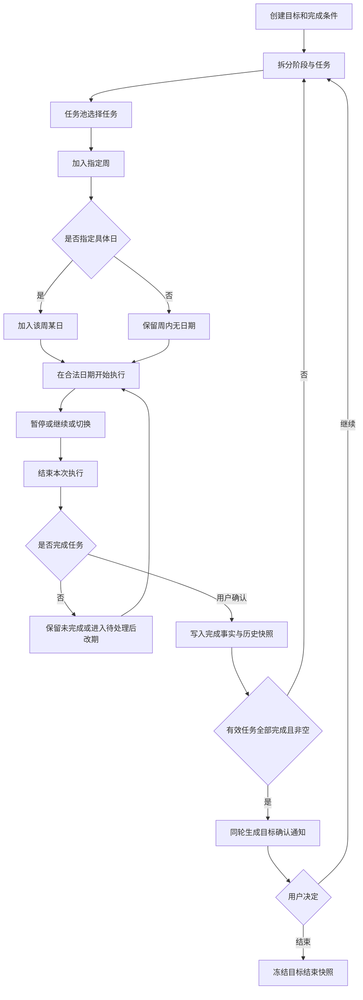

# A12 业务全景

> 文档版本 V2.0；核对日期 2026-10-22。继承现行契约和业务规则。后端仅有工程骨架；业务、DDL、前端及运行验证尚未完成。

## 1. 项目介绍与问题分析

Asterway 面向个人成长管理。用户把长期目标拆成阶段和任务，再从任务中选择近期要做的事项，安排到一周及某一天，实际执行时记录专注时间，通过看板决定下一步，通过历史判断真实投入和完成情况。习惯是独立的重复行动，不强制挂在目标或任务下。

| 使用中遇到的问题 | 本 MVP 提供的能力 | 判断是否解决的依据 |
|---|---|---|
| 有目标，但不知道分几步推进 | 一个目标下创建、排序多个阶段，再创建任务 | 能从目标详情追溯阶段及任务；阶段顺序不阻止并行推进 |
| 任务很多，不清楚这一周和今天做什么 | 任务池→周计划→可选的日计划 | 同一任务只有一份当前安排；周内无指定日期的任务仍可执行 |
| 计划写了，但不知道实际做了多久 | 开始、暂停、继续、结束一次执行 | 同时只有一项计时，暂停及离线空档不累计，预计耗时与实际耗时分开 |
| 没做完的事项重复堆在旧计划里 | 合并待处理、主动重新安排 | 不自动复制到下一天；改期后旧日不留虚假的任务条目，真实投入留在发生日 |
| 目标达到 100% 后不清楚是否真的结束 | 目标完成确认通知、主动结束、结束快照 | 只有用户确认才结束；也允许未达 100% 时主动结束 |
| 想持续做小事，又不想每天重新创建任务 | 按每天或每周指定星期执行习惯 | 今日可完成、过去只读；暂停、结束或删除不抹除已有完成 |
| 当前列表与历史统计相互矛盾 | 当前状态、安排、执行事实和历史快照分开 | 删除退出当前考核，已有投入和完成事实仍参与对应历史统计 |

“做过多少”和“现在还剩多少”是不同问题。开发中不能用当前任务表的行数替代历史完成数，也不能用预计分钟数替代实际投入。

## 2. 角色、范围与使用条件

### 2.1 角色分析

| 角色 | 可以做什么 | 数据范围及约束 |
|---|---|---|
| 未登录访客 | 查看公开站点设置，取得 CSRF，完成滑动验证，注册、登录 | 不能读取个人成长数据；关闭公开注册时不能绕过页面注册 |
| 普通用户 USER | 管理本人的账户资料、目标、阶段、任务、计划、专注、习惯、通知和历史 | 归属由服务端会话决定，不接收 userId 作为授权依据 |
| 管理员 ADMIN | 进入管理后台，查询和管理普通账户，查看普通用户数量 | 不能管理同级及更高角色，不能查看他人成长正文 |
| 超级管理员 SUPER_ADMIN | 管理允许范围的账户、调整角色、维护两项系统配置 | 不能使最后一个可用超级管理员失去资格；个人数据隔离仍然有效 |
| 系统 | 日期补偿、自动暂停、统计、通知消费、完整性和恢复检查 | 执行同一业务规则与事务；系统处理不代替用户完成任务、打卡或结束目标 |

所有登录角色均可进入自己的个人业务入口；无论角色如何，个人接口均只访问当前账户自己的数据。后台中的“用户”指被管理账户，不代表管理者取得该账户的个人操作身份。

### 2.2 本期功能边界

本期包括账户、目标、阶段、任务、周计划、日计划、执行计时、习惯、今日看板、历史统计、目标完成确认通知和基础管理后台，共 12 个功能模块。完整现行功能编号为 132 项，按第 4 章逐项列出，不重新编需求编号。

知识库、社区、协作、付费、积分等级、独立项目层级、月季年计划、外部日历、自动排最优日程、任务质量评分、自助找回密码等不属于本期范围。目标不彻底删除，已完成任务不能恢复未完成，过去习惯不能补记。

### 2.3 使用前提与外部条件

1. 用户有可访问站点的 PC 浏览器和网络。个人操作需有有效会话；断网时不能本地制造完成结果。
2. 日期相关写操作需要有效 IANA 时区。首次无法识别且没有既有时区时，让用户选择；不能默认为服务器所在地。
3. 一周固定周一至周日；业务日以对应有效时区的午夜为界。历史归属使用当时冻结的日期和时区依据。
4. 采用已确定的单应用技术方向：JDK 17、Maven 3.9.4、Spring Boot 3.5.16、MyBatis XML、PostgreSQL 17.11、Vue 3 + TypeScript。配套版本见[12技术版本基线](A08-技术版本基线.md)，工程模块不等于微服务。
5. 所有项目表和框架表均无物理外键。关系正确性在服务事务中检查，并由唯一约束、显式删除顺序和巡检辅助保证。

## 3. 需求分析、业务逻辑与开发设计如何衔接

| 层次 | 回答的问题 | 本设计包位置 | 示例 |
|---|---|---|---|
| 功能性需求 | 哪个角色执行哪个动作 | 本文第 4 章及原 FR 清单 | FR-TASK-009：用户完成任务 |
| 业务分析 | 何时发生，为什么允许，成功后有什么变化 | 本文第 5～8 章、03～05 各功能“需求分析/业务流程”及 现行业务规则 | 先结束所有相关执行，再确认完成，完成不可恢复 |
| 接口设计 | 页面如何提交，服务端返回什么，失败如何表达 | 02 公共规则、03～05 各接口 | API-TASK-005，版本、确认、成功 DTO、409 阻塞及重试 |
| 数据设计 | 结果写到哪，哪些事实不能改，如何保持关系 | 01 字典、各接口“数据操作” | task 状态、task_completion 快照、安排退出、outbox 同事务 |
| 实现设计 | DTO、Controller、Service、Mapper XML 分别做什么 | 各接口“分层实现步骤”、06 | Controller 接入，应用用例协调，Mapper 按身份条件访问 |
| 验证设计 | 用什么输入证明完成且没有副作用 | 各接口“功能测试”、08、09 | 同键重试只产生一份完成；另一个人的任务返回 404 |

功能清单不塞接口细节；接口也不能只写方法与路径、把业务步骤留给实现者猜。每项功能按“需求分析→业务流程→接口设计→数据操作→分层实现步骤→功能测试”连续展开。共享字段在明确命名的 DTO 中集中定义，功能章节指出引用的对象和本动作特有约束。

需求来源优先级：当前明确要求与已确认规则→现行业务规则 当前业务规则和现行 FR/NFR→已确认架构及技术路线→本设计包工程细化。早期《MVP需求定稿》中的暂停目标、目标删除、四象限等表述不能覆盖 现行业务规则的当前规则。FR-GOAL-005、FR-DAY-004 已停用，不得将编号补回来凑连续序列。

## 4. 按模块划分的完整功能需求

### 4.1 账户管理模块

| 编号 | 功能名称 |
|---|---|
| FR-AUTH-001 | 用户注册账户 |
| FR-AUTH-002 | 用户登录账户 |
| FR-AUTH-003 | 用户退出账户 |
| FR-AUTH-004 | 用户修改密码 |
| FR-AUTH-005 | 用户查看用户名及昵称 |
| FR-AUTH-006 | 用户修改用户名及昵称 |
| FR-AUTH-007 | 系统限制用户访问个人数据的范围 |

### 4.2 目标管理模块

| 编号 | 功能名称 |
|---|---|
| FR-GOAL-001 | 用户创建目标 |
| FR-GOAL-002 | 用户查看目标列表 |
| FR-GOAL-003 | 用户查看目标详情 |
| FR-GOAL-004 | 用户修改目标 |
| FR-GOAL-006 | 用户恢复归档目标 |
| FR-GOAL-007 | 用户确认结束目标 |
| FR-GOAL-008 | 用户归档目标 |
| FR-GOAL-009 | 用户查看目标进度 |
| FR-GOAL-010 | 用户查看目标累计投入时间 |
| FR-GOAL-011 | 用户重新打开已完成目标 |
| FR-GOAL-012 | 系统按开始日期启动并显示目标 |
| FR-GOAL-013 | 系统自动延长目标预计结束日期 |

### 4.3 阶段管理模块

| 编号 | 功能名称 |
|---|---|
| FR-STAGE-001 | 用户创建阶段 |
| FR-STAGE-002 | 用户查看阶段列表 |
| FR-STAGE-003 | 用户查看阶段详情 |
| FR-STAGE-004 | 用户修改阶段 |
| FR-STAGE-005 | 用户完成阶段 |
| FR-STAGE-006 | 系统展示阶段推进顺序 |
| FR-STAGE-007 | 用户查看阶段任务完成情况 |
| FR-STAGE-008 | 用户查看阶段累计投入时间 |
| FR-STAGE-009 | 用户调整阶段顺序 |
| FR-STAGE-010 | 用户暂停阶段 |
| FR-STAGE-011 | 用户恢复暂停阶段 |
| FR-STAGE-012 | 用户重新打开已完成阶段 |
| FR-STAGE-013 | 用户删除空阶段 |

### 4.4 任务管理模块

| 编号 | 功能名称 |
|---|---|
| FR-TASK-001 | 用户创建任务 |
| FR-TASK-002 | 用户查看任务列表 |
| FR-TASK-003 | 用户查看任务详情 |
| FR-TASK-004 | 用户修改任务 |
| FR-TASK-005 | 用户删除任务 |
| FR-TASK-006 | 用户设置任务优先级 |
| FR-TASK-007 | 用户设置任务预计耗时 |
| FR-TASK-008 | 系统展示任务截止日期逾期状态 |
| FR-TASK-009 | 用户完成任务 |
| FR-TASK-010 | 用户重新安排未完成任务 |
| FR-TASK-011 | 用户查看任务累计实际耗时 |
| FR-TASK-012 | 用户查看任务执行历史 |
| FR-TASK-013 | 用户暂停任务 |
| FR-TASK-014 | 用户恢复暂停任务 |

### 4.5 周计划模块

| 编号 | 功能名称 |
|---|---|
| FR-WEEK-001 | 用户创建周计划 |
| FR-WEEK-002 | 用户查看周计划 |
| FR-WEEK-003 | 用户将任务加入周计划 |
| FR-WEEK-004 | 用户将任务移出周计划 |
| FR-WEEK-005 | 用户调整周计划安排 |
| FR-WEEK-006 | 系统展示周计划任务推进情况 |
| FR-WEEK-007 | 用户删除周计划 |
| FR-WEEK-008 | 系统展示周计划未完成待处理项 |

### 4.6 日计划模块

| 编号 | 功能名称 |
|---|---|
| FR-DAY-001 | 用户创建日计划 |
| FR-DAY-002 | 用户查看日计划 |
| FR-DAY-003 | 用户将周计划任务加入日计划 |
| FR-DAY-005 | 用户调整日计划任务顺序 |
| FR-DAY-006 | 用户将未完成任务重新安排到其他日期 |
| FR-DAY-007 | 系统展示日计划任务状态 |
| FR-DAY-008 | 用户删除日计划 |
| FR-DAY-009 | 系统展示日计划未完成待处理项 |

### 4.7 任务执行与时间记录模块

| 编号 | 功能名称 |
|---|---|
| FR-FOCUS-001 | 用户开始执行任务 |
| FR-FOCUS-002 | 用户结束本次任务执行 |
| FR-FOCUS-003 | 用户继续执行未完成任务 |
| FR-FOCUS-004 | 用户查看任务执行记录 |
| FR-FOCUS-005 | 系统计算单次执行实际耗时 |
| FR-FOCUS-006 | 系统汇总任务累计实际耗时 |
| FR-FOCUS-007 | 系统汇总阶段累计实际耗时 |
| FR-FOCUS-008 | 系统汇总目标累计实际耗时 |
| FR-FOCUS-009 | 系统按日期统计实际投入时间 |
| FR-FOCUS-010 | 系统分别展示预计耗时与实际耗时 |
| FR-FOCUS-011 | 用户暂停本次任务执行 |
| FR-FOCUS-012 | 系统切换当前计时任务 |
| FR-FOCUS-013 | 系统暂停异常中断的执行 |
| FR-FOCUS-014 | 用户补齐中断执行的结束时间 |
| FR-FOCUS-015 | 系统展示正向专注计时 |

### 4.8 习惯管理模块

| 编号 | 功能名称 |
|---|---|
| FR-HABIT-001 | 用户创建习惯 |
| FR-HABIT-002 | 用户查看习惯列表 |
| FR-HABIT-003 | 用户修改习惯 |
| FR-HABIT-004 | 用户设置习惯类别 |
| FR-HABIT-005 | 用户设置习惯完成条件 |
| FR-HABIT-006 | 用户设置习惯执行周期 |
| FR-HABIT-007 | 用户设置习惯执行时间 |
| FR-HABIT-008 | 用户按类别筛选习惯 |
| FR-HABIT-009 | 用户按状态筛选习惯 |
| FR-HABIT-010 | 用户暂停习惯 |
| FR-HABIT-011 | 用户恢复暂停习惯 |
| FR-HABIT-012 | 用户结束习惯 |
| FR-HABIT-013 | 用户记录当日习惯完成情况 |
| FR-HABIT-014 | 系统展示习惯每日状态 |
| FR-HABIT-015 | 用户查看习惯历史 |
| FR-HABIT-016 | 用户恢复已结束习惯 |
| FR-HABIT-017 | 用户删除习惯 |
| FR-HABIT-018 | 用户查看习惯规则时间线 |

### 4.9 今日看板模块

| 编号 | 功能名称 |
|---|---|
| FR-DASH-001 | 用户查看今日任务 |
| FR-DASH-002 | 用户查看今日任务执行情况 |
| FR-DASH-003 | 用户查看今日应执行习惯 |
| FR-DASH-004 | 用户查看多个进行中目标的概览 |
| FR-DASH-005 | 用户按目标筛选今日任务 |
| FR-DASH-006 | 用户按任务状态筛选今日任务 |
| FR-DASH-007 | 用户从今日看板重新安排未完成任务 |
| FR-DASH-008 | 用户查看本周未指定日期的任务 |
| FR-DASH-009 | 用户查看未完成计划待处理项 |

### 4.10 历史记录与统计模块

| 编号 | 功能名称 |
|---|---|
| FR-HISTORY-001 | 用户查看历史成长记录 |
| FR-HISTORY-002 | 用户按时间范围查询历史记录 |
| FR-HISTORY-003 | 用户查看历史目标及其相关记录 |
| FR-HISTORY-004 | 用户查看历史阶段及其相关记录 |
| FR-HISTORY-005 | 用户查看历史任务及其执行记录 |
| FR-HISTORY-006 | 用户查看历史周计划与日计划 |
| FR-HISTORY-007 | 用户查看习惯历史记录 |
| FR-HISTORY-008 | 用户查看指定时间范围内的任务完成情况 |
| FR-HISTORY-009 | 用户查看指定时间范围内的实际投入时间统计 |
| FR-HISTORY-010 | 用户查看目标与阶段累计投入时间统计 |
| FR-HISTORY-011 | 用户查看指定时间范围内的习惯完成情况 |

### 4.11 系统通知模块

| 编号 | 功能名称 |
|---|---|
| FR-NOTICE-001 | 系统发送目标完成确认通知 |
| FR-NOTICE-002 | 用户查看系统通知 |
| FR-NOTICE-003 | 用户处理目标完成确认通知 |
| FR-NOTICE-004 | 用户标记通知已读 |

### 4.12 管理后台模块

| 编号 | 功能名称 |
|---|---|
| FR-ADMIN-001 | 系统校验后台管理权限 |
| FR-ADMIN-002 | 管理员查看普通用户数量 |
| FR-ADMIN-003 | 管理员查询普通用户账户 |
| FR-ADMIN-004 | 管理员新增普通用户账户 |
| FR-ADMIN-005 | 管理员修改普通用户账户 |
| FR-ADMIN-006 | 管理员删除普通用户账户 |
| FR-ADMIN-007 | 超级管理员查询管理员账户 |
| FR-ADMIN-008 | 超级管理员新增管理员账户 |
| FR-ADMIN-009 | 超级管理员修改管理员账户 |
| FR-ADMIN-010 | 超级管理员删除管理员账户 |
| FR-ADMIN-011 | 超级管理员调整普通用户与管理员角色 |
| FR-ADMIN-012 | 超级管理员查看系统配置 |
| FR-ADMIN-013 | 超级管理员修改系统配置 |

## 5. 各模块需求分析

### 5.1 账户管理

**场景：** 新用户注册后登录，查看或修改用户名与昵称，必要时修改密码、退出。用户名与昵称是不同字段，改名后旧用户名不再用于该账户登录。

**输入与规则：** 用户名 1～30 字符，只允许英文字母、汉字、数字，英文字母不区分大小写判断唯一性；昵称可重复，注册未填时取注册用户名，后续独立维护。新密码 8～50 个 Unicode 码点，确认密码必须相同；全空白视为未填，其他字符原样参与校验，强度提示不能拒绝长度合格的弱密码。凭据不能明文存储或直接用 MD5。

**前置及异常：** 注册检查开放配置与验证用途；登录先检查用户名锁定，再通过当次滑动验证、校验凭据，保存前在锁内再次核验锁定状态。验证码失败不能增加用户名密码失败次数。正常退出和改密前检查所有未结束执行，包括暂停的执行，引导先逐个结束。受强制撤销的账户由系统按最后可信点暂停，不要求已失效会话自行补救。

**结果与落点：** 成功建立或维护稳定账户身份，登录轮换会话；改密撤销旧会话。页面 PAGE-001、002、017、018；接口及字段见 [03](A03-账户接口与对象.md)，实现 DEV-003、004，验收 TEST-003～013。不得由前端带入角色创建超级管理员。

### 5.2 目标管理

**场景：** 用户记录要达成的目标、完成条件及预计日期，查看当前有效任务进度和真实累计投入，主动归档、结束、恢复或重新打开。

**核心分析：** 业务状态 PENDING/ACTIVE/COMPLETED 与主动归档标记分开。未来目标到期开始，但不能自动恢复用户主动归档的目标。当前有效任务完成比例只负责提供参考；达到 N>0 且 C=N 时发起完成确认，用户决定结束或继续管理。空目标进度为“暂无任务”，不能显示自动满足 100%。

**特殊处理：** 超过预计结束日自动延期，公式沿用 现行业务规则，自动延期不放大人工基准时长。归档、结束等动作若存在未结束执行，先返回阻塞提示。结束冻结当前周期快照；重新打开增加周期，旧快照与旧投入保留，已完成任务保持完成。

**落点：** PAGE-004～006；API-GOAL-001～010；JOB-001、002、006；DEV-005、008～010；TEST-014～022、043～044。详见 [04](A04-目标计划接口与对象.md) 和 [11](A07-系统处理.md)。

### 5.3 阶段管理

**场景：** 用户把目标分成多个阶段，排序用于展示推进顺序，可同时推进，不得将排序当作依赖链。首次执行阶段任务后进入进行中。

**规则：** 阶段可暂停、恢复、确认完成、重新打开。完成前核验当前有效任务均已完成且没有未结束执行；空阶段可由用户确认完成。删除只允许当前有效任务为空，历史任务和原阶段关系继续保留；不能为了删除阶段把历史任务改挂到别处。

**一致性：** 完成阶段与新增任务、开始执行并发时，在同一账户锁内重验前提。完整排序集合和父级版本一起校验，防止漏成员、重复成员或覆盖另一页面新增的阶段。

**落点：** PAGE-005；API-STAGE-001～010；DEV-005、009；TEST-015～019、021～022、055。阶段累计投入包含其历史任务的真实贡献，不用当前有效任务数计算历史投入。

### 5.4 任务管理

**场景：** 在本人有效阶段下创建任务，维护内容、优先级、预计耗时与截止日期，从任务池安排至周/日计划，执行后明确完成或删除。

**规则：** 创建与加入计划都不代表已经执行；预计耗时用于规划，实际耗时来自执行事实。截止日逾期只影响展示，不能自动完成或改期。暂停、恢复任务由其执行状态驱动，复用执行接口，不额外造一个与计时状态冲突的开关。

**完成与删除：** 完成要求用户确认且所有本任务执行已结束，生成唯一完成快照，清理当前未完成安排。任务完成不可恢复。删除无贡献任务可清除多余数据；已有投入或完成事实时保留身份和历史贡献，退出当前任务考核，不再参与阶段完成阻塞。

**落点：** PAGE-005、007、008；API-TASK-001～008、API-FOCUS-003/004；DEV-005～009；TEST-018～029、043～044。完整契约见 [04](A04-目标计划接口与对象.md)。

### 5.5 周计划

**场景：** 用户选择某个周一起始日期，把不同目标下的任务放入同一周。任务可以只定周而不定具体日。

**规则：** 同一账户同一周始终复用同一计划身份；每个未完成任务只有一份当前安排。新增安排、移出、改日、跨周等调用统一迁移用例，不在多个页面分别实现。周内无日期任务可在该周执行，不能伪装成今日日计划任务。

**周期结束：** 未完成安排进入待处理，系统不自动复制到下一周。删除周计划区分未执行冗余安排和真实历史，未结束执行先阻塞；有贡献时保留可追溯身份。已发生的周贡献不因后来改期消失。

**落点：** PAGE-009、011；API-PLAN-001～004、007、009、011～012、API-TASK-007；JOB-003；DEV-006、009、010；TEST-023～029、039～044。

### 5.6 日计划

**场景：** 用户从已选周计划的任务中指定日期，形成轻量日计划，按手动顺序查看和执行。

**规则：** 日日期属于对应周；日计划由安排按需创建，不是独立录入重复任务。一账户一日期身份唯一。过去日计划只读，当前未完成任务可以通过当前任务入口改期，不能从历史页面编辑过去。

**迁移示例：** 10 月 17 日投入 20 分钟但没完成，将当前安排改到 10 月 19 日：17 日不再保留一条待办任务副本，20 分钟仍归属 17 日，19 日只出现一条新安排，任务累计投入仍为 20 分钟。跨周迁移同时变更周、日关系，任一步失败整体回滚。

**落点：** PAGE-010、011；API-PLAN-005/006/008/010、API-TASK-007；JOB-003；DEV-006、009、010；TEST-024～029、039～044。

### 5.7 执行计时与时间记录

**场景：** 用户开始一个可执行任务，正向计时；可以暂停、继续、切换或结束本次执行。一个任务可以先后有多次执行。

**规则：** 同一账户同一时刻只有一项计时，可以有多个暂停且未结束的执行。切换先关闭旧计时段，再创建或恢复新段，统一事务。暂停不累计，结束本次不代表完成任务。过去或未来指定日的任务不直接获得今天的执行资格，需先合法改期。

**可信时间：** 服务器记录可信确认点，页面只展示估计值。响应丢失重放原确认不能形成新确认点；许可超时、页面中断、服务重启按最后可信点暂停，离线空档不补算。多设备显式接管更新控制代次，旧页不能重新激活计时。补齐结束时间只针对既有异常末段且受安全上限约束，不支持新增虚构过去执行。

**落点：** PAGE-003、008、012；API-FOCUS-001～012；JOB-005；DEV-007、010；TEST-030～042、054、065。参数、控制协议和逐步实现见 [05](A05-执行查询接口与对象.md)。

### 5.8 习惯管理

**场景：** 用户创建独立习惯，填写类别、具体完成条件、周期和可选执行时间，在当日勾选完成，查看每日历史及规则变化。

**规则：** 周期只包括每天或每周指定星期。执行时间是提示信息，不强制固定时段，不提供推送。启用、暂停、结束分别表达，结束可恢复，删除不可恢复。今日未完成时按最新规则判断今日是否应执行；今日已有有效完成则固定为完成，继续同时计入分子、分母。

**历史处理：** 禁止过去补记和撤销完成。暂停、结束、删除、修改周期不重算过去，不得将非执行日算作未完成。当天跨时区仍复用该日唯一身份，不重复打卡或结算。规则通过新版本和节点记录，不覆盖过去规则。

**落点：** PAGE-013、014；API-HABIT-001～012、API-DASH-003；JOB-004；DEV-011；TEST-045～051、057。详见 [05](A05-执行查询接口与对象.md)。

### 5.9 今日看板

**场景：** 用户登录后快速看到今天做什么、哪项正在计时、还有哪些未处理。

**展示分析：** 今日有日期任务、本周无日期任务、当前执行与暂停执行、今日习惯、活跃目标、待处理、目标确认通知分别呈现。无任务不能遮住仍可完成的习惯。按目标或任务状态筛选只改变展示，不修改业务状态。

**交互分析：** 从看板开始/暂停/改期/完成仍调用同一业务接口；看板只组合查询和入口，不定义第二套计时或计划规则。各区加载失败与成功为空分开显示，保存成功而看板刷新失败显示已保存并允许重查。

**落点：** PAGE-003；API-DASH-001～003及对应动作接口；DEV-012、017；TEST-026、039～043、068～070。

### 5.10 历史与统计

**场景：** 用户按今天、昨天、本周、本月、自定义范围查看真实记录，并追溯目标、阶段、任务、计划和习惯。

**口径：** 日期范围任务完成数来自范围内真实完成的不同任务，包含删除保留贡献；实际投入来自按冻结业务日分配的有效区间；目标/阶段累计包含原归属历史任务；习惯完成率为真实完成次数/应执行次数。分母为零时展示无应执行记录，不显示 0% 或 100%。

**查询分析：** 汇总与关联数字在一次只读一致性快照下取得，不能拼多次不同时点的查询。完整三年汇总应一次可查；明细分页，但历史不按三年截断。迁移只影响当前安排，不重分配过去日期或阶段归属。

**落点：** PAGE-006、008、014、015及计划历史；API-HISTORY-001/002及对象历史接口；DEV-012；TEST-042～051、058、067、070。

### 5.11 系统通知

**场景：** 目标当前有效任务全部完成时提示用户确认。系统只发送这一类站内通知，不扩展消息聊天或提醒推送。

**规则：** 同目标同条件轮次只生成一条。已读只改变未读标记，不代表完成目标；选择继续管理只处理该轮提示，不循环发送同轮通知；确认结束复用目标结束接口。条件失效、目标归档或关闭后，旧通知不能再用于完成目标。

**可靠性：** 完成事实与 outbox 同事务，通知消费可以重试，消费失败不撤销任务完成。迟到旧轮事件先核对当前轮次，再判断是否过时，不能失效新轮通知。

**落点：** PAGE-016及顶部通知入口；API-NOTICE-001～004、API-GOAL-007；JOB-006；DEV-008；TEST-020、043、052～054。

### 5.12 基础管理后台

**场景：** 管理员维护普通账户；超级管理员维护管理员和角色，并修改站点显示名称、是否开放注册。

**规则：** 管理对象按角色和有效状态限制，最后一个可用超级管理员必须保留。ADMIN只取得USER数量；SUPER_ADMIN分别取得USER和ADMIN数量，不得将SUPER_ADMIN混入ADMIN数量，也不以全体账户总量替代分类统计。密码、会话、滑动验证秘密、成长正文不出现在后台响应。

**安全变更：** 禁用、删除、改角色、撤销等即时更新安全依据并使相关旧会话失效；强制影响进行中执行时先按最后可信点暂停。安全变更与独立账本按现有恢复设计衔接，账本不可核实不能靠恢复旧数据库放行敏感操作。

**落点：** PAGE-019、020；API-ADMIN-001～009、API-PUB-001；DEV-013；TEST-012、059～064。管理员不能借管理权限操作普通用户的成长数据。

## 6. 产品原型与完整主流程

### 6.1 页面导航原型

```text
登录 / 注册
  └─ 个人工作区
      ├─ 今日：今日任务 | 本周无日期 | 当前执行 | 今日习惯 | 待处理 | 通知
      ├─ 目标列表 → 目标详情 → 阶段排序与任务拆解 → 时间线 / 结束快照
      ├─ 任务池 → 任务详情 → 安排到周 → 可选安排到日 → 执行详情
      ├─ 周计划 / 日计划 / 待处理 → 查看、调整顺序、合法改期
      ├─ 习惯清单 → 习惯详情 → 今日完成 / 规则时间线 / 每日历史
      ├─ 历史统计 / 站内通知
      └─ 资料 / 改密 / 退出；有权限时另有账户管理、系统配置
```

这是一份文字原型，不是已经实现的页面。每个页面的字段、按钮、禁用条件、空态与请求顺序在 [07 页面设计](A06-页面交互.md)；模块分析必须能落到该处的真实页面编号，不额外造页面。

### 6.2 一次目标执行的完整业务



用户也可在未满进度时主动结束目标。流程图的“结束本次执行”和“完成任务”是两个独立提交；后一步失败不能撤销已经完成的结束执行。每次页面动作需使用刷新后的版本。

### 6.3 一次习惯周期的完整业务

1. 用户创建习惯与初始规则，服务端保存版本及创建节点。
2. 系统依据有效时区和当天规则判断今日应执行情况，未到日期不预造完成事实。
3. 用户在当天勾选完成，锁内重验今天、规则、状态和唯一日身份，写入一次有效完成。
4. 修改或暂停发生在同一天：先看是否已有完成，有则保留完成并继续计入分子分母；无则按最新规则判断。
5. 业务日结束：按该日最终业务规则结算完成、未完成或不要求执行，保存固定日依据。
6. 历史入口只读；恢复习惯只影响恢复后的资格，不补过去暂停期。服务故障后按边界顺序补偿，同一日不再开一个新周期。

## 7. 状态、计算与边界统一表

### 7.1 四类状态分开

| 维度 | 典型字段/表现 | 允许如何变化 | 禁止推断 |
|---|---|---|---|
| 目标业务状态 | PENDING / ACTIVE / COMPLETED | 到期启动、用户结束或重开 | 到日期不自动完成 |
| 主动归档 | goal.archived_at | 用户归档/恢复 | 归档不等于完成，自动开始不恢复主动归档 |
| 阶段/任务状态 | NOT_STARTED / IN_PROGRESS / PAUSED / DONE | 业务用例按前提变更 | 加入计划不等于 IN_PROGRESS，任务 DONE 不恢复 |
| 当前安排 | POOL、WEEK、DAY；安排 ACTIVE / PENDING | 统一迁移、周期处理、完成移除 | 待处理不等于任务完成或删除 |
| 一次执行 | RUNNING / PAUSED / ENDED | 开始、暂停、恢复、结束 | ENDED 不等于任务 DONE |
| 习惯状态 | ACTIVE / PAUSED / ENDED，另有删除标记 | 明确生命周期动作 | 暂停/结束不能抹除已完成日 |
| 通知 | 已读标记与 action_state | 已读、继续、确认、失效 | 已读不等于用户确认结束目标 |

### 7.2 计算口径

| 名称 | 计算与空值 | 变化来源 |
|---|---|---|
| 当前任务总数 N | 本目标/阶段当前有效、未删除的任务数量 | 创建、删除；计划迁移不影响 N |
| 当前完成数 C | 上述当前有效任务中的已完成数 | 完成、删除；应保持 0≤C≤N |
| 任务进度 P | N>0 时 C/N；N=0 时 null，hasTasks=false | 展示可四舍五入为两位；满足完成条件用精确整数 C=N |
| 实际投入 | 有效执行区间经过时间之和，跨日按冻结日边界分配 | 不含暂停和无可信依据空档；预计耗时不参与 |
| 历史任务完成数 | 范围内实际完成的不同任务数 | 删除保留的完成事实仍贡献 |
| 习惯完成率 | 真实完成日数/应执行日数 | 当天已有有效完成同时计入分子、分母；分母零返回 null |
| 自动延期 Δ | max(1,ceil(B×30%×(1-P)))；仅此计算无任务时 P=0 | B 来自最近人工日期设置；新预计结束=max(旧预计结束,今天-1)+Δ；自动延期不改 B |

例如 B=30、C=1、N=2，Δ=5；C=N 时仍未确认结束，Δ 最少 1。不能用前端显示的 66.67% 回算精确完成条件。

### 7.3 必须处理的边界

| 情况 | 用户看到什么 | 服务端与数据结果 |
|---|---|---|
| 必填缺失、格式/日期关系错误 | 对应字段错误并保留其他输入 | 拒绝保存；原结果不变 |
| 他人对象 UUID / 伪造关联 | 不存在或不可用 | 本人条件校验；不泄露名称和内容 |
| 旧版本提交 | 明确冲突，允许比较和重新决定 | 不覆盖新结果；返回有权读取的当前版本 |
| 未结束执行阻塞删除、归档、完成、正常退出 | 展示全部阻塞，允许逐个结束或取消原操作 | 不隐式批量结束；处理完刷新版本再提交原动作 |
| 保存成功，响应丢失 | 结果待确认，保留原键和原意图 | 先查询原结果/当前事实，同键重试不产生第二次效果 |
| 数据库不可用 | 明确失败或待确认 | 不以本地缓存完成、不生成虚假统计零值 |
| 并发开始两个任务 | 最终只计时一个，另一个按控制规则处理 | 账户锁与控制代次约束，不能出现重叠有效区间 |
| 服务跨多日停机后恢复 | 到期事实补偿后展示 | 按固定边界顺序分批追赶，失败不推进检查点 |
| 习惯已完成后修改周期/删除 | 今日完成保留，历史可查 | 不删除或重算已有贡献 |
| 空查询与查询失败 | 分别显示空态、错误态 | 成功空集合与错误响应不同，不混用 |

## 8. 非功能性需求分析及验收承接

以下是已有 NFR 的摘要索引，数字属于建议验收基线，不是实测结论；完整条款与来源保持在原 NFR，实施不能凭本摘要降低标准。

| 质量维度 | 目标及分析 | 设计与验证落点 |
|---|---|---|
| 性能与容量 | 普通查询 P95≤500ms，业务写入≤800ms，一年/三年统计≤2s；每页≤100；重度历史不能全量装入浏览器 | 01 索引、02 分页、05 快照查询、08 TEST-067/070；NFR-PERF/CAP |
| 原子性与并发 | 核心业务整体提交；一人一项计时；同周同日计划身份唯一；状态前提在保存时成立 | 01 约束、02 版本/幂等、04/05 事务、06 锁序；NFR-REL |
| 时间可靠性 | 区分最后可信点、许可判定和实际暂停；不补离线空档；夏令时与变更时区按真实边界 | 05 控制协议、11 自动处理、08 TEST-030～042/065；NFR-TIME/EVENT |
| 安全与隐私 | 会话授权和个人隔离逐请求生效；专用密码哈希；管理无权读取他人成长正文；日志与结果无秘密 | 02/03、06 安全账本、08 TEST-003～013/060～065；NFR-SEC/PRIV |
| 可用性与恢复 | 月可用性 99% 依赖真实月记录；备份链、RPO/RTO按原条款验证；恢复后旧会话和不确定安全状态不能放行 | 08 备份恢复与发布；TEST-062～066/071～072；NFR-AVAIL/BCP |
| 可观察性 | traceId、业务错误分类、队列积压、到期补偿滞后及计时确认可观测 | 02 错误、11 监测、08 运维；NFR-OBS |
| 易用性与兼容 | 空/错/待确认分开，键盘可操作、焦点明确、危险动作确认；浏览器矩阵与视口按原条款测试 | 07 原型与交互、08 TEST-068～070；NFR-USE/A11Y/COMP |
| 可维护性 | 需求、规则、接口、字段、页面、批次及测试均可追溯，变更同步 | 00、06、09；NFR-MAIN |

参考负载为 100 账户、10 同时活跃用户，稳定每秒 5 次业务请求持续 30 分钟并叠加 10 个计时确认流量；短时突发每秒 15 次持续 1 分钟。参考资源及数据集见 NFR 第 2 章。它们是验收环境，不是用户对象配额。

## 9. 统一验收主线与开发交接

| 主线 | 最少验证的输入与动作 | 预期结果 |
|---|---|---|
| 从注册到退出 | 注册、登录、修改资料、开始执行、尝试退出、结束执行后退出 | 凭据正确，资料同步；未结束执行阻塞正常退出；退出后旧会话不可读个人数据 |
| 从目标到完成确认 | 建目标、阶段、两任务，安排周/日，执行并完成两任务 | 结束执行不自动完成任务；两任务完成后目标仍需确认，同轮通知一条 |
| 改期与历史 | 过去日已有 20 分钟，迁移当前安排至未来日，再查两日 | 当前只一份安排，20 分钟仍在原日，累计不变，无虚假新贡献 |
| 多端计时与中断 | A 页开始，B 页显式接管，重放 A 的确认；随后中断 | 旧控制不生效；最多一段计时；按可信点暂停，空档不补 |
| 习惯规则与历史 | 当天完成后改周期、暂停、删除，再查当天与历史 | 完成仍计分子分母，过去不改，不提供补记或恢复删除 |
| 管理与恢复 | ADMIN 请求管理同级、尝试读他人成长正文；模拟安全变更后恢复旧点 | 权限拒绝且无泄露；旧会话及未核实敏感状态不能放行 |

实现前先读本文，再读 01、02 和对应业务册；系统触发的业务继续读 11。按 06 的 DEV 批次实施，03～05 的功能测试是局部验收，08 的 TEST 是跨模块及质量验收。09 将 132 项 FR 对应到接口/系统处理、数据、开发批次和测试。

文档检查只能证明本设计包的编号、链接和契约可互相定位，不能证明数据库已建、接口可用或性能达标。工程、真实测试、部署、运行验收均保持 NOT_VERIFIED。
